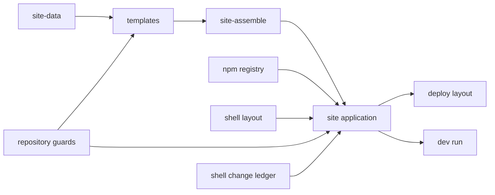
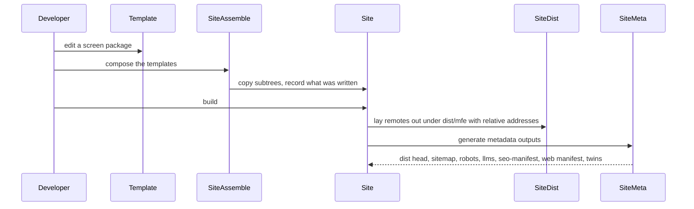
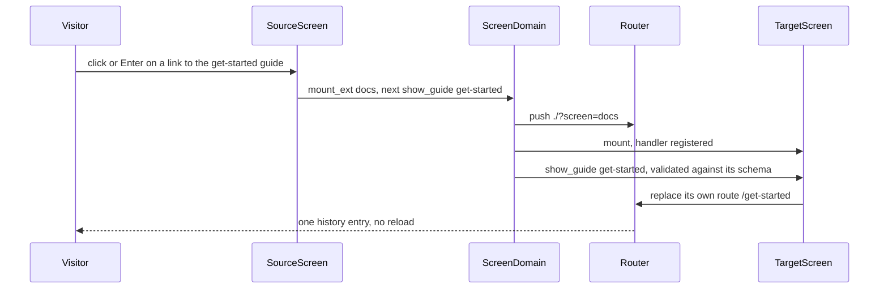
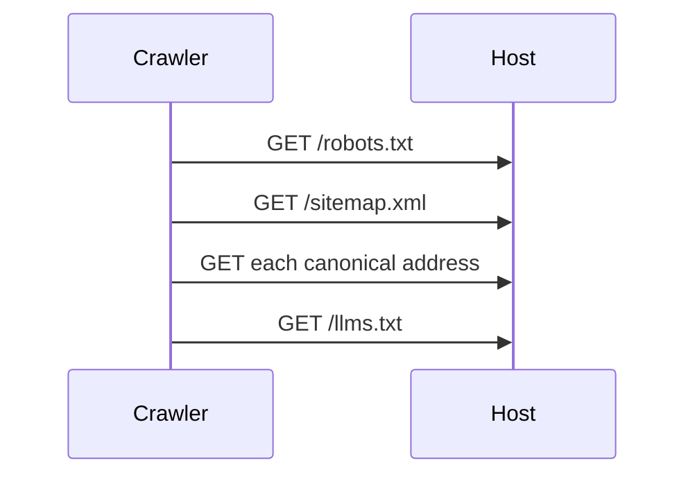

# Technical Design - FrontX Site Repository


<!-- toc -->

- [1. Architecture Overview](#1-architecture-overview)
  - [1.1 Architectural Vision](#11-architectural-vision)
  - [1.2 Architecture Drivers](#12-architecture-drivers)
  - [1.3 Architecture Layers](#13-architecture-layers)
- [2. Principles & Constraints](#2-principles--constraints)
  - [2.1 Design Principles](#21-design-principles)
  - [2.2 Constraints](#22-constraints)
- [3. Technical Architecture](#3-technical-architecture)
  - [3.1 Domain Model](#31-domain-model)
  - [3.2 Component Model](#32-component-model)
  - [3.3 API Contracts](#33-api-contracts)
  - [3.4 Internal Dependencies](#34-internal-dependencies)
  - [3.5 External Dependencies](#35-external-dependencies)
  - [3.6 Interactions & Sequences](#36-interactions--sequences)
  - [3.7 Database schemas & tables](#37-database-schemas--tables)
  - [3.8 Deployment Topology](#38-deployment-topology)
- [4. Additional context](#4-additional-context)
  - [4.1 Repository tree](#41-repository-tree)
  - [4.2 The uniform shape](#42-the-uniform-shape)
  - [4.3 How the site is assembled](#43-how-the-site-is-assembled)
  - [4.4 Templates](#44-templates)
  - [4.5 Routing table](#45-routing-table)
  - [4.6 SEO: single source and generated outputs](#46-seo-single-source-and-generated-outputs)
  - [4.7 Commands](#47-commands)
  - [4.8 Ecosystem dependencies](#48-ecosystem-dependencies)
  - [4.9 CI workflow shape](#49-ci-workflow-shape)
  - [4.10 Known gaps](#410-known-gaps)
  - [4.11 Deferred decisions](#411-deferred-decisions)
  - [4.12 Design checks](#412-design-checks)
  - [4.13 Generated site data](#413-generated-site-data)
  - [4.14 Applicability of the remaining review areas](#414-applicability-of-the-remaining-review-areas)
- [5. Traceability](#5-traceability)

<!-- /toc -->

- [x] `p3` - **ID**: `cpt-site-design-repository`

Local folder and working name: `frontx-site` (the root package name and the npm config path use it). The proposed repository name is `frontx-showcase`; the repository is not created yet, and its organization and hosting are open. The site's look and information architecture follow the approved designer site, a design reference only: nothing is copied from its code, and its texts are written from FrontX's own sources. The repository is built from the following sources, each read and never modified:

| Source | Location | State |
|---|---|---|
| gears-frontx ecosystem packages (ui-kit, api, routing, routing-tanstack, cli) and the ui-kit demo | npm registry releases, published from `constructorfabric/gears-frontx` `main` (the Release/0.3.0 merge, PR #666); the demo commit and each demo file's SHA-256 are recorded in `template-catalogue/src-app/mfe_packages/catalogue-mfe/kit-demo/kit-demo.lock.json` | `00f71b2380ccbe7d12a68d0f021bb69112a25bda` |
| gears-frontx mfes `0.3.2` and gts-plugin `0.3.3` | npm registry releases, published from `constructorfabric/gears-frontx` `main` | `ec2a1dbf8e65f4701d55c3fb8b4989dc81366ed0` |
| gears-frontx-templates (official templates) | `constructorfabric/gears-frontx-templates`, `main` | `8510e80` |
| Inbox app (draft PR #13) | draft PR #13 of `constructorfabric/gears-frontx-templates`, head branch `feat/template-inbox` on a contributor fork | `3c468efe` |

The demo apps in the site are the ui-kit demo of gears-frontx, the inbox app of PR #13 and template-mfe's MFE mechanics demo and widget fixtures. The calendar screen is a placeholder until a calendar kit is released. `packages/telemetry/demo` in gears-frontx is a consumer check of that package's public API, not a demo, and is not part of the site.

This document describes the repository as a whole: how the templates are composed into the site, the site-owned code (the repository tooling in `scripts/`, the shell layout and the shell files the site changed) and the contracts every template meets. Each template's own screens, data and tooling are described in that template's own artifact tree (section 4.4). The known gaps of the shell, routing, tooling and ui-kit releases are listed in [GAPS.md](GAPS.md); a G-number in this document names a row there.

## 1. Architecture Overview

### 1.1 Architectural Vision

The repository holds four kinds of content, and each kind has exactly one home:

| Kind | Home | Ownership |
|---|---|---|
| The official FrontX site (a FrontX application) | `site/` | Assembled: template-shell, template-mfe and template-design-guardrails applied by the FrontX CLI from gears-frontx-templates (recorded in `site/.frontx/provenance.json`), plus this repository's own templates composed by `site:assemble` |
| The templates the site is built from | `template-site/` (home, templates, docs, libraries), `template-catalogue/`, `template-site-meta/` (the page metadata pipeline), `template-site-brand/` (the brand), `template-kit-candidates/` (the primitives proposed to the kit), `template-site-blocks/` (the blocks) | This repository; template territory (`frontx-template.json`) |
| The demos for the site | screens inside `site/` | Generated into `site/src-app/mfe_packages/` from the demo templates; never edited there |
| The demos' templates | `template-inbox/`, `template-mfe-demo/`, `template-calendar-demo/` | This repository; template territory |

Repository-level tooling (`scripts/`, `assets/`, CI, `.cf-studio/`, `architecture/`) belongs to the repository, not to the site and not to any template. A part of the site becomes a template only when what it reads and writes lies inside the project a template applies into; the page metadata pipeline meets that measure and is template-site-meta, while the generated site data and the repository policies read this repository's own files and stay in `scripts/` (`cpt-site-adr-template-or-repository-tooling`).

Every screen MFE package exists in one place only: inside the template that owns it. `site/src-app/mfe_packages/` is a composition product: template-shell's own `.gitignore` already declares that path as composed-in content regenerated by a compose step, and the repository supplies that step (`site:assemble`), copying each template's claimed subtrees into the site and checking the copies for drift (`cpt-site-adr-composition-by-copy`).

Every page is a screen of an MFE package, addressed by the FrontX URL grammar, and every page's metadata is declared once on its screen extension; the discovery files and the runtime head are generated from it by template-site-meta. The applied shell is rebuilt in place on React and `@gears-frontx/ui-kit` to the site's look, and a ledger records every shell file the site changed, added or removed (`cpt-site-adr-shell-rebuilt-in-place`); every FrontX mechanic (screen domain, MFE loading, Shadow DOM isolation, the routing engine, query addressing, shared properties, provenance, the compose step) stays as template-shell ships it, apart from the changes section 4.3.4 lists. A link from one screen to another is one actions chain, the screen domain's `mount_ext`, followed for a page of it by the show action the receiving screen declares; no screen writes, builds or renders the shell's address, and only the shell lists the registered screens (`cpt-site-adr-cross-screen-deep-links`). The production build is one self-contained static folder that works at any mount path (`cpt-site-adr-static-deploy-layout`). The facts the site's own pages show about templates, versions and libraries are generated from their sources and checked in CI (`cpt-site-adr-generated-site-data`), and every template package pins the exact registry versions the site installs (`cpt-site-adr-exact-registry-pins`).

The look of every page comes in layers, each with one home (section 4.2.3): `@gears-frontx/ui-kit` components first; the primitives the kit lacks as kit candidates under the kit's own names, until the kit releases them; the brand as values over the kit's tokens, with the typeface and the brand art; and blocks, the section-level arrangements the design draws, built from those three with layout-only CSS on tokens and content-only props. Pages are configuration over blocks and carry no CSS. Every declaration a block or the shell chrome keeps because the kit lacks something is a row of an exemptions ledger that names the gap it waits for, and the repository policies and a measured design check in CI hold these rules.

Each template carries its own artifact tree under `<template>/architecture/`, and the `@cpt-` markers in a template's code bind only to that tree; the root tree specifies the site-owned code only (`cpt-site-adr-template-territory-traceability`).

### 1.2 Architecture Drivers

**ADRs**: `cpt-site-adr-template-territory-traceability`, `cpt-site-adr-composition-by-copy`, `cpt-site-adr-shell-rebuilt-in-place`, `cpt-site-adr-template-or-repository-tooling`, `cpt-site-adr-static-deploy-layout`, `cpt-site-adr-cross-screen-deep-links`, `cpt-site-adr-generated-site-data`, `cpt-site-adr-exact-registry-pins`, `cpt-site-adr-document-entry-and-host-stamp`

#### Functional Drivers

| Requirement | Design Response |
|-------------|------------------|
| `cpt-site-fr-screen-pages` | Every page is a screen extension of an MFE package with a top-level `route` token and its own route tree (sections 4.2.2, 4.5); the screens themselves are each template's |
| `cpt-site-fr-catalogue-routes` | template-catalogue's screen gives every kit component and foundation its own route under the `catalogue` token (section 4.4, [template-catalogue DESIGN](../template-catalogue/architecture/DESIGN.md)) |
| `cpt-site-fr-site-sections` | template-site's home, templates, docs and Libraries screens (section 4.4); the facts they show come from the generated site data, `cpt-site-component-site-data` (section 4.13) |
| `cpt-site-fr-site-navigation` | `cpt-site-component-shell-layout`: header navigation built from the registered screen extensions and the nav group each one names; the screen container opens the home screen at the bare address (section 4.3.4) |
| `cpt-site-fr-cross-screen-links` | `cpt-site-interface-screen-actions`: `mount_ext` for the target followed by the receiving screen's own show action in one chain; the target replaces the entry `mount_ext` pushed, so one history entry and no reload; the link element has the link role, opens on Enter and carries no address (section 4.5.1) |
| `cpt-site-fr-demo-screens` | The demo templates (template-inbox, template-mfe-demo, template-calendar-demo) are composed like every template and registered in the host's `demos` nav group, which the header lists under one entry (sections 4.4, 4.5) |
| `cpt-site-fr-metadata-single-source` | The `seo` block on the screen extension and the site-level values in `site.config.json`; template-site-meta derives every output from them (section 4.6) |
| `cpt-site-fr-discovery-files` | template-site-meta's generator writes the discovery files and the static head into the build output; the shell serves the brand icon set (section 4.6.2) |
| `cpt-site-fr-plain-text-twins` | template-site-meta renders each outline page as a plain-text twin and lists it in `llms.txt`; in the local run the shell's dev server serves the same twins (sections 4.3.4, 4.6.2) |
| `cpt-site-fr-uniform-shape` | `cpt-site-component-guards`: the template shape check and the pin check hold every template and package to the shape of section 4.2 |
| `cpt-site-fr-single-copy` | `cpt-site-component-site-assemble` composes the templates into the git-ignored `site/src-app/mfe_packages/` and its check names each drifted file (section 4.3) |
| `cpt-site-fr-static-build` | `cpt-site-component-deploy-layout`: one `dist/` with the host, the manifest aggregate and every remote under `mfe/<package>/` with addresses relative to the aggregate; the shell's links relative to the document (section 3.8) |
| `cpt-site-fr-screen-load-failure` | `cpt-site-component-shell-layout`: the screen domain's mount handler reports a failed load to a per-page store, and the screen container shows a kit-built error state with a retry that keeps the original history intent (section 4.3.4) |
| `cpt-site-fr-local-run` | `cpt-site-component-dev-run`: the shell's development run with every remote on a fixed port, the tools the shell runs declared in the site's install, and a smoke check that waits for the host and every remote entry (section 4.7) |

#### NFR Allocation

| NFR ID | NFR Summary | Allocated To | Design Response | Verification Approach |
|--------|-------------|--------------|-----------------|----------------------|
| `cpt-site-nfr-toolchain` | Reproducible installs with one pinned package manager; checks on the Node floor and the current release | root `package.json`, `.npmrc`, `.nvmrc`, CI | The root package is the repository tooling; the site is its own npm project, whose workspaces hold the screen packages and the tooling packages templates deliver (`cpt-site-constraint-site-own-project`, section 4.1) | CI matrix on 24.14.x and 25.x with the pinned npm version checked |
| `cpt-site-nfr-styling` | Kit components first, then kit candidates, brand values over the kit's tokens and layout-only blocks; pages carry no CSS; no Tailwind in site-owned code or the changed shell | every template, the rebuilt shell | The visual layers of section 4.2.3 and the styles rule of section 4.2.2; the shell rebuild of section 4.3.4 (`cpt-site-constraint-no-tailwind`) | The own-styles policy of `cpt-site-component-guards` and template-site-brand's brand check in `lint`; the design check job in CI (section 4.9) |
| `cpt-site-nfr-content-rules` | Constructor Fabric brand; no long dash, design-tool vendor name, internal company domain or former product name | whole repository | Content review and a text scan of every file git records (`cpt-site-constraint-content-rules`) | The text policy of `cpt-site-component-guards` |
| `cpt-site-nfr-semantics` | One top-level heading, headed sections, real links, text contrast of 4.5:1 | every screen, the shell layout | The semantic markup rule of section 4.6.2; the shell layout renders no top-level heading of its own; the brand moves each surface together with the text drawn on it | Screen tests; template-site-brand's contrast rule over every brand text and surface pair; template-design-guardrails' design check with axe on every page at 1440 and 390 pixels against the recorded baseline, light in CI and dark by a local run (section 4.9) |

### 1.3 Architecture Layers

```mermaid
graph TD
    subgraph Repo[frontx-site repository]
        TS[template-site] --> ASM
        TC[template-catalogue] --> ASM
        TI[template-inbox] --> ASM
        TM[template-mfe-demo] --> ASM
        TK[template-calendar-demo] --> ASM
        TSM[template-site-meta] --> ASM
        TB[template-site-brand] --> ASM
        TKC[template-kit-candidates] --> ASM
        TBL[template-site-blocks] --> ASM
        ASM[site-assemble] --> PKG[site/src-app/mfe_packages/*]
        ASM --> SEO[site/src-app/verify_packages/site-meta]
        ASM --> VIS[site/src-app/verify_packages: site-brand, kit-candidates, site-blocks]
        VIS --> PKG
        VIS --> SITE
        DATA[site-data] --> TS
        DIST[site-dist] --> OUT
        SEO --> OUT[site/dist: host, manifest aggregate, mfe/package remotes, head, discovery files, plain-text twins]
    end
    REG[npm registry: @gears-frontx/* releases] --> SITE
    subgraph Official[gears-frontx-templates@8510e80 via frontx CLI]
        SH[template-shell] --> SITE
        MF[template-mfe] --> SITE
        GR[template-design-guardrails] --> SITE
    end
    SITE[site/ application] --> PKG
    PKG --> DIST
    PKG --> SEO
```

- [x] `p3` - **ID**: `cpt-site-tech-layers`

| Layer | Responsibility | Technology |
|-------|---------------|------------|
| Presentation | Screens rendered inside the shell, each in its own Shadow DOM, built from blocks, kit candidates and kit components; the shell layout around them; the brand values and typeface in the document | React 19, `@gears-frontx/ui-kit`, the kit candidates, site-brand and site-blocks packages, CSS Modules, routing-tanstack route trees |
| Application | Host, navigation, framework router, MFE registration, theme and language shared properties | template-shell (`@gears-frontx/framework`, `@gears-frontx/react`, `@gears-frontx/mfes`), Vite, Module Federation |
| Composition | Applying the official templates and composing this repository's templates into `site/` | FrontX CLI, `scripts/site-assemble.mjs` |
| Build and metadata | Site build, production layout, page metadata outputs, head-sync runtime | Vite, `scripts/site-dist.mjs`, template-site-meta's `site-meta` package, esbuild |
| Infrastructure | Ecosystem packages, install, validation | npm registry, npm, GitHub Actions, Constructor Studio |

## 2. Principles & Constraints

### 2.1 Design Principles

#### Single source for screen code

- [x] `p2` - **ID**: `cpt-site-principle-single-source`

A screen MFE package is committed only inside the template that owns it. The site holds composed copies that git ignores and that `site:assemble --check` compares with the templates.

**ADRs**: `cpt-site-adr-composition-by-copy`

#### The shell: applied by the CLI, rebuilt on the kit

- [x] `p2` - **ID**: `cpt-site-principle-shell-as-is`

template-shell, template-mfe and template-design-guardrails are applied by the FrontX CLI. template-mfe's and template-design-guardrails' files stay as they ship, apart from the long-dash adaptation every applied text file carries (section 4.3.4). The shell is built on React and `@gears-frontx/ui-kit`: the site carries the working version of that change, kept template-shaped for the owner to carry into template-shell, and the shell change ledger records every file it changes, adds or removes against template-shell at the pinned commit (section 4.3.4). Every other shell file stays as it ships, with the same adaptation. The dependency delta in `site/package.json` (section 4.8) pins the FrontX registry packages at their released versions and declares the tool the shell's development run uses without declaring it.

**ADRs**: `cpt-site-adr-shell-rebuilt-in-place`, `cpt-site-adr-document-entry-and-host-stamp`

#### One uniform shape

- [x] `p2` - **ID**: `cpt-site-principle-uniform-shape`

Every template and every screen package follows the shape of section 4.2. Where the moved sources differ, the official template conventions win.

**ADRs**: `cpt-site-adr-template-territory-traceability`

#### Page metadata declared once

- [x] `p2` - **ID**: `cpt-site-principle-metadata-once`

A page's title, description, indexability and Open Graph data live in the `seo` block of its screen extension. Every generated output and the runtime head derive from that block and `site.config.json`. The decision to keep the block on the screen extension belongs to template-site-meta, which records it in its own tree ([template-site-meta ADR directory](../template-site-meta/architecture/ADR/)).

#### Registry-shaped template content

- [x] `p2` - **ID**: `cpt-site-principle-registry-shaped`

Template packages pin exact registry versions, the same released versions the site's application installs (section 4.2.2), so a template's packages install unchanged in any project.

**ADRs**: `cpt-site-adr-exact-registry-pins`

### 2.2 Constraints

#### Screens are addressed in the query string

- [x] `p2` - **ID**: `cpt-site-constraint-query-addressing`

FrontX routing makes the pathname the shell's own territory and addresses every domain occupant as a query entry (`@gears-frontx/routing` ADR 0003). Canonical addresses are `/?screen=<token>[;route=<path>]`; paths inside a screen are projected from the entry's `route` parameter.

**ADRs**: `cpt-site-adr-cross-screen-deep-links`

#### Toolchain floor

- [x] `p2` - **ID**: `cpt-site-constraint-toolchain`

Node `>=24.14.0` with `engine-strict`, npm `>=10` and `packageManager` `npm@10.9.4`, as the ecosystem packages require.

#### The site is its own npm project

- [x] `p2` - **ID**: `cpt-site-constraint-site-own-project`

template-shell's `package.json` is itself a workspace root and npm has no nested workspace roots, so `site/` is installed as its own npm project (`npm ci --prefix site`), exactly as a seeded project would be. The root workspace holds only the repository tooling.

**ADRs**: `cpt-site-adr-composition-by-copy`

#### No Tailwind in site-owned code

- [x] `p2` - **ID**: `cpt-site-constraint-no-tailwind`

Code the site owns, the shell files it changed included, styles with `@gears-frontx/ui-kit` components first and CSS Modules on the kit's tokens. The shell carries no Tailwind: no config, no PostCSS config, no Tailwind dependency. The generated demo files (the catalogue's examples, pages and `shared.tsx`) keep their inline styles and string class names and are listed as exempt by path. The studio package (`site/packages/studio`, a development overlay that is not part of the production bundle) is kept as it ships, with its own self-contained utility CSS (G26).

**ADRs**: `cpt-site-adr-shell-rebuilt-in-place`

#### Brand and content rules

- [x] `p2` - **ID**: `cpt-site-constraint-content-rules`

The site is a Constructor Fabric property: its header and footer carry the Constructor Fabric logo and lockup before FrontX, and the company name, its product names, its brand domain and its GitHub organization may appear in any file of the repository. No file carries a long dash, a design-tool vendor name, an internal company domain or the former product name. The rule that FrontX itself names no company belongs to gears-frontx upstream, not to this repository.

The site's art is its own: template-site-brand's art components (`src/art/`) draw the hero, the architecture map, the change story's workbench, the template, metric and chart figures and the closing visual as SVG with the structure of the designer site's figures (hairline line art on the brand's palettes), and nothing of the designer site's scripts or images is copied. Every brand value records the designer site's value beside it, and a value that differs carries its reason; the main difference is the section label colour on the pale band, which reads 3.81:1 there on the designer site and is the nearest shade of the same hue that keeps the 4.5:1 the site holds on the pale band and on white. template-site-brand's brand check holds the record and every text and surface pair.

#### Template territory traceability

- [x] `p2` - **ID**: `cpt-site-constraint-template-territory`

Each template's documents carry only ids with that template's prefix and cite every other tree, the root one included, by a link to its document; a template's `@cpt-` markers name only that template's ids. No document and no marker of this repository carries a gears-frontx id: a gears-frontx decision is cited as plain text or a link. The gears-frontx markers under `site/` are residue of the official templates' archived generation; their paths are never registered, and a site-changed file loses them in the change that touches it. The validator keeps all ids in one set, so review holds these rules.

**ADRs**: `cpt-site-adr-template-territory-traceability`

## 3. Technical Architecture

### 3.1 Domain Model

**Technology**: JSON manifests with GTS type ids, TypeScript

**Location**: `template-*/frontx-template.json`, `template-*/src-app/mfe_packages/*/mfe.json`, `site.config.json`, `site/package.json`, `site/.frontx/provenance.json`

**Core Entities**:

| Entity | Description | Schema |
|--------|-------------|--------|
| Template | A top-level directory with `frontx-template.json`; an overlay that claims MFE package subtrees or a non-screen package subtree (tooling, brand or components), and its own AI bundle | section 4.2.1 |
| Screen MFE package | A Module Federation remote with `mfe.json`, a lifecycle per entry and a route tree per entry | section 4.2.2 |
| Screen extension | An extension of the screen domain in `mfe.json`: `route` token, `presentation`, `seo` | section 4.2.2 |
| Page | An address that renders content: a screen, or a route inside it | section 4.5 |
| SEO block | Title, description, indexability and Open Graph data of a screen and of its routes | section 4.6.1 |
| Site config | Site-level values: origin, site name, title template, locale, home screen, header and footer choices, languages | section 4.6.1 |
| Ecosystem package | A `@gears-frontx/*` release on the npm registry, pinned exactly, with the commit it was published from (`gitHead`) | section 4.8 |
| Provenance record | The CLI's record of an applied official template and its source-spec | section 4.3.2 |
| Assembly record | `site:assemble`'s record of the paths it wrote into `site/` | section 4.3 |
| Shell change ledger | The list of shell files the site changed, added or removed against template-shell at the pinned commit | section 4.3.4 |
| Brand source | template-site-brand's `brand.json`: the light values over the kit's tokens and the brand tokens the kit lacks, each with the designer site's value and the reason for a difference; the token files are generated from it | section 4.2.3 |
| Kit candidate | A primitive the kit lacks, in template-kit-candidates under the kit's own name, folder convention and API, until the kit releases it | section 4.2.3 |
| Block | A section-level arrangement the design draws, built from kit components, kit candidates and brand art, with layout-only CSS on tokens and content-only props | section 4.2.3 |
| Exemptions ledger | A `styles-exemptions.json` beside the blocks of one template or the shell chrome: one row per declaration that is not layout, naming the kit gap or kit defect it waits for | section 4.2.3 |
| Design check baseline | The root-owned list of design check findings the site carries, each with its reason (a checker false finding or a kit defect) | section 4.9 |

**Relationships**:
- Template -> Screen MFE package: owns one or more
- Screen MFE package -> Screen extension: declares one per screen entry
- Screen extension -> SEO block: carries one, with one entry per internal route
- Page -> Screen extension: addressed by its `route` token and route parameter
- Assembly record -> Template: names, for every path it wrote, the template that claims it
- Block -> Kit candidate, Brand source: built from them and from kit components
- Exemptions ledger -> Block: lists the non-layout declarations of the blocks beside it

### 3.2 Component Model



#### Site application

- [x] `p2` - **ID**: `cpt-site-component-site-app`

##### Why this component exists

It is the FrontX application that serves every page of the site.

##### Responsibility scope

Host, routing and MFE registration from template-shell; MFE build pipeline from template-mfe; design checks from template-design-guardrails; installing the ecosystem packages from the npm registry at the pins of section 4.8.

##### Responsibility boundaries

Owns no screen code (composed in) and no page metadata (declared in the templates). The shell files the site changed belong to the shell layout and are listed by the shell change ledger; every other shell file stays as it ships.

##### Related components (by ID)

- `cpt-site-component-site-assemble` - receives the composed screen packages from
- `cpt-site-component-shell-layout` - contains
- `cpt-site-component-deploy-layout` - is laid out for production by
- `cpt-site-component-dev-run` - is run locally by

#### Shell layout

- [x] `p2` - **ID**: `cpt-site-component-shell-layout`

##### Why this component exists

The site needs one look across the shell and its screens: a header with the navigation, a page frame and a footer, on the kit, and a home page at the bare address.

##### Responsibility scope

`site/src-app/app/layout/`, the screen container and the screen load-failure store (`site/src-app/app/mfe/`), the themes, `App.tsx` and `main.tsx`: the header (the Constructor Fabric lockup, navigation from the registered screens except the groups `site.config.json` hides, the source link and the language select while the site ships more than one language), the footer, the skip link, the popup and overlay layers, the home screen at the bare address, the error state of a screen that fails to load; the light and dark themes on the kit's token sets, the light one rendered; the document-entry convention that loads every installed verify package's `src/document.css` (`documentEntries.ts`) and the host theme stamp on the screen hosts (`mfe/hostTheme.ts`); the plain-text twin middleware of the development server (section 4.3.4).

##### Responsibility boundaries

Changes no FrontX mechanic: mounting goes through the screen domain's `mount_ext` action, the address is written by the framework router, theme and language through the framework registries. Renders no top-level heading of its own; a page's heading is its screen's. Names no template: the brand values and the typeface are template-site-brand's and reach the document through the document-entry convention (`cpt-site-adr-document-entry-and-host-stamp`).

##### Related components (by ID)

- `cpt-site-component-site-app` - is part of
- `cpt-site-component-shell-change-ledger` - is recorded by

#### Shell change ledger

- [x] `p2` - **ID**: `cpt-site-component-shell-change-ledger`

##### Why this component exists

The shell rebuild is carried upstream later; that needs an exact list of what the site changed, and the repository policies need to know which applied files are site-owned code.

##### Responsibility scope

`scripts/shell-changes.mjs`: for each applied official template (template-shell, template-mfe, template-design-guardrails), the list of every file the site changed, added or removed against the template at the source-spec the provenance records; the long-dash adaptation every other applied text file carries; a check that compares the lists and the adaptation with `site/` and the pristine templates in the CLI inventory; and the command that writes the adaptation over an applied file that lacks it.

##### Responsibility boundaries

Records and checks; edits an applied file only to write its adapted pristine text. The lists scope the text and own-styles policies, which run in the guards.

##### Related components (by ID)

- `cpt-site-component-shell-layout` - records the changes of
- `cpt-site-component-guards` - scopes the policies of

#### site-assemble

- [x] `p2` - **ID**: `cpt-site-component-site-assemble`

##### Why this component exists

template-shell expects `src-app/mfe_packages/*` to be produced by a compose step; this is that step.

##### Responsibility scope

Copies each template's `exclusiveSubtrees` into `site/`, records what it wrote, removes what it wrote before and no template claims, refuses to overwrite paths it did not create, reports drift both ways with a check and re-copies on edits in a watch mode. It owns the shared modules of `scripts/` that the guards use too: `template-discovery.mjs` (a directory is a template when it holds `frontx-template.json`) and the entry check `entry-point.mjs`.

##### Responsibility boundaries

Never writes outside `site/src-app/mfe_packages/`, the claimed non-screen packages under `site/src-app/verify_packages/` and `site/.frontx/ai/` of this repository's templates; never touches files applied by the FrontX CLI.

##### Related components (by ID)

- `cpt-site-component-guards` - shares template discovery with
- `cpt-site-component-site-app` - writes into

#### site-data

- [x] `p2` - **ID**: `cpt-site-component-site-data`

##### Why this component exists

The templates, docs and Libraries screens show manifests, versions and source-specs; copied by hand they would drift.

##### Responsibility scope

`scripts/site-data.mjs`: writes the templates outline, the docs version data and the libraries data from the templates' manifests and sources, the pins and lockfiles, the installed packages, the registry's `gitHead` of each pinned release, the provenance, `.nvmrc` and the npm pin; its check fails on drift (section 4.13).

##### Responsibility boundaries

Writes only the three generated files inside template-site; installs an official template into the CLI inventory only through the CLI the repository pins.

##### Related components (by ID)

- `cpt-site-component-site-app` - reads the installs and provenance of

#### Repository guards

- [x] `p2` - **ID**: `cpt-site-component-guards`

##### Why this component exists

The uniform shape, the pins, the visual layers and the text rules hold only if CI checks them.

##### Responsibility scope

`validate-templates.mjs`, `policy-pins.mjs`, `policy-own-styles.mjs` (with the layer rules in `style-rules.mjs`) and `policy-text.mjs`, each with tests, which find templates and tell a command run from an import through the shared modules of `cpt-site-component-site-assemble`; the own-styles policy classifies every file as a kit candidate, brand, layout tokens, block, screen frame, shell chrome, test or composition and holds each class to its rule and its exemptions ledger (section 4.2.3). The repository tests that hold rules across templates: the plain-text twin path rule's two copies to one answer, the mock plugin order of every screen package, every copy of template-mfe's kit theme helpers to template-mfe's code and the site's language list. They check this repository's files, so they stay repository tooling (`cpt-site-adr-template-or-repository-tooling`).

##### Responsibility boundaries

Reports violations; never rewrites templates.

##### Related components (by ID)

- `cpt-site-component-site-assemble` - shares template discovery with
- `cpt-site-component-shell-change-ledger` - reads the site-owned applied files from

#### Deploy layout

- [x] `p2` - **ID**: `cpt-site-component-deploy-layout`

##### Why this component exists

The shell's build fetches the manifest aggregate from a fixed place and its generator writes absolute remote addresses; the site must be one static folder that works at any mount path.

##### Responsibility scope

`scripts/site-dist.mjs`: copies every remote the manifest aggregate names from its package's build into `site/dist/mfe/<package>/` and rewrites each remote's `publicPath` relative to the aggregate; the shell bootstrap's side (`site/src-app/app/mfe/bootstrap.ts`): fetches the aggregate from the build base resolved against the document and registers each relative `publicPath` as written, which the MFE handler resolves against the document, in the aggregate's folder; the host's relative build base.

##### Responsibility boundaries

Refuses an unknown manifest id or a missing aggregate before it writes; idempotent. Does not generate metadata outputs (template-site-meta does) and does not choose the hosting target (deferred, section 4.11).

##### Related components (by ID)

- `cpt-site-component-site-app` - lays out the build of

#### Dev run

- [x] `p2` - **ID**: `cpt-site-component-dev-run`

##### Why this component exists

A developer and CI need one local run in which the host and every remote answer, with no interactive prompt and no unpinned download.

##### Responsibility scope

`scripts/dev-smoke.mjs`: starts the documented development run, waits until the host and every remote entry the host's served manifests name answer, then stops every process it started; fails first when a tool the shell runs through `npx` is missing from the site's install, when npx starts a download or when a development port is taken. The design check over that run: `scripts/verify-ui.mjs` runs template-design-guardrails' runner over every page the built `seo-manifest.json` lists, every block showcase route and the not-found address, at 1440 and 390 pixels, against the root-owned baseline `scripts/design-verify-baseline.json`, so only a new finding fails; `scripts/design-verify-baseline.mjs` builds the baseline from a run's findings and checks it, refusing a finding without a reason (a G34 false finding or a kit defect row of [GAPS.md](GAPS.md)). The shell's development script previews every remote on its fixed port and stops with the port's name when it is taken (section 4.3.4).

##### Responsibility boundaries

Starts and stops processes; changes no source file and serves no production output.

##### Related components (by ID)

- `cpt-site-component-site-app` - runs

### 3.3 API Contracts

- [x] `p2` - **ID**: `cpt-site-interface-surface`

- **Contracts**: `cpt-site-interface-canonical-address`, `cpt-site-interface-template-overlay`, `cpt-site-contract-seo-block`, `cpt-site-contract-official-templates`
- **Technology**: URL grammar, JSON manifests, npm scripts
- **Location**: sections 4.2, 4.5, 4.6 and 4.7

**Endpoints Overview**:

| Method | Path | Description | Stability |
|--------|------|-------------|-----------|
| `GET` | `/?screen=<token>[;route=<path>]` | A page of the site, by canonical address, relative to the mount point | stable |
| `GET` | `/sitemap.xml`, `/robots.txt`, `/llms.txt`, `/seo-manifest.json`, `/site.webmanifest` | Generated discovery files | stable |
| `GET` | `/<token>/<route>.md`, `/<token>/index.md` | Plain-text twins of the templates, docs and Libraries pages | stable |
| `file` | `template-*/frontx-template.json` | Template manifest of an overlay that another project can copy (section 4.2.1) | unstable |
| `file` | `mfe.json` `extensions[].seo` | Page metadata contract of a screen (section 4.6.1) | unstable |
| `file` | `site/.frontx/provenance.json` | The source-specs of the official templates the site is applied from, at the pinned commit (section 4.3.2) | stable |
| `npm` | `npm run <script>` | Repository commands (section 4.7) | unstable |

- [x] `p2` - **ID**: `cpt-site-interface-screen-actions`

- **Contracts**: `cpt-site-interface-canonical-address`
- **Technology**: FrontX actions chain on the screen domain
- **Location**: section 4.5.1; each show action and its schema are declared once, by the package of the screen that receives it

**Endpoints Overview**:

| Method | Path | Description | Stability |
|--------|------|-------------|-----------|
| `action` | `mount_ext` on the screen domain with the target screen extension as its subject | Opens another screen at its root; the framework router pushes one history entry | stable |
| `action` | `gts.frontx.mfes.comm.action.v1~frontx.site_docs.nav.show_guide.v1~` with payload `{ guide }`, as the chain's `next` step | Shows one docs guide; the payload is an enum of the guides | unstable |
| `action` | `gts.frontx.mfes.comm.action.v1~frontx.site_templates.nav.show_template.v1~` with payload `{ template }`, as the chain's `next` step | Shows one template's page; the payload is an enum of the templates | unstable |
| `action` | `gts.frontx.mfes.comm.action.v1~frontx.catalogue.nav.show_component.v1~` with payload `{ component }`, as the chain's `next` step | Shows one component's catalogue page; the payload is an enum of the component slugs | unstable |
| `action` | `gts.frontx.mfes.comm.action.v1~frontx.inbox_contacts.nav.show_contact.v1~` with payload `{ contact }`, as the chain's `next` step | Shows one person's page in the inbox contacts screen | unstable |

Each show action's schema is closed: its `target` is the receiving screen's own extension and its payload names a page in that screen's terms, never a route. The receiving screen's handler, registered in its lifecycle's mount before it returns, maps the payload to its own route and replaces the entry `mount_ext` pushed through its app's navigation facade. The host registers each schema with the receiving entry and validates every chain against it (`cpt-site-adr-cross-screen-deep-links`).

### 3.4 Internal Dependencies

| Dependency Module | Interface Used | Purpose |
|-------------------|----------------|----------|
| template-shell (in `site/`) | screen domain, shared properties, `vitest.mfe.base.ts`, `__test-utils__` | Host, registration, theme and language, test harness for every package |
| `@gears-frontx/routing` | `serializeGrammar`, `parseGrammar`, `resolveNavigationHistory` | The shell's and the metadata tooling's canonical addresses, the screen container's address check and head-sync; no screen uses the grammar |
| `@gears-frontx/react` | `FRONTX_SCREEN_DOMAIN`, `screenDomain.route`, `FRONTX_ACTION_MOUNT_EXT`, `ActionHandler`, `app.mfeRouter.navigation()` | Opening screens, the show action handlers, the screen domain's id and key |
| `@gears-frontx/routing-tanstack` | route tree, `Link`, `ExtensionRouter` | Routes inside a screen |
| `@gears-frontx/ui-kit` | components, `theme.css` | Screens' and the shell layout's UI and tokens |
| FrontX CLI | `install`, `seed`, `add`, `validate` | Applying official templates, validating this repository's templates |

**Dependency Rules**:
- A package references only its own template's shared folder, never another template's
- Nothing imports `@tanstack/*` directly; route hooks come from routing-tanstack
- No circular dependencies

### 3.5 External Dependencies

#### gears-frontx-templates

| Dependency Module | Interface Used | Purpose |
|-------------------|---------------|---------|
| template-shell, template-mfe, template-design-guardrails | `github:` source-spec through the FrontX CLI | The applied official templates |

#### gears-frontx ecosystem packages

| Dependency Module | Interface Used | Purpose |
|-------------------|---------------|---------|
| ui-kit, mfes, gts-plugin, api, routing, routing-tanstack, cli | npm registry releases, pinned exactly | Runtime and tooling of the site |
| framework, react, state, i18n, auth, studio | template-shell's workspace sources under `site/packages/*`, at the versions the applied shell carries | The shell's own runtime, built in the site's install |

#### npm registry

| Dependency Module | Interface Used | Purpose |
|-------------------|---------------|---------|
| `registry.npmjs.org` | npm install, `npm view` (`site-data` reads each pinned release's `gitHead`) | The `@gears-frontx/*` releases, third-party packages and the shell's published workspace dependencies |

### 3.6 Interactions & Sequences

#### Compose and build the site

**ID**: `cpt-site-seq-compose-build`

**Use cases**: `cpt-site-usecase-change-screen`

**Actors**: `cpt-site-actor-site-developer`, `cpt-site-actor-frontx-cli`, `cpt-site-actor-template-consumer`



**Description**: A change made in a template reaches the site through composition and the build; the production layout makes the build mount-independent, and the generated files follow from the screens' `seo` blocks. A template consumer copies the same claimed subtrees into another project.

#### Visit a page

**ID**: `cpt-site-seq-visit-page`

**Use cases**: `cpt-site-usecase-visit-page`

**Actors**: `cpt-site-actor-visitor`

```mermaid
sequenceDiagram
    Visitor ->> Host: GET ./?screen=catalogue;route=components/button
    Host ->> HeadSync: apply head for the address
    Host ->> Registry: mount the catalogue screen
    Registry ->> Screen: lifecycle with route /components/button
    Screen -->> Visitor: page content
```

**Description**: The host serves one document; the framework router mounts the screen named in the query and the screen renders the internal route; head-sync keeps title, description and canonical equal to the page. When the screen fails to load, the screen container shows the error state with a retry.

#### Follow a link to another screen

**ID**: `cpt-site-seq-follow-link`

**Use cases**: `cpt-site-usecase-follow-link`

**Actors**: `cpt-site-actor-visitor`



**Description**: A click or Enter on the link sends the actions chain of `cpt-site-interface-screen-actions`; the link carries no address, and a crawler reaches the same page through the sitemap and the plain-text twins.

#### Crawl the site

**ID**: `cpt-site-seq-crawl`

**Use cases**: `cpt-site-usecase-crawl`

**Actors**: `cpt-site-actor-crawler`



**Description**: Crawlers find every indexable page from the sitemap and the page summaries and plain-text twins from `llms.txt`.

### 3.7 Database schemas & tables

Not applicable: the site has no database.

### 3.8 Deployment Topology

- [x] `p3` - **ID**: `cpt-site-topology-static-dist`

`site/dist/` is self-contained: the host document, `generated-mfe-manifests.json` and each remote in `mfe/<package>/` with a `publicPath` relative to the aggregate, the discovery files and the plain-text twins. Any static server on one origin serves it at the root or under a sub-path with no rewrite rule, since every page is the mount folder plus a query string; the configured origin affects only the canonical addresses of the metadata outputs (`cpt-site-adr-static-deploy-layout`). The hosting target and edge head injection are deferred (section 4.11).

The folder ships as one container image (`Dockerfile`): a build stage on Node 24 with npm 10.9.4 runs `npm ci`, `npm run setup` and `npm run build` with `SITE_ORIGIN` from a required build argument, so an image carries one origin; the run stage serves `site/dist` with Caddy (`deploy/site/Caddyfile`) as a non-root user on port 8080 (`PORT`), with a health check, zstd and gzip compression, `nosniff`, a referrer policy, frame and permissions restrictions and a content security policy limited to `base-uri`, `object-src` and `frame-ancestors` (the head sync is an inline script, the MFE loader runs chunks from `blob:` addresses and the type system compiles validators with `new Function`, so a script policy would protect nothing). Files under an `assets/` folder carry a content hash and are cached as immutable; every other file (the document, the manifest aggregate, each remote's `remoteEntry.js`, `mf-manifest.json` and `shared/*.js`, the discovery files, the twins) is served with `no-cache`, and a missing file with `no-store`. The twins are served as `text/plain; charset=utf-8`. The image always serves the site at its root; a sub-path is the proxy's prefix strip.

`deploy/docker-compose.yml` runs the image read-only with every capability dropped behind an edge Caddy (`deploy/Caddyfile`), which serves the site at the root and under `/frontx/` locally and, once a domain exists, terminates TLS for it. The deploy webhook (`deploy/webhook/`) receives GitHub's `workflow_run` delivery, checks its HMAC signature (`X-Hub-Signature-256` under `DEPLOY_WEBHOOK_SECRET`) and, as defence in depth, GitHub's published hook address ranges, and on a successful push run of the image workflow whose ref is a version `vX.Y.Z` (the workflow publishes only from such tags on `main`) pulls the `latest` image, restarts the site service and prunes the replaced site images (by the image's label) through the host's Docker, one deploy at a time. What needs the domain, the host or the secret is commented out or gated in those files, each with the information that enables it (section 4.11).

## 4. Additional context

### 4.1 Repository tree

```text
frontx-site/
├── .github/                         CODEOWNERS, workflows/main.yml and workflows/docker.yml
├── .cf-studio/                      config/ + version.toml committed; .core/ .gen/ config/kits/sdlc/ git-ignored
├── architecture/                    the root tree: PRD.md, DESIGN.md, ADR/, GAPS.md (unregistered gap list)
├── AGENTS.md, CLAUDE.md             root agent instructions and the template territory rule
├── CONTRIBUTING.md                  DCO sign-off, branch model (main only), layout, dev loop, validation
├── LICENSE, NOTICE                  Apache-2.0, as gears-frontx-templates
├── README.md
├── .gitignore, .npmrc, .nvmrc       registry and engine-strict; Node 25.1.0 (as gears-frontx)
├── package.json, package-lock.json  repo tooling root: engines, packageManager, the scripts of section 4.7
├── site.config.json                 site-level values (section 4.6.1)
├── eslint.config.js, tsconfig.json, vitest.config.mjs   lint, type-check and tests of scripts/ and deploy/
├── scripts/                         repository tooling: composition, site data, guards, ledger, production layout, dev smoke
├── Dockerfile, .dockerignore         the container image of site/dist (section 3.8)
├── deploy/                          the image's Caddyfile, its smoke check, the compose stack with the edge proxy, the deploy webhook
├── assets/                          the share image's source and the raster record that pins the PNG to it
├── template-site/                   the site's own sections: home, templates, docs, libraries
├── template-catalogue/              ui-kit catalogue screen
├── template-inbox/                  inbox demo (4 screens)
├── template-mfe-demo/               MFE mechanics demo (4 screens + 2 widget packages)
├── template-calendar-demo/          calendar demo screen (placeholder)
├── template-site-meta/              page metadata pipeline: the site-meta tooling package
├── template-site-brand/             brand values over the kit, the typeface and the brand check: the site-brand package
├── template-kit-candidates/         primitives proposed to the kit, until it releases them: the kit-candidates package
├── template-site-blocks/            the site's blocks and their layout tokens: the site-blocks package and the blocks showcase screen
└── site/                            the FrontX application (section 4.3)
```

Every `template-*` directory holds its own artifact tree in `architecture/`.

The root package is the repository tooling and has no workspaces; its scripts are the commands of section 4.7, and its only FrontX dependency is the CLI, pinned exactly. The root lockfile is updated incrementally (`npm install` with the lockfile present): npm 10.9.4 fails to resolve it from scratch. `site/` is deliberately not a root workspace (`cpt-site-constraint-site-own-project`).

The root `.gitignore` (repository-owned) ignores the installs, the CLI inventory `.frontx-inventory/`, the Studio runtime and agent integration files, the change-impact reports, and the composed copies the shell's own `.gitignore` does not cover: one line per template for its assembled AI bundle under `site/.frontx/ai/`, and the site copy of every non-screen package a template claims under `site/src-app/verify_packages/`. The template shape check fails when either list and the templates differ. The bundles of the CLI-applied official templates are committed.

### 4.2 The uniform shape

The same shape applies to every template in this repository and to every screen MFE package inside them. Where the moved sources differ, the official template conventions win (template-mfe's `_blank-mfe` and its navigation contribution guideline on gears-frontx-templates main, and the gears-frontx ADRs on the template manifest contract, the uniform mechanism and template territory). The template shape check and the pin check of `cpt-site-component-guards` hold every rule below that a script can read; each template's own design describes how its packages meet them.

#### 4.2.1 Template shape

- A template is a top-level directory with `frontx-template.json`, a README, its own AI bundle under `.frontx/ai/@gears-frontx/frontx-template-<name>/` with at least one guideline, one or more screen or widget packages under `src-app/mfe_packages/`, an optional shared folder `src-app/mfe_packages/shared/<name>/` without a `package.json`, or a non-screen package under `src-app/verify_packages/` (template-site-meta's tooling, template-site-brand's brand package, template-kit-candidates' components, template-site-blocks' blocks).
- Identity `@gears-frontx/frontx-template-<name>`, the prefix template-shell and template-mfe use. Versions start at `0.1.0-alpha.0`; a template that continues its source's line keeps it.
- Overlay only (`cpt-site-interface-template-overlay`): no root `package.json`, no lockfile, no `sharedFiles`, no claim outside its packages, its shared folder and its AI bundle, no `referencedTemplates`; the prerequisite on template-shell and template-mfe is stated in the manifest's description and the README. `src-app/verify_packages/*` is template-shell's workspace root for the packages a template delivers that are not screens (G48).
- No harness: the site is the harness; the shell supplies the test base and the test utilities.
- Self-contained content: no `file:` specifier, tsconfig path, `extends`, `include` or lockfile entry that resolves outside the template directory, and no source import of another template (G49).
- Traceability: `@cpt-` markers in template code bind only to that template's own artifact tree, and no template carries a gears-frontx id (`cpt-site-constraint-template-territory`); behaviour consumers rely on is documented in the README and the guideline.
- README sections in a fixed order: what it contributes, prerequisites, screens and routes, where the metadata is declared, how to develop it here, how to move it into another project.

#### 4.2.2 Screen MFE package shape

- Files: a README, `mfe.json`, `package.json`, `tsconfig.json`, `vite.config.ts`, `vitest.config.ts`, a remote stub `index.html`, and under `src/` the app setup, one lifecycle per entry, one route tree per entry, a folder per screen with its strings beside it, an API folder only when the screen has data, the package-local helpers and the test helpers. Directory names end in `-mfe`, except the two widget fixtures that keep their names.
- `mfe.json` has template-mfe's fields plus one site field, `seo`, on each screen extension. `route` is a top-level extension field: the screen's token in the URL, a routing name, unique in the screen domain. Token naming: the site's own sections are bare tokens, a one-screen demo template uses its scope name, a several-screen demo template uses `<scope>-<screen>`. A demo screen is a plain screen extension whose `presentation.group` is the id of the host's `demos` nav group (`gts.frontx.screensets.layout.nav_group.v1~frontx.site.layout.demos.v1`); its package carries no screen type schema. No `templateExample` flag: every package here is product content. Ports are unique site-wide.
- Pins are exact and come from one set: the site application's registry pins, the applied shell's workspace versions, template-shell's toolchain and the kit's own dependencies (`cpt-site-principle-registry-shaped`). Every other dependency is pinned at the version the site's lockfile resolves for the package's composed copy.
- Shared dependencies follow `_blank-mfe`'s rule: `mfe.json` declares none, and the package externalizes one shared list, in one order, in every package: template-mfe's list plus the two routing packages, so the shell's extension router and the package's route tree use one router copy.
- Lifecycle on `ThemeAwareReactLifecycle` of `@gears-frontx/react`, directly or through one base the entries of a package or template share; it renders the route tree through `ExtensionRouter` over the registry of the package's app. Theme and language come from the shell's shared properties; no package keeps its own theme switch.
- Kit theme: one convention in every kit-based package, template-mfe's `_blank-mfe` form: the kit's theme text re-anchored on the shadow host once, put into one marked style node in the shadow root. Screens that show the shell's palette carry no kit tokens.
- Translations: a screen's strings live beside it, one file per locale, loaded through the package's translations hook, which applies only the latest load; a screen calls the hook directly, or, where its strings serve several route components, loads them once in a provider in its folder (the catalogue's `CatalogueText.tsx`). template-inbox keeps its synchronous catalogues with parameters, plural forms and a shared layer. The site ships `en`; packages that carry more locales keep them.
- Styles: the visual layers of section 4.2.3: a screen's own files are compositions and carry no stylesheet, no `style` prop and no foreign class name; their look comes from blocks, kit candidates and kit components. CSS Modules on tokens exist only in kit candidates, brand art and blocks; no Tailwind in any package; the generated catalogue demo files are exempt by path.
- Kit theme helpers: a package's copy of template-mfe's `anchorKitThemeOnShadowHost.ts` and `kitThemeScope.ts` keeps template-mfe's code, apart from its own comments and markers, and is the one place a composition imports the kit's `theme.css` as text.
- Tests: every package has a lifecycle test (theme and language direction on the shadow host), a test per screen, a test beside each route tree and a manifest test that holds `mfe.json` to the rules of this section, including that the declared pages equal the pages of the route tree, read from the tree itself.

#### 4.2.3 Visual layers

The site follows FrontX's split of the visual layer: the kit for generic parts, the brand for values, and blocks for the arrangements a site draws. Each layer has one home, and a file belongs to exactly one class:

| Class | Where | What it may hold |
|---|---|---|
| Kit candidate | template-kit-candidates, `src-app/verify_packages/kit-candidates/src/<component>/` | The components two proposed kit pull requests add (`Heading`, `Text`, `Link`, `VisuallyHidden`, the `sr-only` class; `CodeBlock`, `DescriptionList`, `render` on `Card`, `CardTitle`, `EmptyTitle`, `AlertTitle`), in the kit's own folder convention, API and token use; the template is deleted when the kit releases them |
| Brand | template-site-brand, `src-app/verify_packages/site-brand/src/` | `brand.json` and the token files generated from it (`tokens.css` for the document; `theme.ts`, the complete light and dark variable sets, which no theme entry uses yet, G33), the typeface registration, the brand assets and the art components with their declared palettes |
| Block | template-site-blocks' `site-blocks/src/blocks/<Block>/`, and the blocks of template-inbox (`shared/inbox/blocks/`), template-mfe-demo (`demo-mfe/src/blocks/`) and template-catalogue (`catalogue-mfe/src/blocks/`) | One arrangement per block, built from kit components, kit candidates and brand art; layout-only CSS on tokens; props that carry content, slots and callbacks, never a variant or a layout switch; a card, a fixture and a test beside it |
| Layout tokens | template-site-blocks' `site-blocks/src/layout.css` and its document entry | Custom properties only: the page and header columns, the header height and the section rhythms the blocks and the shell chrome share |
| Screen frame | a screen package's themed frame outside a blocks folder (the inbox's lifecycle frame, the calendar's `ScreenFrame`) | The block rules with no ledger: layout only |
| Shell chrome | `site/src-app/app/layout/`, `site/src-app/app/mfe/` and `site/src-app/app/globals.css` | The shell's header, footer, lockup, navigation, skip link and layers, built on kit candidates under the block rules, since the shell cannot import from a template |
| Composition | every other source file of a template or of the site-owned shell: screens, pages, routes, outlines, renderers, lifecycles, `main.tsx` | Kit components, kit candidates and blocks with their documented props; no stylesheet import (except the kit's `theme.css?inline` beside the theme helpers, and the shell's document entries in `main.tsx` and `documentEntries.ts`), no `style` prop, and a `className` only as a kit variants call or the component's own forwarded one |

The rules every class meets:

- A block's or the shell chrome's CSS places parts with layout properties on token, keyword, `0`, percentage, `fr` and `auto` values. Every other declaration, a length literal off the kit's scales included, is a row of the exemptions ledger beside it (`styles-exemptions.json`) that names the selector, the property and the kit gap or kit defect it waits for (a literal that equals a kit token is a block defect named for its swap); a row whose file, selector or property does not exist or that names no reason fails, and a row goes when the kit closes its gap ([GAPS.md](GAPS.md), the table of kit gaps behind the ledgers).
- A colour literal appears only in `brand.json` and its generated files, in the brand art's stylesheets and declared palettes and in mask stops.
- The brand reaches the document through the document entry of section 4.3.4 and every screen through the head styles the lifecycle adopts; the shell names no template (`cpt-site-adr-document-entry-and-host-stamp`).
- Every brand text colour is checked at 4.5:1 against every brand surface it is drawn on, in the light theme and for the dark resets; the dark theme keeps the kit's dark palette with the brand's text resets.
- A part the kit lacks is first looked for in the kit, then added as a kit candidate when it is generic, and otherwise drawn by a block; a difference that comes from a kit component stays as the kit draws it and is recorded, and a kit defect a page meets is a row of the kit defects table with its upstream report.
- The site follows the designer site's structure and measures, not its pixels: every page and block is measured at 1440 and 390 pixels against it, and every remaining difference is classified (kit component, recorded decision, content).

`policy:own-styles` holds the classes and the ledgers, `brand:check` holds the brand (one source, contrast, the designer site's record, every token read), and the design check job holds the rendered pages (section 4.9).

### 4.3 How the site is assembled

#### 4.3.1 Ownership of `site/` files

| Path in `site/` | Owner | How it gets there | Committed |
|---|---|---|---|
| `packages/`, `src/`, `src-app/app/`, `src-app/__test-utils__/`, `src-app/__tests__/`, `src-app/vite-env.d.ts`, `src-app/vitest.config.ts`, `src-app/vitest.mfe.base.ts`, `public/`, `scripts/`, `__tests__/`, `tsconfig*.json`, `tsup.config.ts`, `vite.config.ts`, `vitest.*`, `eslint.config.js`, `.dependency-cruiser.cjs`, `.gitignore`, `index.html`, `README.md`, `QUICK_START.md`, `.frontx/ai/@gears-frontx/frontx-template-shell/` | template-shell | `frontx seed` | yes; as it ships with the long-dash adaptation, except the files of section 4.3.4, which the site owns |
| `package.json`, `package-lock.json` | template-shell | `frontx seed` | yes; `package.json` carries the registry pins of section 4.8, the lockfile is regenerated |
| `.frontx/ai/@gears-frontx/frontx-template-mfe/` | template-mfe | `frontx add` | yes; as it ships, with the long-dash adaptation of section 4.3.4 |
| `DESIGN.md`, `.frontx/ai/@gears-frontx/template-design-guardrails/`, `src-app/verify_packages/design-verify/` | template-design-guardrails | `frontx add` | yes; as it ships, with the long-dash adaptation of section 4.3.4 |
| `.frontx/provenance.json` | FrontX CLI | written by `seed` and `add` | yes |
| `.npmrc` | site (project) | new file | yes |
| `src-app/mfe_packages/<package>/`, `src-app/mfe_packages/shared/<name>/` | this repository's templates | `site:assemble` | no (shell `.gitignore`) |
| `src-app/mfe_packages/.assembled.json` | `site:assemble` | written by it | no (same ignore line) |
| `.frontx/ai/@gears-frontx/frontx-template-<this repo's name>/` | this repository's templates | `site:assemble` | no (root `.gitignore`) |
| `src-app/verify_packages/site-meta/`, `src-app/verify_packages/site-brand/`, `src-app/verify_packages/kit-candidates/`, `src-app/verify_packages/site-blocks/` | template-site-meta, template-site-brand, template-kit-candidates, template-site-blocks | `site:assemble` | no (root `.gitignore`) |
| `src-app/mfe_packages/README.md`, `_blank-mfe/` | template-mfe | present after `frontx add` on the machine that ran it | no (shell `.gitignore`); not needed to build or run |
| `dist/` | build output | `npm run build` | no |

#### 4.3.2 Provenance

`site/.frontx/provenance.json` is written by the CLI only (the `.frontx/` namespace outside a template's own AI bundle is CLI-reserved). It holds one record per official template (template-shell, template-mfe, template-design-guardrails), each with a `github:constructorfabric/gears-frontx-templates//<template>@<commit>` source-spec pinned to the read commit `8510e80` (`cpt-site-contract-official-templates`).

This repository's own templates are not recorded there. They are not acquired from elsewhere: the template and the site are one commit, so a provenance record would carry no baseline the repository does not already hold. Their composition is reproduced by `site:assemble` from the working tree; the CLI cannot apply them from here (G11). When the repository is published and another project applies one of these templates, that project gets an ordinary provenance record with this repository's source-spec.

The applied `site/package.json` (project-owned after seeding) differs from template-shell's by the registry pins of section 4.8 and the dependency changes of section 4.3.4; the pins change no script, workspace or config line.

#### 4.3.3 Composition order

1. Install template-shell into the CLI inventory and seed `site/` from it.
2. Install and add template-mfe, then template-design-guardrails.
3. Remove everything template-mfe put under `site/src-app/mfe_packages/`: its demo packages come from template-mfe-demo, and every directory there is a member of the site's npm workspace, so a package present on one machine and absent on a fresh clone would put a workspace into the lockfile that a clean install cannot find (G10).
4. Apply the registry pins to `site/package.json` and to the framework and react workspaces (section 4.8), and add `site/.npmrc`.
5. Compose with `site:assemble`, write the site's lockfile once with the pinned npm, and restore the lockfile's self-link entry for template-shell to a link when npm rewrote it, as gears-frontx-templates does for template-shell's own lockfile; afterwards every install is a clean install of `site/` on npm 10.9.4.

#### 4.3.4 The shell rebuild

The shell is built on React and `@gears-frontx/ui-kit` (`cpt-site-adr-shell-rebuilt-in-place`). The site carries the working version, template-shaped so the owner can carry it into template-shell. Every FrontX mechanic stays: the screen domain and its Exclusive mount strategy, MFE loading and Shadow DOM isolation, the framework router and query addressing, the theme and language shared properties, provenance and the compose step. What the rebuilt shell does, by area (`cpt-site-component-shell-layout` unless named otherwise):

- **Layout and landmarks**: a skip link to the main landmark as the first focusable element; a sticky header with the Constructor Fabric lockup linking to the home screen, the navigation and the source link; the main landmark with the screen domain's slot and the right sidebar domain; a footer with the lockup, the source repositories and the screens `site.config.json` names, in a showcase variant on the screens it names. Every piece is a kit component or a named shell component in `layout/ui/` built from kit components and kit candidates, whose CSS Module follows the block rules of section 4.2.3 with its own exemptions ledger (`layout/styles-exemptions.json`), at the reference design's breakpoints; where the kit draws a piece, the kit's look stands. The popup layer is the kit's dialog; the overlay layer keeps its layout-state behaviour.
- **Navigation**: built from the registered screen extensions through the framework's domain extensions hook, so a screen registered after bootstrap joins it: label and order from `presentation`, and a group from `presentation.group` (G23). The shell's screen extension type carries an optional `presentation.group`: the id of an instance of the shell's nav group type (`gts.frontx.screensets.layout.nav_group.v1~`, `src/gts/schemas/nav_group.v1.json`, exported as `navGroupSchema`), an object `{ id, name }`. The type's `pattern` refuses at registration a value that is not a nav group id, such as the bare token `demos`; the type system does not check that the named instance exists, so a well-formed id the host does not define is admitted and the screen is a top-level entry. `layout/navGroups.test.ts` holds every assembled package to the groups the host defines. The host defines the instances in `layout/navGroups.ts`, one, `demos`, and registers the type and its instances with the type system after the screen extension schema. A screen without a group, or naming a group the host does not define, is a top-level entry; a group is one disclosure entry at its first member's order, named from the layout strings `nav.groups.<name>`; the groups `site.config.json` names in `headerHiddenGroups` are left out of the header. From 900px down the entries keep to one row of their own that scrolls sideways when it outgrows it, as V2's phone header does, and a group's list opens under the header at the column's end, so it stays within the viewport at every width. Every entry is a real link to its canonical address, written relative to the document; a plain click mounts the screen through `mount_ext` and the framework router writes the address. The shell is the one part of the site that lists screens: the header lists the `demos` group's screens under one entry. The document styles give a link without an address (a screen's link to another screen) the pointer cursor, and reach every screen's shadow root with the adopted head styles.
- **Home at the bare address**: the home screen is `homeScreen` of `site.config.json`. When the address names no screen and nothing is mounted, the screen container mounts it through `mount_ext` with the `replace` intent, after reading the address through the shell app's navigation facade, because the framework's route status reads zero right after bootstrap (G37).
- **Screen load failure**: the screen domain's mount handler reports a failed load or mount of a screen to a per-page store and rethrows; the screen container then shows an error state built from kit parts under the normal header and footer, and its retry dispatches `mount_ext` again with the failed action's history intent. A failed bootstrap shows the same state, and its retry reloads the page.
- **Mount-independent addresses** (`cpt-site-component-deploy-layout`): the host is built with a relative base, the bootstrap fetches the manifest aggregate from the build base resolved against the document and the MFE handler resolves relative remote addresses against the document, and the shell's links are relative to the document (G8, G39).
- **Development run** (`cpt-site-component-dev-run`): the shell's development script previews every remote on its fixed port with a strict port, so a taken port stops the run with the port's name.
- **Themes**: `light` (the default, rendered) and `dark`, each selecting the kit's own token set through `appearance`; the theme stays a FrontX shared property and the dark theme stays registered. The site's brand values (template-site-brand) sit on top of the kit's light set in the document and reach every screen through the head styles the lifecycle adopts (G33).
- **Document entry** (`cpt-site-adr-document-entry-and-host-stamp`): `documentEntries.ts` loads every installed verify package's `src/document.css` through one glob, imported between the kit's tokens and the document styles, so the shell names no template and a project without such a package loads nothing; template-site-brand's entry carries the brand tokens and the typeface, template-site-blocks' entry the page layout tokens the blocks share (G52).
- **Host theme stamp** (`cpt-site-adr-document-entry-and-host-stamp`): `mfe/hostTheme.ts` sets the theme registry's current appearance as `data-theme` on every screen host in the screen slot, on attach, on each host added and on every theme change, started and released through the slot's `onAttached` and `onDetached` in the screen container. The document's brand rules then match the host from outside, so the host and the popups a screen renders outside its themed frame take the site's theme instead of the operating system's colour scheme (G33).
- **Strings, languages and typeface**: the layout's texts are a namespace of the FrontX i18n registry, English as the source locale; the language select offers the languages `site.config.json` lists and is hidden with one (G27). template-site-brand's document stylesheet registers the self-hosted variable Inter under the kit's family name once in the document, so every screen renders in it (G28); the shadow hosts' base resets of `@gears-frontx/react` read the theme's `--font-sans` instead of a fixed system stack, so a widget nested in a screen renders in it too (G54).
- **Plain-text twins in development**: a development-server middleware answers a `.md` request with the twin template-site-meta's renderer produces from the current sources, served as plain text; without that package it serves nothing (G50).
- **No Tailwind and no unused primitives**: the Tailwind and PostCSS configs and the Tailwind-styled primitives are removed with their dependencies; the document styles (`globals.css`) are shell chrome on the kit's tokens (`cpt-site-constraint-no-tailwind`).
- **Head and assets**: the static head links the brand favicon and carries the site name; `public/brand/` holds the Constructor Fabric head icons as published by the designer site (the header lockup's logo is template-site-brand's `constructor-weave.svg` asset, imported by the lockup), and `public/og-image.png` is pinned to its source by the raster record (section 4.6.2). The development overlay loads in development only.

The ledger (`cpt-site-component-shell-change-ledger`) lists every file the site changed, added or removed against template-shell at the pinned commit, and does the same for template-mfe (its demo packages and package README left out, section 4.3.3) and template-design-guardrails (no change). Every other applied text file carries one adaptation, the catalogue generator's long-dash rule (a long dash becomes `-`), so the repository text policy holds in every file; an adapted file is neither recorded nor site-owned, and `npm run shell:changes -- --adapt` writes the adaptation after a template upgrade. The check compares the lists and the adaptation with the pristine templates in the CLI inventory. The template-shell list is the upstream candidate, and the lists scope the text and own-styles policies.

### 4.4 Templates

The nine templates of this repository are composed into the site by `site:assemble`. Each has its own self-contained artifact tree (PRD, DESIGN, ADRs, and later its DECOMPOSITION and FEATUREs) under `<template>/architecture/`, which describes its screens, data, tooling and decisions; this document links them and defines only what they share.

| Template | What it contributes to the site | Its design |
|---|---|---|
| template-site | The home, templates, docs and Libraries screens, their content model (entries named after the blocks of template-site-blocks), the renderer with no CSS, plain-text twin links and the links between screens | [template-site DESIGN](../template-site/architecture/DESIGN.md) |
| template-catalogue | The UI Kit screen: a page and address per kit component and foundation, generated from the kit demo at the pinned release | [template-catalogue DESIGN](../template-catalogue/architecture/DESIGN.md) |
| template-site-meta | The page metadata pipeline: generated head, discovery files and plain-text twins, the head-sync runtime and the metadata checks | [template-site-meta DESIGN](../template-site-meta/architecture/DESIGN.md) |
| template-inbox | The inbox demo: contacts, dashboard, chat and mail each screen answering from its own copy of the sample data | [template-inbox DESIGN](../template-inbox/architecture/DESIGN.md) |
| template-mfe-demo | The MFE mechanics demo screens and the two widget fixtures of a nested domain | [template-mfe-demo DESIGN](../template-mfe-demo/architecture/DESIGN.md) |
| template-calendar-demo | The "Calendar: coming soon" placeholder screen | [template-calendar-demo DESIGN](../template-calendar-demo/architecture/DESIGN.md) |
| template-site-brand | The brand values over the kit's tokens, the brand tokens the kit lacks, the typeface, the brand assets, the generated theme variables and the brand check, delivered to the document through the document-entry convention | [template-site-brand DESIGN](../template-site-brand/architecture/DESIGN.md) |
| template-kit-candidates | The primitives the kit lacks, proposed to `@gears-frontx/ui-kit` and used by the screens until the kit releases them, in the kit's own layout and APIs | [template-kit-candidates DESIGN](../template-kit-candidates/architecture/DESIGN.md) |
| template-site-blocks | The site's blocks: section-level compositions of kit components, kit candidates, brand art and the layout tokens, with layout-only styles and content-only props, one block per arrangement; and the blocks showcase screen, a route per block fixture, kept out of the search index | [template-site-blocks DESIGN](../template-site-blocks/architecture/DESIGN.md) |

What the root defines for every template:

- **The overlay contract** (`cpt-site-interface-template-overlay`): the shape of section 4.2.1, applied into a project that already has template-shell and template-mfe; the screens appear in the shell's navigation without further wiring.
- **The package shape and pins** of section 4.2.2, held by the repository guards.
- **The page metadata contract** (`cpt-site-contract-seo-block`): the `seo` block of section 4.6.1, read by template-site-meta.
- **The screen actions** (`cpt-site-interface-screen-actions`): `mount_ext` for another screen, and the show action a receiving screen declares for its pages, which a screen's links send (section 4.5.1).
- **The nav groups** of the shell layout: a screen joins one by naming its instance id in `presentation.group`; the demo screens name the `demos` group.
- **Traceability**: each tree stays self-contained (`cpt-site-constraint-template-territory`).

### 4.5 Routing table

FrontX addresses screens in the query string, not the pathname (`cpt-site-constraint-query-addressing`): the pathname is the shell's own territory and every domain occupant is an entry `domain-key=extension;param...`. Inside one screen, routing-tanstack projects the entry's reserved `route` parameter onto the screen's own virtual pathname, and `/` stays unescaped in parameter values. template-shell uses the shell subroute `/`, its screen domain's route key is `screen`, and its router mode is `browser`. So the canonical address of a page is `/?screen=<token>[;route=<internal path without leading slash>]`, written relative to the mount point. The tokens and internal paths of the site:

| Token | Template | Internal routes (virtual pathname) | Example address |
|---|---|---|---|
| `home` | template-site | `/` | `/?screen=home` |
| `templates` | template-site | `/`, `/<template>` (12) | `/?screen=templates;route=template-shell` |
| `catalogue` | template-catalogue | `/`, `/components/$slug` (64), `/foundations/$slug` (3) | `/?screen=catalogue;route=components/button` |
| `docs` | template-site | `/`, `/get-started`, `/first-change` | `/?screen=docs;route=get-started` |
| `libs` | template-site | `/`, `/routing`, `/mfes`, `/screen-domain` | `/?screen=libs;route=routing` |
| `blocks` | template-site-blocks | `/`, `/$block` (31) (noindex) | `/?screen=blocks;route=section-frame` |
| `calendar` | template-calendar-demo | `/` (placeholder, noindex) | `/?screen=calendar` |
| `inbox-contacts` | template-inbox | `/`, `/$contactId` | `/?screen=inbox-contacts;route=r-19` |
| `inbox-dashboard` | template-inbox | `/` | `/?screen=inbox-dashboard` |
| `inbox-chat` | template-inbox | `/` | `/?screen=inbox-chat` |
| `inbox-mail` | template-inbox | `/` | `/?screen=inbox-mail` |
| `mfe-hello-world` | template-mfe-demo | `/` | `/?screen=mfe-hello-world` |
| `mfe-profile` | template-mfe-demo | `/` | `/?screen=mfe-profile` |
| `mfe-theme` | template-mfe-demo | `/` | `/?screen=mfe-theme` |
| `mfe-widgets` | template-mfe-demo | `/`; hosts the `widgets` domain | `/?screen=mfe-widgets&widgets=widget-alpha` |

The header lists Home, Templates, UI Kit, Blocks, Libraries and Docs, then the GitHub link. The screens of the `demos` group are listed under one header entry, Demos. Each template's design lists its screens' ports, menu orders and route details.

#### 4.5.1 How the site uses FrontX routing

Every piece below is a FrontX API used as FrontX intends it (FrontX ADR-0036, extension routing port, and routing ADR 0003); where FrontX has no API the gap is named.

| Concern | How the site does it | FrontX API |
|---|---|---|
| Writing the address | Only the framework router writes it, as a byproduct of `mount_ext` (screens, widgets) and of a screen's own router; no site code writes the history or the location | ADR-0036, "URL ownership" |
| The bare address `/` | The screen container mounts the `homeScreen` with `mount_ext` and the `replace` intent once it knows the address names no screen (G37); head-sync gives `/` the home page's head | `mount_ext`, the navigation facade |
| Inside a screen | Each screen declares `route` on its extension, renders its route tree with `ExtensionRouter` over its app's registry and links with routing-tanstack | `ExtensionRouter`, `@gears-frontx/routing-tanstack` |
| To another screen's root | `mount_ext` on the screen domain through the screen's bridge (the shell's navigation through the shell's registry) | `mount_ext` |
| To a page inside another screen | One actions chain: `mount_ext` for the target, then the show action the target's entry declares as `next` (`cpt-site-interface-screen-actions`); the payload names the page in the target's terms, never its route. `mount_ext` pushes one entry and the target's handler replaces it, so a link makes one history entry, Back returns to the previous screen and the page is not reloaded (G6) | actions chain with `next`, `ActionHandler`, the navigation facade, the type system's validation |
| Link elements and canonical addresses | A link from a screen to another screen has the link role, is in the tab order, opens on a click or Enter and has no `href` (links inside one screen keep their router's `href`, heading anchors `#<id>`, external links their address); only the shell's own links carry addresses of screens, written with `serializeGrammar` at the shell subroute with the screen domain's key and made relative to the shell's document; canonical addresses are absolute with the configured origin in the discovery files and the twins (G39) | `serializeGrammar` (shell and metadata tooling only) |
| The screen domain's id and key | `FRONTX_SCREEN_DOMAIN` and `screenDomain.route` from `@gears-frontx/react`, never written by hand | `@gears-frontx/react` |
| The route parameter name | `route`, named by the site because routing-tanstack keeps it internal (G38) | none |
| The document head | head-sync follows the realm's navigation history and parses the address; it never writes the URL (G3) | `resolveNavigationHistory`, `parseGrammar` |
| Nested domains | The Widgets Host owns the `widgets` domain and mounts its widgets with `mount_ext` and the `replace` intent; their entries follow the screen's entry in settle order (G40) | `ExtensionDomainSlot`, `mount_ext` |

### 4.6 SEO: single source and generated outputs

#### 4.6.1 Where metadata lives

| Level | File | Fields |
|---|---|---|
| Site | `site.config.json` (repository root) | the origin the site is served from (required for a production build, overridable for a local preview), the home screen, the footer's screens and its showcase-variant screens, the groups the header hides, the languages the site ships, the site name, short name and title template, the default description, the locale, the share image and its alternative text, the card type, the theme and background colours |
| Screen | `seo` on the screen extension in the package's `mfe.json` | title, description, indexability (default true), share image (optional) |
| Internal route | `seo.routes["<virtual path>"]` on the same extension | the same fields; a path with a parameter is a pattern and not indexable by default |

The site config is read by the shell layout (home screen, header, footer, languages) and by template-site-meta (the metadata values and the home screen, whose root is the home page). The screen domain key is not configured: it is read from the applied shell's screen domain instance. Canonical URLs are produced with the same grammar function the framework router writes the URL with, so the canonical string and the live address cannot drift. Each package's manifest test holds its declared pages equal to its route tree; template-site-meta's check adds the site-wide rules (every screen titled and described, titles and canonical URLs unique, descriptions 50 to 160 characters).

#### 4.6.2 Generated outputs

template-site-meta's tooling package, composed into `site/src-app/verify_packages/site-meta/`, generates into the build output after the host build and the production layout: the static head of `index.html` (title, description, canonical, Open Graph and Twitter tags with the share image, theme colour, the brand icons and the web manifest link, the inlined page map and the head-sync script), `seo-manifest.json`, `sitemap.xml`, `robots.txt`, `llms.txt`, `site.webmanifest` and the plain-text twins of every outline page; head-sync then keeps the head equal to the current page and never writes the URL. Its design is [template-site-meta's DESIGN](../template-site-meta/architecture/DESIGN.md); the root scripts call its command line with this repository's site config and raster record (`assets/rasters.json`).

The brand icon set the head links lives in the shell's `public/brand/` (company assets taken as published by the designer site, with a hyphen where a source title had a long dash), and the share image `public/og-image.png` is rendered by hand from `assets/og-image.svg` and pinned to it by the raster record, which the metadata check verifies. The plain-text twin path rule exists in template-site (the links) and in template-site-meta (the files), since neither template references the other; a repository test holds the two copies to one answer over the composed site (G49).

Semantic markup, owned by each screen (`cpt-site-nfr-semantics`): one top-level heading per page; sections with headings; lists of links as labelled navigation; links between pages of one screen as real links whose `href` is the page's address, and links to another screen as link elements without an address that open it through FrontX actions (4.5.1), the sitemap and the plain-text twins listing every page.

### 4.7 Commands

All commands run from the repository root with Node `>=24.14.0` (`.nvmrc` pins `25.1.0`) and npm 10.9.4, with a user-level npm config that points at the public registry only (a config that routes `@gears-frontx` to another registry must not apply).

| Group | Commands | Purpose |
|---|---|---|
| Install and compose | `npm ci`, `npm run setup`, `npm run site:assemble` (`-- --check`, `-- --watch`) | Install the tooling; compose the templates and install the site; check the copies for drift or re-copy on edits (`cpt-site-component-site-assemble`) |
| Run | `npm run dev`, `npm run dev:smoke` | The development run of the host and every remote; its smoke check (`cpt-site-component-dev-run`) |
| Build | `npm run build`, `npm run site:dist`, `npm run preview` | Compose, build the shell, lay out the remotes, generate the metadata outputs; serve the build locally (`cpt-site-component-deploy-layout`) |
| Deploy | `docker build --build-arg SITE_ORIGIN=<origin> .`, `docker compose -f deploy/docker-compose.yml up -d --build` | Build the container image of `site/dist`; run it behind the edge proxy at the root and under a sub-path (section 3.8) |
| Generated data | `npm run site:data` (`-- --check`), `npm run catalogue:generate`, `npm run catalogue:check` | The site data (`cpt-site-component-site-data`); the catalogue's generated demo files (template-catalogue) |
| Metadata | `npm run seo:generate`, `npm run seo:check` | template-site-meta's generator and check with this repository's config and raster record |
| Brand | `npm run brand:generate`, `npm run brand:check` | template-site-brand's generator (token files from `brand.json`) and its check, run on the composed copy and part of `lint` |
| Ledger | `npm run shell:changes` (`-- --check`, `-- --adapt`) | The shell change ledger, its check and the long-dash adaptation of the applied files (`cpt-site-component-shell-change-ledger`) |
| Checks | `npm run templates:validate`, `npm run policy:pins`, `npm run policy:own-styles`, `npm run policy:text`, `npm run type-check`, `npm run lint`, `npm run arch:deps`, `npm run test:unit` | The repository guards and the tooling and shell checks (`cpt-site-component-guards`) |
| Design check | `npm run verify:ui` (`-- --themes light,dark`, `-- --no-baseline`), `npm run verify:ui:baseline -- build <findings.json>`, `npm run verify:ui:baseline -- check` | template-design-guardrails' design checker over every page and block showcase route at 1440 and 390 pixels against the baseline; building the baseline from a run and checking that every carried finding names its reason (`cpt-site-component-dev-run`) |

### 4.8 Ecosystem dependencies

Every gears-frontx ecosystem package the repository installs (ui-kit, api, routing, routing-tanstack, mfes, gts-plugin, cli) is a release on the npm registry, pinned at an exact version in every `package.json` that names it: the site's application, the shell's framework and react workspaces, every template package, the root tooling (`cli`) and template-site-meta's package (`cpt-site-adr-exact-registry-pins`). The shell's own packages are not registry installs: template-shell ships `framework` (`0.2.0-alpha.12`), `react` (`0.2.0-alpha.10`), `state` (`0.2.0-alpha.1`), `i18n` (`0.2.0-alpha.1`), `auth` (`0.2.0-alpha.2`) and `studio` (`0.2.0-alpha.2`) as sources in `site/packages/*`, npm workspaces of the site built before the application, and a template package that depends on one pins the version the applied shell carries. One version per package exists in each install, so no override is needed to deduplicate.

| Package | Version | Published from (gears-frontx `main`) |
|---|---|---|
| `@gears-frontx/ui-kit` | `0.4.0` | `00f71b23` |
| `@gears-frontx/api` | `0.3.0` | `00f71b23` |
| `@gears-frontx/routing`, `@gears-frontx/routing-tanstack` | `0.3.0` | `00f71b23` |
| `@gears-frontx/cli` | `0.3.0` | `00f71b23` |
| `@gears-frontx/mfes` | `0.3.2` | `ec2a1dbf` |
| `@gears-frontx/gts-plugin` | `0.3.3` | `ec2a1dbf` |

The site's `package.json` pins its six direct `@gears-frontx/*` dependencies (ui-kit, api, routing, routing-tanstack, mfes, gts-plugin; routing-tanstack added as a direct dependency) at the versions above, keeps only template-shell's own overrides, and declares `concurrently` `9.2.4`, which the shell's development script runs through `npx` without declaring it (G22). A new release is taken by moving every pin of the package at once (the pin check names any pin left behind), updating both lockfiles as section 4.3.3 describes, and regenerating the site data, which reads the commit each release was published from.

### 4.9 CI workflow shape

`.github/workflows/main.yml` runs on push and pull request to `main` with read-only contents permission and no persisted credentials. The `validate` job runs on Node 24.14.x and 25.x, installs and checks the pinned npm, and runs in order: the tooling install, the template shape check, the catalogue check, setup, the pin check, the site data check, the ledger check, the build, the metadata check, type-check, lint, the dependency rules, the unit tests and the dev smoke; it builds against a local preview origin while the production origin is deferred. The `template-validate` composition job of gears-frontx-templates is not repeated: setup, build and these checks are that composition here.

The `verify-ui` job runs after `validate` on Node 24.14.x: it installs, composes and builds the site, checks that every finding the baseline carries names its reason, then runs the design check against the development run on every page of the built `seo-manifest.json`, every block showcase route and the not-found address, at 1440 and 390 pixels in the light theme, and fails only on a finding the baseline does not carry. The dark theme is honoured only through the development overlay's stored theme, since the site renders light, so it is checked by a local run (`--themes light,dark`) rather than in CI.

`.github/workflows/docker.yml` runs on the same events and on a pushed version tag `v*.*.*`, with read-only contents permission. Its `build` job builds the image for `linux/amd64` against a local origin and runs `deploy/smoke.sh`, which starts it read-only with every capability dropped and checks its health, the document, a twin's content type, the origin in `robots.txt`, `nosniff`, the content security policy, the cache policy on the host's and a remote's files, named and hashed, and a missing file's `404` with `no-store`, with no `Server` header on the document or the missing file; a newer run of the same pull request cancels the older one. Its `publish` job runs only on a version tag once the repository variable `SITE_ORIGIN` holds the production origin, one run at a time (a tag pushed while another waits replaces the waiting run, which then needs a re-run), with `packages: write` for that job alone; a push to `main` publishes nothing, so a deploy always follows a released version. It fails unless the tag is a plain `vX.Y.Z` on a commit of `main`, builds the image with that origin, runs the same smoke check on it and pushes that image to GHCR as `X.Y.Z` and the commit sha, as `X.Y` when it is the highest patch of its line and as `latest` when it is the highest release, counting the `vX.Y.Z` tags on `main` only; a successful run is what the deploy webhook acts on.

The `studio-validate` job installs the Studio release pinned in `.cf-studio/version.toml` (`v1.8.0`) on Python 3.12, materializes its runtime and validates the artifact trees: the root tree and one tree per template, every kind traced in FULL mode. Code is scanned only through the codebase paths the registry lists (the site-owned code for the root, each template's own code for its tree), and a marker binds only to the ids of its own tree (`cpt-site-adr-template-territory-traceability`).

The `studio-spec-coverage` job installs the same Studio release and measures the marker coverage of each system's registered code, one step per system. Each step sets a coverage floor and a granularity floor just under that system's current values, so code added without markers, or marked in coarser blocks, fails the job. The per-file thresholds are not used, because registered files without markers (types, constants, presentational components that a screen's step covers where it renders them) would fail them.

### 4.10 Known gaps

The gaps of the current shell, routing, tooling and ui-kit releases, with their effect on the site and where each is closed, are listed in [GAPS.md](GAPS.md), together with the kit gaps the kit candidates, the blocks' exemptions ledgers, the brand and the shell chrome fill and the kit defects the pages meet. They remove nothing from the scope. The constraints they impose on this design:

- Head and crawling: one static document answers every address, the shell has no head management, and the development run has no per-page head (G2, G3); the route parameter name is read by convention (G38).
- Addressing and links: `mount_ext` carries no page, so a receiving screen declares its own show action (G6); no API returns an occupant's address or the shell's base, so the shell's links and the widgets host's manifest read are resolved against the document (G39, G41); the route status reads zero before the slot attaches (G37); concurrent widget entries follow settle order (G40).
- Shell and tooling: the production layout is a site step (G8); the shell's `.gitignore` and template-mfe's claims shape composition (G9, G10); the CLI cannot apply a template from the working tree or upgrade several records (G11, G12); undeclared development tools, missing grouping, default screen, brand theme channel, font registration, document stylesheet and dev-server plugin conventions are site changes or settings (G22, G23, G27, G28, G33, G50, G52); the studio overlay keeps its own CSS (G26); template tooling lands in the verification workspace root (G48); self-containment of source imports is held by review and tests (G49); a package whose exposes share CSS builds with `bundleAllCSS` (G53); the shadow hosts' base resets carry a fixed system font, which the site's shell copy replaces with the theme's (G54).
- Data and runtime: no bundled data protocol, so services answer from the mock plugin (G24); the loader's text matching forces Base64 for source text carried as data (G31); no registration event on the registry, so the shell's menu re-reads the registry (G32); the mock plugin order protects the shared query cache (G51); mock failures, stale time, store typing and the test host affect template-inbox (G42 to G45).
- Kit: no component contracts, portals outside the shadow root, a second main landmark in an example, no demo sources in the published kit (G14, G15, G21, G46); the reference showcase's extra pages (G36); the design checker's false findings, which the design check baseline carries with G34 as their reason (G34); the demo copy of template-mfe (G47).

### 4.11 Deferred decisions

- Production origin (domain): DEFER until the hosting target exists; `site.config.json` `origin` (or `SITE_ORIGIN`) is the address the site is served from, optionally with its sub-path, is required for a production build and has no default there. It affects the metadata outputs only, not loading.
- Hosting target and edge head injection: DEFER until the site is to be published. The deploy layout itself is decided (`cpt-site-adr-static-deploy-layout`), and so is its packaging, the container image and the deploy stack of section 3.8; a sub-path deploy needs `robots.txt` placed at the origin's root by the edge, and the image serves the plain-text twins as `text/plain; charset=utf-8`. Commented out or gated until the information exists: the GHCR publish job (the production origin as the repository variable `SITE_ORIGIN`), the published image in the compose file (that publish), the public ports and the domain block with TLS of the edge (the host, the domain name with its DNS record, the operator's address for certificate notices), and the webhook service with its route (the host, the domain, the published image, `DEPLOY_WEBHOOK_SECRET` and the GitHub webhook registration for the "Workflow runs" event, and a read-only registry config while the package is private).
- Public repository coordinates and final name: DEFER until publication (the proposed name is `frontx-showcase`); until then no source-spec for this repository's templates is written anywhere.
- Locales beyond `en`: DEFER until content exists.
- Raster renders of the hero and closing band: DEFER until design delivers them as assets; section 2.2 "Brand and content rules" states what the site's art components draw.
- Restoring template-mfe's `_blank-mfe` on fresh clones: DEFER until a workflow in this repository needs it; new site screens are created inside a `template-*` directory from an existing site package.

### 4.12 Design checks

SOLID verdicts:

- SRP: PASS. Templates own screens, `site-assemble` owns composition, template-site-meta owns metadata output, the deploy layout owns the production folder, the CLI owns provenance, the shell owns runtime and routing.
- OCP: PASS. A new page is a new template or a new route plus its `seo.routes` entry; no shared list changes (the navigation is registry-driven, the sitemap is generated).
- LSP: PASS. Every screen package satisfies the same screen-extension contract and lifecycle base; the shell's scanners treat them identically.
- ISP: PASS. Screens depend on their own `mfe.json` and the shell's shared properties; the metadata generator reads only `mfe.json`, `site.config.json` and the screen domain instance.
- DIP: RISK. head-sync depends on the URL grammar through `@gears-frontx/routing`'s public functions and the realm singleton, not on the shell; the `route` parameter name is a routing-tanstack convention that package keeps internal (G38). template-site-meta defines the name once and a test holds it to routing-tanstack's behaviour, so a change of the convention fails the test rather than the live head.

Anti-patterns checked: generated `site/src-app/mfe_packages/` could read as magic; it is the shell's own declared behaviour, documented in README, CONTRIBUTING and the template READMEs, and guarded by `site:assemble --check`.

Risks by root component (the risks of the catalogue, the inbox, the calendar screen and head-sync are stated in their templates' designs):

| Component | Technical | Operational | Integration |
|---|---|---|---|
| site-assemble | Low | Medium (developers editing generated copies; the check guards) | Low |

Weakest assumption: that the shell's GTS registration accepts the extra `seo` field on screen extensions. The schema is open and the manifest generator passes unknown extension fields through; the home screen registers with its `seo` block (no GTS validation error, the navigation shows "Home", and the manifest aggregate carries the block unchanged), so `seo` stays on the screen extension.

### 4.13 Generated site data

`cpt-site-component-site-data` writes three files that template-site's screens render, so no template description, version or source-spec is copied by hand (`cpt-site-adr-generated-site-data`): the templates screen's outline (an index and a page per template, built from every template's manifest and files at the version the site uses and template-site's hand-written guide; a link to another screen names that screen by the extension id and a page of it by the show action its package's `mfe.json` declares, never by a route), the docs screen's version data (Node, npm, CLI and template versions and source-specs) and the Libraries screen's data (each `@gears-frontx/*` package the site depends on, its version, description and source at the commit it was published from, and the shell's workspace packages).

It is repository tooling, not template content: its sources are this repository's template directories, the root package and lockfile, `.nvmrc`, the FrontX CLI inventory and the npm registry, none of them inside the project a template applies into, and its outputs are template-site's sources (`cpt-site-adr-template-or-repository-tooling`). The generation fails on any inconsistency between the guide, the templates, the inventory, the provenance, the pins, the lockfiles, the installs and the registry; both the generation and its check ask the registry.

### 4.14 Applicability of the remaining review areas

- Security (authentication, authorization, data protection, threat model, audit): the site has no accounts, no backend and no visitor data; the inbox demo's data is built-in sample data in the page. The image serves static files as a non-root user, and the compose file runs it read-only with every capability dropped (section 3.8). The one server process with power is the deploy webhook: it holds the host's Docker socket, which is root-equivalent, so it acts only on a delivery signed with `DEPLOY_WEBHOOK_SECRET` (kept in `deploy/.env` on the host, never in the repository), only on a successful push run of the image workflow whose ref is a version `vX.Y.Z` (the tag and `main` checks run in the workflow, so anyone who may push tags may trigger a deploy), and only by pulling and restarting the site service and pruning the replaced site images; the edge overwrites `X-Forwarded-For` and is the only container on the webhook's network, so the address check cannot be spoofed. The repository holds no secret; CI runs with read-only contents permission and no persisted credentials, and only the publish job may write packages.
- Privacy and compliance: not applicable. The site collects nothing and carries no analytics; the PRD records these exclusions.
- Data architecture and database design: not applicable. There is no database (section 3.7); the site's data are generated files checked into template-site (section 4.13) and each demo template's sample data.
- Performance, scalability and capacity: a static folder served by any static server; each screen is a separately loaded remote, so a page loads the host and the screens it shows. No load, latency or capacity budget is set while the hosting target is deferred (section 4.11), and hosting cost follows from that target.
- Reliability: a screen that fails to load or mount is contained to an error state with a retry inside the page frame (section 4.3.4); there is no server state to recover.
- Observability and operations: no runtime telemetry or service-level target; the image has a health check, Caddy writes its runtime messages (no access log) and the webhook its decisions to the container output. Operations are the image build and the deploy stack (section 3.8), and CI is the operational check (section 4.9).
- Testing: every package's tests (section 4.2.2), the repository's tests in `scripts/` and the deploy webhook's in `deploy/webhook/`, the shell's suites, the dev smoke and the image's smoke run in CI (section 4.9).

## 5. Traceability

- **PRD**: [PRD.md](./PRD.md)
- **ADRs**: [ADR/](./ADR/)
- **Features**: [features/](./features/)
- **Known gaps**: [GAPS.md](./GAPS.md)
- **Template trees**: [template-site](../template-site/architecture/), [template-catalogue](../template-catalogue/architecture/), [template-site-meta](../template-site-meta/architecture/), [template-inbox](../template-inbox/architecture/), [template-mfe-demo](../template-mfe-demo/architecture/), [template-calendar-demo](../template-calendar-demo/architecture/), [template-site-brand](../template-site-brand/architecture/), [template-kit-candidates](../template-kit-candidates/architecture/), [template-site-blocks](../template-site-blocks/architecture/)
