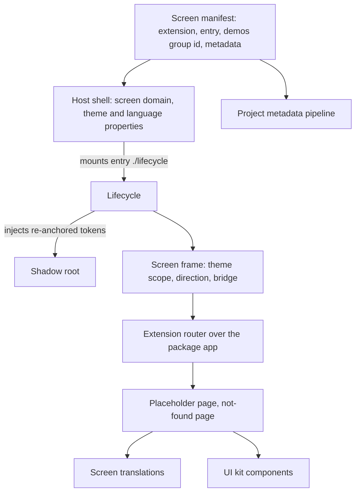
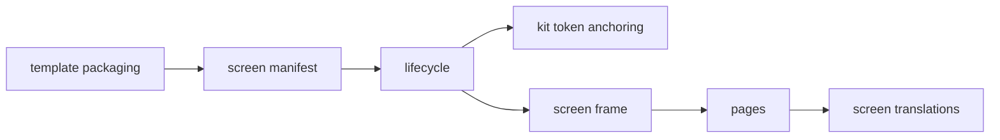
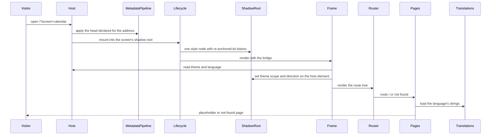
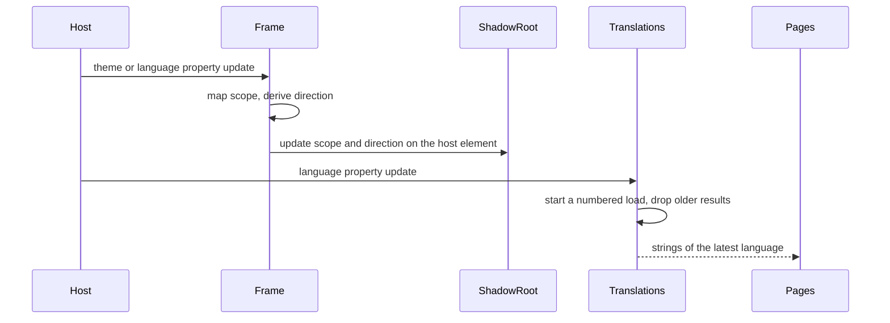
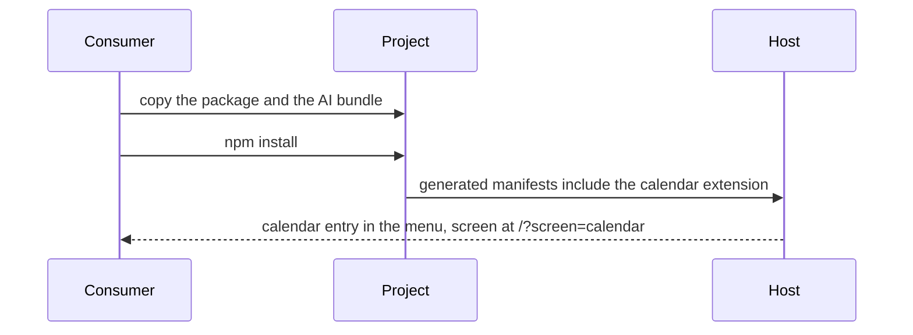

# Technical Design - template-calendar-demo

<!-- toc -->

- [1. Architecture Overview](#1-architecture-overview)
  - [1.1 Architectural Vision](#11-architectural-vision)
  - [1.2 Architecture Drivers](#12-architecture-drivers)
  - [1.3 Architecture Layers](#13-architecture-layers)
- [2. Principles & Constraints](#2-principles--constraints)
  - [2.1 Design Principles](#21-design-principles)
  - [2.2 Constraints](#22-constraints)
- [3. Technical Architecture](#3-technical-architecture)
  - [3.1 Domain Model](#31-domain-model)
  - [3.2 Component Model](#32-component-model)
  - [3.3 API Contracts](#33-api-contracts)
  - [3.4 Internal Dependencies](#34-internal-dependencies)
  - [3.5 External Dependencies](#35-external-dependencies)
  - [3.6 Interactions & Sequences](#36-interactions--sequences)
  - [3.7 Database schemas & tables](#37-database-schemas--tables)
- [4. Additional context](#4-additional-context)
  - [4.1 Package layout](#41-package-layout)
  - [4.2 Checks that hold the design](#42-checks-that-hold-the-design)
- [5. Traceability](#5-traceability)

<!-- /toc -->

- [x] `p3` - **ID**: `cpt-template-calendar-demo-design-template`

template-calendar-demo is a FrontX template of the FrontX site repository: an overlay with one screen MFE package, `calendar-demo-mfe` (`@gears-frontx/calendar-demo-mfe`, private, port 3070, scope `frontx.calendar_demo`), and one AI bundle. The repository composes it into the site with the other templates; the site-level design is in the [root DESIGN](../../architecture/DESIGN.md), and this document covers only the template.

## 1. Architecture Overview

### 1.1 Architectural Vision

The screen is a placeholder that holds a place in the site's demos until the calendar kit is released. Its design keeps the parts a later calendar demo inherits apart from the part it replaces: the screen extension (address token, menu entry, page metadata), the lifecycle, the screen frame that applies the host's theme and direction, and the translations loader are the stable frame; the placeholder page in the route tree is the only content, and it is the one thing the real demo swaps.

The package follows template-mfe's screen package form: a Module Federation remote whose manifest declares one entry and one screen extension, a lifecycle that renders the screen's own route tree through the framework's extension router, and a shared dependency set externalized so the screen and the host share one copy of React, the framework and the router. The screen renders inside a shadow root the host creates, so the UI kit's token stylesheet, written for a document root, is re-anchored on the shadow host before it is injected.

Metadata is data, not behaviour: the screen declares title, description and "not indexable" on its extension and never touches the document head. The project's metadata pipeline turns that declaration into the generated head, the sitemap exclusion and the run-time head.

### 1.2 Architecture Drivers

**ADRs**: `cpt-template-calendar-demo-adr-placeholder-until-kit-release` (the screen is a kit-built placeholder with no calendar dependency until the calendar kit is released), `cpt-template-calendar-demo-adr-kit-tokens-in-shadow-root` (the kit's tokens are anchored on the shadow host inside the screen's own shadow root). The template follows the site repository's decisions on composition by copy, the template boundary and exact registry pins, cited by link (root [ADR folder](../../architecture/ADR/)). The page metadata contract it implements is template-site-meta's ([template-site-meta architecture](../../template-site-meta/architecture/)).

#### Functional Drivers

| Requirement | Design Response |
|-------------|------------------|
| `cpt-template-calendar-demo-fr-screen-registration` | The screen manifest declares one extension of the shell's screen extension type in the host's screen domain, with route token `calendar`, the menu entry and the demos nav group's id (`cpt-template-calendar-demo-component-screen-manifest`) |
| `cpt-template-calendar-demo-fr-placeholder-page` | The route tree maps `/` to the placeholder page, built from the kit's `Empty` component with one heading whose text is the page title string (`cpt-template-calendar-demo-component-pages`) |
| `cpt-template-calendar-demo-fr-not-found` | The route tree's root route renders the not-found page for every unmatched path, with a router link back to `/` (`cpt-template-calendar-demo-component-pages`) |
| `cpt-template-calendar-demo-fr-host-theme-direction` | The screen frame reads the theme and language shared properties, maps the host theme onto the kit's light or dark scope, derives the direction, and sets both on the frame and the shadow host; the lifecycle injects the re-anchored kit tokens once per shadow root (`cpt-template-calendar-demo-component-screen-frame`, `cpt-template-calendar-demo-component-kit-token-anchoring`, `cpt-template-calendar-demo-component-lifecycle`) |
| `cpt-template-calendar-demo-fr-page-text-per-language` | The translations hook loads the string set of the current language with an English fallback and applies only the latest load while the screen is mounted (`cpt-template-calendar-demo-component-screen-translations`) |
| `cpt-template-calendar-demo-fr-page-metadata` | The screen extension's metadata block declares title, description and `indexable: false` with no per-route entries; no component writes the document head (`cpt-template-calendar-demo-component-screen-manifest`) |
| `cpt-template-calendar-demo-fr-self-contained` | The template manifest claims the package and the AI bundle as exclusive subtrees and no shared file; every helper the package needs is a local copy inside it (`cpt-template-calendar-demo-component-template-packaging`, `cpt-template-calendar-demo-principle-package-local-helpers`) |
| `cpt-template-calendar-demo-fr-ai-guideline` | The AI bundle registers one guideline that states the screen's contract (`cpt-template-calendar-demo-component-template-packaging`) |

#### NFR Allocation

| NFR ID | NFR Summary | Allocated To | Design Response | Verification Approach |
|--------|-------------|--------------|-----------------|----------------------|
| `cpt-template-calendar-demo-nfr-metadata-quality` | Title equals the heading; description of 50 to 160 characters | screen manifest, placeholder page strings | The metadata title and the heading read the same text; the description is written to the length | The package's manifest test compares the title with the English heading string and checks the description length |
| `cpt-template-calendar-demo-nfr-semantics` | One top-level heading per page; decorative icon hidden | pages | Each page renders the kit's title part as its one `h1` (the kit candidate `EmptyTitle` with `render`); the icon's container is hidden from assistive technology | The package's lifecycle and route tests; the site's design guardrail checks |
| `cpt-template-calendar-demo-nfr-kit-consistent-look` | Only kit components and semantic tokens; no utility-class framework | pages, kit token anchoring, screen frame | Pages compose kit components and kit candidates and import no stylesheet; the screen frame's CSS Module lays the screen out on the kit's tokens; tokens reach the shadow root through the anchoring | The site's own-styles policy over the template; the anchoring tests over the pinned kit stylesheet |

### 1.3 Architecture Layers

- [x] `p3` - **ID**: `cpt-template-calendar-demo-tech-layers`

| Layer | Responsibility | Technology |
|-------|---------------|------------|
| Presentation | The placeholder and not-found pages, their text and the screen frame's layout | React 19, `@gears-frontx/ui-kit` `Empty`, the kit candidates `EmptyTitle` and `Link`, `lucide-react` icon, a CSS Module on kit tokens in the frame |
| Application | The screen's lifecycle, its own FrontX app, its route tree and router, the frame that applies theme and direction | `@gears-frontx/react` (`ThemeAwareReactLifecycle`, `ExtensionRouter`, `createFrontX` with `microfrontends`), `@gears-frontx/routing-tanstack` |
| Integration | Registration with the host and declaration of metadata | MFE manifest with GTS type ids, Module Federation remote built by Vite with the shell's build plugin |
| Infrastructure | Install, build, tests | npm registry releases and the applied shell's workspace packages, pinned exactly, Vite, Vitest with the shell's test base |

## 2. Principles & Constraints

### 2.1 Design Principles

#### Kit first

- [x] `p2` - **ID**: `cpt-template-calendar-demo-principle-kit-first`

The page is composed from UI kit components and the kit candidates; only the screen frame carries a stylesheet, a CSS Module that lays the screen out on the kit's tokens. The screen carries no colour of its own and no utility-class framework, so the kit's theme governs its look.

**ADRs**: none of this template; the styling rule is the site repository's (root [DESIGN](../../architecture/DESIGN.md)).

#### Metadata declared once

- [x] `p2` - **ID**: `cpt-template-calendar-demo-principle-metadata-once`

Page metadata exists only on the screen extension. The screen never sets the document title or head tags; the project's metadata pipeline applies the declaration, so the generated head, the run-time head and the page cannot disagree.

**ADRs**: none of this template; the contract is template-site-meta's.

#### Package-local helpers

- [x] `p2` - **ID**: `cpt-template-calendar-demo-principle-package-local-helpers`

The package imports nothing from a sibling package or another template. The helpers every kit-styled screen package needs (screen frame, theme scope mapping, token anchoring, translations hook) are copies inside the package, each with its own tests, as template-mfe's packages do. A copy is the price of a package that moves alone.

**ADRs**: none of this template; the template boundary is the site repository's decision (root [ADR folder](../../architecture/ADR/)).

#### The frame stays, the content is replaced

- [x] `p2` - **ID**: `cpt-template-calendar-demo-principle-stable-frame`

The address token, the menu entry, the metadata block, the lifecycle, the frame and the translations loader form the screen's lasting contract. The placeholder page is the only content and depends on nothing calendar-specific, so the calendar demo replaces the page without changing an address, a link or another template.

**ADRs**: `cpt-template-calendar-demo-adr-placeholder-until-kit-release`

### 2.2 Constraints

#### Host prerequisites

- [x] `p2` - **ID**: `cpt-template-calendar-demo-constraint-host-prerequisites`

The package builds, tests and runs only in a project with template-shell and template-mfe applied: the shell supplies the screen domain and the screen extension type, the theme and language shared properties, the `frontxMfGts()` build plugin, `src-app/vitest.mfe.base.ts` and `src-app/__test-utils__/`.

**ADRs**: none.

#### Rendering inside a shadow root

- [x] `p2` - **ID**: `cpt-template-calendar-demo-constraint-shadow-root`

The host mounts the screen into a shadow root it keeps across mounts. A document-level stylesheet does not reach it and a `:root` selector matches nothing in it, so the kit's tokens are re-anchored on the shadow host, injected into the shadow root by the lifecycle, and the theme scope and direction are set on the shadow host as well as on the frame, for kit overlays that open at the shadow root's top level.

**ADRs**: `cpt-template-calendar-demo-adr-kit-tokens-in-shadow-root`

#### One router for the screen

- [x] `p2` - **ID**: `cpt-template-calendar-demo-constraint-one-router`

The build keeps template-mfe's form, with `@gears-frontx/routing` and `@gears-frontx/routing-tanstack` in the externalized shared set, so the extension router and the route tree use one router instance. Routes, links and hooks come from `@gears-frontx/routing-tanstack`, never from `@tanstack/*` directly.

**ADRs**: none.

#### Exact released versions only

- [x] `p2` - **ID**: `cpt-template-calendar-demo-constraint-exact-pins`

The package pins `@gears-frontx/ui-kit` `0.4.0`, `@gears-frontx/routing` and `@gears-frontx/routing-tanstack` `0.3.0`, `lucide-react` at the kit's version, and the shell's workspace versions, exactly, equal to the site's installs. An unreleased package cannot be a dependency, which is why the screen depends on no calendar package until the calendar kit is published.

**ADRs**: `cpt-template-calendar-demo-adr-placeholder-until-kit-release`; the exact registry pins themselves are the site repository's decision (root [ADR folder](../../architecture/ADR/)).

#### Two kit theme scopes

- [x] `p2` - **ID**: `cpt-template-calendar-demo-constraint-two-kit-scopes`

The kit scopes its tokens as light or dark only, and the host hands the screen a theme identifier, not a palette or a light/dark flag. The screen therefore maps an enumerated set of dark host themes onto the kit's dark scope and every other identifier onto the light scope; a host palette renders in the kit's colours of the matching scope.

**ADRs**: `cpt-template-calendar-demo-adr-kit-tokens-in-shadow-root`

## 3. Technical Architecture

### 3.1 Domain Model

**Technology**: JSON manifests with GTS type ids, JSON string sets, TypeScript

**Location**: [mfe.json](../src-app/mfe_packages/calendar-demo-mfe/mfe.json), [frontx-template.json](../frontx-template.json), [i18n](../src-app/mfe_packages/calendar-demo-mfe/src/screens/calendar/i18n/)

**Core Entities**:

| Entity | Description | Schema |
|--------|-------------|--------|
| Template manifest | Name, version and the exclusive subtrees of the overlay | [frontx-template.json](../frontx-template.json) |
| MFE manifest | The remote's id and entry address | [mfe.json](../src-app/mfe_packages/calendar-demo-mfe/mfe.json) `manifest` |
| Entry | The exposed lifecycle module and the shared properties it requires (theme, language) | `mfe.json` `entries` |
| Screen extension | An extension of the shell's screen extension type in the host's screen domain: route token, presentation (label, icon, order, group), metadata block | `mfe.json` `extensions` |
| Demos nav group | The host's instance of the shell's nav group type the demo screens join (`gts.frontx.screensets.layout.nav_group.v1~frontx.site.layout.demos.v1`); `presentation.group` holds its id | the site host's `site/src-app/app/layout/navGroups.ts`, on the shell's `nav_group.v1.json` |
| Metadata block | Title, description, indexability of the screen's one page | `mfe.json` `extensions[].seo` |
| String set | The page text of one language, by key | [en.json](../src-app/mfe_packages/calendar-demo-mfe/src/screens/calendar/i18n/en.json) |
| AI bundle | The registry of the template's guidelines | [extension.json](../.frontx/ai/@gears-frontx/frontx-template-calendar-demo/extension.json) |

**Relationships**:
- Template manifest -> MFE package, AI bundle: claims both as exclusive subtrees
- MFE manifest -> Entry: one entry exposing the lifecycle
- Entry -> Screen extension: the extension mounts the entry
- Screen extension -> Demos nav group: `presentation.group` names its id
- Screen extension -> Metadata block: carries one, with no per-route entries
- Page -> String set: reads its text by key from the current language's set

### 3.2 Component Model

#### Screen manifest

- [x] `p1` - **ID**: `cpt-template-calendar-demo-component-screen-manifest`

##### Why this component exists

The host registers screens and the metadata pipeline finds pages only through manifests; the manifest is the screen's whole contract with both.

##### Responsibility scope

Declares the remote (`frontx.calendar_demo` manifest, entry address on port 3070), one entry exposing `./lifecycle` that requires the theme and language shared properties, and one screen extension of the shell's screen extension type: route token `calendar`, label "Calendar: coming soon", icon `lucide:calendar`, order 60, group the demos nav group's id, and the metadata block (title equal to the page heading, a description, `indexable: false`, no `seo.routes`). Carries no schema. Declares no shared dependencies; the build externalizes them.

##### Responsibility boundaries

Does not decide where the menu shows the group (the host's site configuration hides the demos group from the header) and does not apply metadata to the head.

##### Related components (by ID)

- `cpt-template-calendar-demo-component-lifecycle` - names as its exposed entry module
- `cpt-template-calendar-demo-component-pages` - declares the title the placeholder heading repeats

#### Lifecycle

- [x] `p1` - **ID**: `cpt-template-calendar-demo-component-lifecycle`

##### Why this component exists

The host mounts a screen through a lifecycle object with mount and unmount; the lifecycle is where the screen's own app, styles and route tree meet.

##### Responsibility scope

Creates the package's FrontX app once at module load, with effects, the shared query cache and `microfrontends()`, so the screen owns a registry to build its router from. Extends the framework's theme-aware React lifecycle; on every mount puts the re-anchored kit tokens into the shadow root in exactly one marked style node (updating it when it exists, since the host keeps the shadow root across mounts); renders the screen frame around the extension router over the package's registry and route tree. Fails loudly when the app was built without `microfrontends()`.

##### Responsibility boundaries

Does not map themes or directions (screen frame) and does not decide routes (pages).

##### Related components (by ID)

- `cpt-template-calendar-demo-component-kit-token-anchoring` - calls once at module load
- `cpt-template-calendar-demo-component-screen-frame` - renders around the router
- `cpt-template-calendar-demo-component-pages` - renders their route tree

#### Kit token anchoring

- [x] `p2` - **ID**: `cpt-template-calendar-demo-component-kit-token-anchoring`

##### Why this component exists

The kit declares its tokens on `:root`, which matches nothing in a shadow tree; without a rewrite every kit component paints from unresolved variables, and a naive rewrite silently drops the dark variant.

##### Responsibility scope

Rewrites every `:root` selector of the kit's token stylesheet to name the shadow host: a bare `:root` to `:host`, a `:root` with a compound tail to the functional `:host(...)` form, a pseudo-element kept outside it. Strips comments first; the result is idempotent. Holds, through its tests, the assumption it rests on: every `:root` in the pinned kit stylesheet stands in selector position, and their count is pinned.

##### Responsibility boundaries

A textual rewrite, not a CSS parser: a kit stylesheet that names `:root` inside a quoted value or a feature query needs a parser, not a wider pattern. Does not inject the result (lifecycle).

##### Related components (by ID)

- `cpt-template-calendar-demo-component-lifecycle` - is called by

#### Screen frame

- [x] `p1` - **ID**: `cpt-template-calendar-demo-component-screen-frame`

##### Why this component exists

Every route component needs the host's theme and language applied around it and access to the bridge; doing that once at the root keeps pages free of host concerns.

##### Responsibility scope

Reads the theme and language shared properties from the bridge and follows their changes; maps the host theme onto the kit's light or dark scope (an enumerated set of dark host themes, light for any other identifier); derives the text direction from the language's primary subtag (right to left for Arabic, Hebrew, Persian, Urdu); sets the scope and direction on the frame element and on the shadow host; provides the bridge to route components.

##### Responsibility boundaries

Does not load text (translations) and does not inject tokens (lifecycle).

##### Related components (by ID)

- `cpt-template-calendar-demo-component-lifecycle` - is rendered by
- `cpt-template-calendar-demo-component-pages` - provides the bridge to

#### Pages

- [x] `p1` - **ID**: `cpt-template-calendar-demo-component-pages`

##### Why this component exists

It is the screen's content: the route tree and the two pages.

##### Responsibility scope

The route tree has a root route rendering an outlet, one child route `/` with the placeholder page, and the not-found page for every other path; the screen has no inner routes. The placeholder page is the kit's `Empty` with a calendar-clock icon hidden from assistive technology, an `EmptyTitle` rendered as the one `h1` with the page title, and a description that names the kit catalogue as the place for the calendar components available today. The not-found page is `Empty` with an `EmptyTitle` rendered as its one `h1`, a description and the kit candidate `Link` over the router link to `/`. Both render nothing until their text is loaded and import no stylesheet; the screen frame centres them.

##### Responsibility boundaries

Depends on no calendar package and shows no calendar component. Does not set the document head.

##### Related components (by ID)

- `cpt-template-calendar-demo-component-screen-translations` - reads its text through
- `cpt-template-calendar-demo-component-screen-frame` - reads the bridge from

#### Screen translations

- [x] `p2` - **ID**: `cpt-template-calendar-demo-component-screen-translations`

##### Why this component exists

The page text follows the host's language, and a new language must be a new string file and nothing else.

##### Responsibility scope

Takes the screen's string sets, collected once at module level from its `i18n` folder, and the bridge; loads the set of the current language, falling back to English and then to an empty set with a logged error; numbers every load and applies only the latest one while the screen is mounted; reloads when the language property changes; returns a lookup that logs and returns the key for a missing string, and a loading flag. The package ships English only.

##### Responsibility boundaries

Does no interpolation or plural forms; the screen's strings need none.

##### Related components (by ID)

- `cpt-template-calendar-demo-component-pages` - is used by

#### Template packaging

- [x] `p2` - **ID**: `cpt-template-calendar-demo-component-template-packaging`

##### Why this component exists

A project copies, validates and removes the template as a unit, and AI agents in that project need the screen's contract in writing.

##### Responsibility scope

The template manifest (`@gears-frontx/frontx-template-calendar-demo`, version `0.1.0-alpha.0`) claims the package directory and the AI bundle directory as exclusive subtrees and no shared file. The AI bundle registers one guideline, the calendar demo contract: package, port, extension, group declaration through the demos nav group's id, pages, metadata, theme and direction, styling and build form.

##### Responsibility boundaries

The template's README is the consumer-facing description and is not part of the bundle; composition into the site is done by the repository's tooling.

##### Related components (by ID)

- `cpt-template-calendar-demo-component-screen-manifest` - claims the package that holds

### 3.3 API Contracts

- [x] `p2` - **ID**: `cpt-template-calendar-demo-interface-package-surface`

- **Contracts**: `cpt-template-calendar-demo-interface-screen-extension`, `cpt-template-calendar-demo-interface-template-overlay`, `cpt-template-calendar-demo-contract-host-shell`, `cpt-template-calendar-demo-contract-page-metadata`, `cpt-template-calendar-demo-contract-ui-kit`
- **Technology**: URL grammar of the FrontX screen domain, MFE manifest with GTS type ids, Module Federation remote, template manifest
- **Location**: [mfe.json](../src-app/mfe_packages/calendar-demo-mfe/mfe.json), [frontx-template.json](../frontx-template.json), [calendar demo contract](../.frontx/ai/@gears-frontx/frontx-template-calendar-demo/guidelines/calendar-demo-contract.md)

**Endpoints Overview**:

| Method | Path | Description | Stability |
|--------|------|-------------|-----------|
| `GET` | `/?screen=calendar` | The placeholder page | stable |
| `GET` | `/?screen=calendar;route=<path>` | Any other path: the screen's not-found page | stable |
| `module` | `./lifecycle` of the remote | Lifecycle with mount and unmount, the default export | stable |
| `file` | `mfe.json` `extensions[0]` | Screen extension: token, menu entry, group, metadata block | stable |
| `file` | `frontx-template.json` | Overlay manifest with two exclusive subtrees | unstable |

Required from the host: the screen domain `frontx.screensets.layout.screen.v1`, the screen extension type with its optional `presentation.group`, the demos nav group, and the theme and language shared properties. Required from the kit: the `Empty` family of components and the token stylesheet with light and dark scopes.

### 3.4 Internal Dependencies

| Dependency Module | Interface Used | Purpose |
|-------------------|----------------|----------|
| template-shell (in the project) | screen domain, screen extension type, theme and language shared properties, `frontxMfGts()`, `vitest.mfe.base.ts`, `__test-utils__` | Registration, host properties, build and test harness |
| template-mfe (in the project) | screen package form, Vite configuration form | The shape this package keeps |
| `@gears-frontx/react` | `createFrontX`, `microfrontends`, `effects`, `queryCacheShared`, `gtsPlugin`, `ThemeAwareReactLifecycle`, `ExtensionRouter`, `ChildMfeBridge`, shared property ids | Lifecycle, the package's app, the bridge |
| `@gears-frontx/routing-tanstack` | `createRootRoute`, `createRoute`, `Outlet`, `Link` | The route tree and links |
| `@gears-frontx/ui-kit` | `Empty` and its parts, `theme.css` | Page UI and tokens |
| `@gears-frontx/kit-candidates` | `EmptyTitle` with `render`, `Link` | The pages' headings and the not-found page's link, until the kit releases them |

**Dependency Rules**:
- The package imports nothing outside its own directory
- Nothing imports `@tanstack/*` directly
- No circular dependencies

### 3.5 External Dependencies

#### npm registry

| Dependency Module | Interface Used | Purpose |
|-------------------|---------------|---------|
| `@gears-frontx/*` ecosystem releases, `react`, `react-dom`, `lucide-react`, `@tanstack/react-query` | npm install at exact versions; template-shell's own `@gears-frontx/*` packages are the applied shell's workspace sources at the versions it carries | Runtime and build of the package |

### 3.6 Interactions & Sequences

#### Open the calendar screen

**ID**: `cpt-template-calendar-demo-seq-open-screen`

**Use cases**: `cpt-template-calendar-demo-usecase-open-screen`

**Actors**: `cpt-template-calendar-demo-actor-visitor`, `cpt-template-calendar-demo-actor-host-shell`, `cpt-template-calendar-demo-actor-metadata-pipeline`

**Description**: The host mounts the screen; the lifecycle supplies tokens, the frame applies theme and direction, the router picks the page, and the page shows once its text is loaded. The head comes from the declared metadata, never from the screen.

#### Theme or language changes

**ID**: `cpt-template-calendar-demo-seq-host-change`

**Use cases**: `cpt-template-calendar-demo-usecase-open-screen`

**Actors**: `cpt-template-calendar-demo-actor-host-shell`

**Description**: The screen follows the host without a reload; a slower earlier language load never overwrites the latest one.

#### Apply the template to a project

**ID**: `cpt-template-calendar-demo-seq-apply-template`

**Use cases**: `cpt-template-calendar-demo-usecase-apply-template`

**Actors**: `cpt-template-calendar-demo-actor-template-consumer`, `cpt-template-calendar-demo-actor-host-shell`

**Description**: The two claimed subtrees are the whole template; the host picks the screen up from its manifest.

### 3.7 Database schemas & tables

Not applicable: the template has no database and no server process.

## 4. Additional context

### 4.1 Package layout

| Path (under `src-app/mfe_packages/calendar-demo-mfe/`) | Component |
|---|---|
| `mfe.json` | screen manifest |
| `src/init.ts`, `src/lifecycle.tsx` | lifecycle |
| `src/shared/anchorKitThemeOnShadowHost.ts` | kit token anchoring |
| `src/shared/ScreenFrame.tsx`, `src/shared/kitThemeScope.ts` | screen frame |
| `src/routes.tsx`, `src/screens/calendar/` | pages |
| `src/shared/useScreenTranslations.ts` | screen translations |
| `src/test-support/` | test helpers (a jsdom stand-in for scrolling, the route tree path reader) |
| `vite.config.ts`, `vitest.config.ts`, `tsconfig.json`, `package.json`, `index.html` | build and test configuration (`index.html` only says the remote is not meant to be opened directly) |

The template manifest and the AI bundle (`.frontx/ai/@gears-frontx/frontx-template-calendar-demo/`) sit at the template root.

### 4.2 Checks that hold the design

- The manifest test: shared dependencies only in the Vite configuration and in template-mfe's order with the two routing packages, GTS ids that parse, one entry exposing `./lifecycle`, the entry address on the preview port, the extension's token and menu entry, the shell's screen type, the demos group's id and no schema, a route tree of `/` alone, no per-route metadata, `indexable: false`, the title equal to the heading string and the description length.
- The lifecycle, route and translations tests, and the tests of the theme scope mapping and the token anchoring against the pinned kit stylesheet.
- In the site repository: the template shape check, the composition drift check and the own-styles and text policies (root [DESIGN](../../architecture/DESIGN.md)).

## 5. Traceability

- **PRD**: [PRD.md](./PRD.md)
- **ADRs**: [ADR/](./ADR/); root decisions in [../../architecture/ADR/](../../architecture/ADR/)
- **Features**: [features/](./features/)
