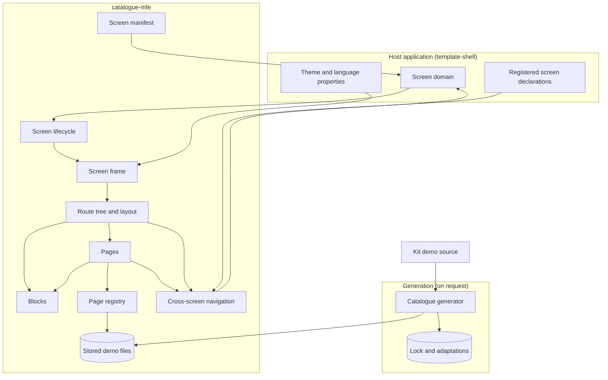
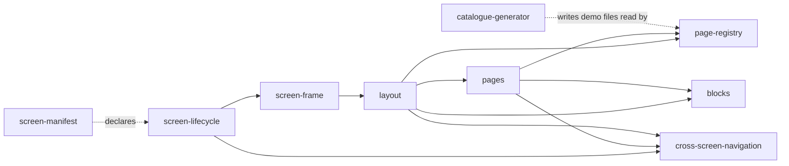

# Technical Design - template-catalogue

<!-- toc -->

- [1. Architecture Overview](#1-architecture-overview)
  - [1.1 Architectural Vision](#11-architectural-vision)
  - [1.2 Architecture Drivers](#12-architecture-drivers)
  - [1.3 Architecture Layers](#13-architecture-layers)
- [2. Principles & Constraints](#2-principles--constraints)
  - [2.1 Design Principles](#21-design-principles)
  - [2.2 Constraints](#22-constraints)
- [3. Technical Architecture](#3-technical-architecture)
  - [3.1 Domain Model](#31-domain-model)
  - [3.2 Component Model](#32-component-model)
  - [3.3 API Contracts](#33-api-contracts)
  - [3.4 Internal Dependencies](#34-internal-dependencies)
  - [3.5 External Dependencies](#35-external-dependencies)
  - [3.6 Interactions & Sequences](#36-interactions--sequences)
  - [3.7 Database schemas & tables](#37-database-schemas--tables)
  - [3.8 Deployment Topology](#38-deployment-topology)
- [4. Additional context](#4-additional-context)
  - [4.1 Deliberate differences from the reference showcase](#41-deliberate-differences-from-the-reference-showcase)
  - [4.2 Adaptations in force](#42-adaptations-in-force)
  - [4.3 Known kit gaps that show in the catalogue](#43-known-kit-gaps-that-show-in-the-catalogue)
  - [4.4 Design checks](#44-design-checks)
- [5. Traceability](#5-traceability)

<!-- /toc -->

- [x] `p3` - **ID**: `cpt-template-catalogue-design-catalogue`

## 1. Architecture Overview

### 1.1 Architectural Vision

template-catalogue contributes one screen MFE package, `catalogue-mfe` (`src-app/mfe_packages/catalogue-mfe/`), and its AI bundle. The package is a FrontX screen extension with route token `catalogue`, mounted by the host application built from template-shell inside a shadow root, and rendered by the framework's extension router over the package's own route tree. Every page is a route inside the screen, so every page has its own address in the host's URL grammar, and every navigation entry is a real link to it.

The package has two halves. The demo files (the kit demo's example files, foundation pages and their shared helper) are produced by a generator inside the package from the kit demo at the commit the pinned kit release was published from, and stored; the screen never edits them and the build never runs the generator (`cpt-template-catalogue-adr-generated-from-kit-demo`). The screen around them is the package's own code: a page registry derived from the stored example files, the route tree and the layout (section bar, navigation panel, page select), the pages (index, component, foundation, not found) composed from the package's own blocks, the frame that brings the host's theme, language and the kit's tokens into the shadow root, and the cross-screen navigation: the catalogue's own `show_component` action, through which another screen opens a component's page.

The package is self-contained. It references no file outside its own directory, and it knows no other screen of the application: it reads no list of registered screens and links to no other screen; the only contract it offers other screens is its own `show_component` action. The kit candidates (the components proposed for the kit and not yet released) come by name, as the workspace package `@gears-frontx/kit-candidates` that template-kit-candidates delivers, pinned to its exact version. The rest of the site, its root design and the other templates, are described in their own trees: the site's [DESIGN](../../architecture/DESIGN.md) for how the templates are composed into the application, and its [ADR directory](../../architecture/ADR/) for the decisions the site owns.

### 1.2 Architecture Drivers

**ADRs**: `cpt-template-catalogue-adr-generated-from-kit-demo`

#### Functional Drivers

| Requirement | Design Response |
|-------------|------------------|
| `cpt-template-catalogue-fr-component-pages` | The page registry derives one component entry per stored example file, loaded lazily; the route tree has one pattern route over the slugs and a not-found page for anything else |
| `cpt-template-catalogue-fr-foundation-pages` | The page registry lists the three foundation pages; the generated foundation pages read token values on an element inside the shadow root and re-read them when the theme scope changes |
| `cpt-template-catalogue-fr-index` | The index groups the registry's components by the fixed family order and filters by the screen-wide search |
| `cpt-template-catalogue-fr-component-page-content` | The component page renders the example behind its own error boundary, loads the example's source as encoded text for the Code tab and the download, and builds the install line and the type definitions link from the installed kit version |
| `cpt-template-catalogue-fr-screen-navigation` | The layout renders the section bar, the navigation panel and, below the narrow breakpoint, a page select; rows are router links; the panel scrolls only its own rows to reveal the current one |
| `cpt-template-catalogue-fr-links-to-screens` | The package has no reader of the host's declarations, no routing grammar and no link to another screen; the host's menu lists the application's screens |
| `cpt-template-catalogue-fr-show-component` | The manifest declares `show_component` with a closed schema whose payload enum is the component slugs; the lifecycle registers its handler in `mount()`; the handler replaces the entry `mount_ext` wrote with `/components/<slug>` through the app's navigation facade |
| `cpt-template-catalogue-fr-demo-files-from-kit` | The generator reads the demo at the locked commit, applies the content rules and the recorded adaptations, and writes the demo files |
| `cpt-template-catalogue-fr-generation-check` | The generator's check mode regenerates in memory and compares with the stored files, the lock and the pin |
| `cpt-template-catalogue-fr-record-adaptation` | The generator's record mode diffs the edited file against the locked source and stores the adaptation, keeping or requiring its kind and reason |
| `cpt-template-catalogue-fr-kit-release-move` | The generator's move mode lists the demo at the new commit, refuses a commit declaring another kit version, moves the lock and lists the adaptations that no longer apply |
| `cpt-template-catalogue-fr-host-theme-language` | The screen frame maps the host's theme property onto the kit's two token scopes, sets the text direction from the language, and loads the screen's strings in that language |
| `cpt-template-catalogue-fr-page-metadata` | The `seo` block of the screen extension in `mfe.json` declares every page; the manifest test holds it equal to the route tree's pages and the titles equal to the navigation labels |

#### NFR Allocation

| NFR ID | NFR Summary | Allocated To | Design Response | Verification Approach |
|--------|-------------|--------------|-----------------|----------------------|
| `cpt-template-catalogue-nfr-offline-build` | Builds, tests and page loads need no network | `cpt-template-catalogue-component-catalogue-generator` | The demo files are stored; the generator runs only on request and is not part of the build | The package builds with the network off; the built bundle holds no generator code |
| `cpt-template-catalogue-nfr-failure-containment` | One failing page breaks only itself | `cpt-template-catalogue-component-pages`, `cpt-template-catalogue-component-page-registry` | Each example is its own lazy module behind its own error boundary keyed by slug; a source load that fails says so | The pages test renders every page at its own route and fails on an error boundary |
| `cpt-template-catalogue-nfr-self-contained` | Nothing outside the template, exact pins | the whole package | No reference to another template's code or to the host's files; generator on Node built-ins only; a template consumer (`cpt-template-catalogue-actor-template-consumer`) copies the package and its AI bundle and changes nothing outside them | FrontX CLI template validation; the site's pin policy |
| `cpt-template-catalogue-nfr-page-semantics` | One `h1`, no second `main`, groups not landmarks | `cpt-template-catalogue-component-layout`, `cpt-template-catalogue-component-pages` | The page container is a plain element under the host's `main`; navigation groups are `role="group"`; each page has one header with its `h1` | The screen's page and layout tests; the site's design checks |

### 1.3 Architecture Layers



- [x] `p3` - **ID**: `cpt-template-catalogue-tech-stack`

| Layer | Responsibility | Technology |
|-------|---------------|------------|
| Presentation | Layout, pages, blocks, the kit's components and the generated demo files | React 19, `@gears-frontx/ui-kit`, `@gears-frontx/kit-candidates`, layout CSS Modules on the kit's tokens in the blocks, lucide icons |
| Application | Lifecycle, route tree, page registry, search, translations, cross-screen navigation | `@gears-frontx/react` (lifecycle base, extension router, actions), `@gears-frontx/routing-tanstack`, `@gears-frontx/routing` |
| Domain | Catalogue entries, families, the kit version | TypeScript modules of the package |
| Infrastructure | Module Federation remote, the example-source build plugin, the generator | Vite with Module Federation and the shell's GTS build plugin; Node built-ins for the generator |

## 2. Principles & Constraints

### 2.1 Design Principles

#### The kit demo is the source of the demo files

- [x] `p1` - **ID**: `cpt-template-catalogue-principle-kit-demo-is-source`

The example files, the foundation pages and their shared helper are generated from the kit demo at the pinned release's commit and never edited by hand; a deliberate change is a recorded adaptation with its kind and reason. The screen's own code lives beside them and never inside them.

**ADRs**: `cpt-template-catalogue-adr-generated-from-kit-demo`

#### The host lists screens, the catalogue lists its pages

- [x] `p2` - **ID**: `cpt-template-catalogue-principle-host-lists-screens`

The component pages come from the stored example files; no list in the screen's code names a component page, and a new example file appears without a change to the frame, only its metadata added, with the tests naming what is missing. The application's other screens are the host's to list: the catalogue names none, links to none and reads no list of them.

#### One address per page

- [x] `p1` - **ID**: `cpt-template-catalogue-principle-page-per-address`

Every page is a route of the screen's route tree, every navigation entry is a router link that renders the page's composed address, and nothing in the package writes the URL by hand.

#### Contain every failure to its page

- [x] `p2` - **ID**: `cpt-template-catalogue-principle-contain-failures`

Code from another repository renders in sixty-seven pages; each loads on its own, behind its own boundary, and every asynchronous read (an example's source) has a stated failure state instead of an endless wait.

### 2.2 Constraints

#### The screen renders in a shadow root

- [x] `p1` - **ID**: `cpt-template-catalogue-constraint-shadow-root`

The host mounts each screen inside a shadow root. The kit declares its tokens on `:root`, which matches nothing there, so the lifecycle injects the kit's token stylesheet rewritten to target the shadow host; the kit's component styles reach the shadow root through the host document's styles. The kit's overlay components open their popups in the document body, outside the shadow root, so they take the document's theme and type; that is a kit gap the site records, not something the screen fixes.

#### Screens are addressed in the query string

- [x] `p1` - **ID**: `cpt-template-catalogue-constraint-query-addressing`

FrontX addresses a screen as an entry in the query string of the host's URL and projects the entry's `route` parameter onto the screen's own virtual pathname (FrontX routing ADR 0003). The catalogue's pages are therefore `/?screen=catalogue;route=<path>`, and only the catalogue's own router moves inside them: another screen reaches a component page through the catalogue's `show_component` action, never through its route.

#### The MFE loader scans chunk text for imports

- [x] `p1` - **ID**: `cpt-template-catalogue-constraint-loader-scans-imports`

The MFE loader of `@gears-frontx/mfes` finds a chunk's imports by matching its text, so an import statement inside a string is taken for a real one. An example's source therefore reaches the page encoded as base64 through the package's own build plugin, never as plain text.

#### The lifecycle module exports its lifecycle only

- [x] `p2` - **ID**: `cpt-template-catalogue-constraint-lifecycle-default-export`

The lazily loaded example chunks share code with the lifecycle chunk, so the bundler consolidates it and rewrites its default export; the shell's build plugin repairs that only when the module's namespace holds `default` alone, and Module Federation ignores a package's own chunking settings. The lifecycle module exports its lifecycle as the default export and nothing else.

#### The published kit carries no demo

- [x] `p1` - **ID**: `cpt-template-catalogue-constraint-no-published-demo`

The published `@gears-frontx/ui-kit` ships no demo sources, no component manifest and no source commit, so the generator reads the demo from the gears-frontx repository at a commit recorded in the lock, and producing or checking the demo files needs the network or a local checkout.

**ADRs**: `cpt-template-catalogue-adr-generated-from-kit-demo`

#### The generated files fix part of the package layout

- [x] `p2` - **ID**: `cpt-template-catalogue-constraint-generated-layout`

The generated examples import their shared helper as `../shared`, so the helper sits at `src/shared.tsx` and the package's own helpers live in `src/frame/` instead of the `src/shared/` folder other screen packages of the site use.

#### Styling and pins

- [x] `p2` - **ID**: `cpt-template-catalogue-constraint-styling-and-pins`

The screen's own code uses the kit's components first, the kit candidates for the parts the kit lacks (headings, text roles, links, the code block), and its own blocks for how the parts are laid out: a block's CSS Module declares layout on the kit's tokens, and every other declaration a block keeps is a row of the package's exemptions ledger naming the kit gap it waits for. The compositions (the layout and the pages) import no stylesheet; there is no Tailwind; the generated demo files keep their inline styles and are exempt by path. The package pins the kit, the kit candidates, the routing packages, the shell's packages and the libraries the kit's examples use (`lucide-react`, `react-day-picker`, `recharts`) to exact versions.

## 3. Technical Architecture

### 3.1 Domain Model

**Technology**: TypeScript types of the package; JSON for the lock and the screen manifest

**Location**: [catalog.ts](../src-app/mfe_packages/catalogue-mfe/src/catalog.ts), [kit-demo.lock.json](../src-app/mfe_packages/catalogue-mfe/kit-demo/kit-demo.lock.json)

**Core Entities**:

| Entity | Description | Schema |
|--------|-------------|--------|
| Catalogue entry | A page of the catalogue: a component (slug, path, label key, icon, family, lazy component, source loader) or a foundation (slug, path, label key, icon, component) | [catalog.ts](../src-app/mfe_packages/catalogue-mfe/src/catalog.ts) |
| Family | One of nine fixed component groups, in display order, each with its card icon | [catalog.ts](../src-app/mfe_packages/catalogue-mfe/src/catalog.ts) |
| Section | One of the section bar's two sections (components, foundations), derived from the current path | [CatalogueLayout.tsx](../src-app/mfe_packages/catalogue-mfe/src/screens/catalogue/CatalogueLayout.tsx) |
| Kit demo lock | The kit version, the source repository and commit, the included demo file patterns and the content hash of each demo file | [kit-demo.lock.json](../src-app/mfe_packages/catalogue-mfe/kit-demo/kit-demo.lock.json) |
| Adaptation | A per-file diff against the locked source with its kind and reason | [adaptations](../src-app/mfe_packages/catalogue-mfe/kit-demo/adaptations/) |
| Page metadata | The screen's title and description and one entry per other page, on the screen extension | [mfe.json](../src-app/mfe_packages/catalogue-mfe/mfe.json) |

**Relationships**:
- Kit demo lock -> Adaptation: each adaptation applies to one locked demo file.
- Catalogue entry (component) -> generated example file: one entry per stored example file, named by its slug.
- Catalogue entry (component) -> Family: each component belongs to exactly one family.
- Page metadata -> Catalogue entry: one metadata entry per page path, with the entry's label as its title.

### 3.2 Component Model



#### Screen manifest

- [x] `p1` - **ID**: `cpt-template-catalogue-component-screen-manifest`

##### Why this component exists

The host registers a screen from its declaration: without it the catalogue has no entry, no route token, no menu label and no page metadata.

##### Responsibility scope

`mfe.json`: the remote's manifest, the entry with its exposed lifecycle module, the shared properties it requires (theme, language) and the action it accepts, the closed schema of its `show_component` action (target: the catalogue's screen; payload: an enum of the component slugs), and the screen extension (route `/catalogue`, label "UI Kit", order 30, `seo` with one entry per page other than the index).

##### Responsibility boundaries

Holds declarations only; it does not decide which pages exist (the route tree and the page registry do) and does not generate metadata.

##### Related components (by ID)

- `cpt-template-catalogue-component-screen-lifecycle` - declares the module that implements

#### Screen lifecycle

- [x] `p1` - **ID**: `cpt-template-catalogue-component-screen-lifecycle`

##### Why this component exists

The host mounts and unmounts a screen through its lifecycle; the catalogue's needs the kit's tokens in the shadow root and its `show_component` handler registered before a chained action reaches it.

##### Responsibility scope

`src/lifecycle.tsx` and `src/init.ts`: the package's own FrontX app (effects, the shared query cache, microfrontends with the GTS type system), the theme-aware lifecycle that injects the kit's token stylesheet once per shadow root, renders the screen frame with the extension router over the catalogue's route tree, and registers the `show_component` handler in `mount()`.

##### Responsibility boundaries

Does not render pages and reads no list of screens; the module exports nothing but its lifecycle.

##### Related components (by ID)

- `cpt-template-catalogue-component-screen-frame` - renders
- `cpt-template-catalogue-component-cross-screen-navigation` - registers the `show_component` handler of

#### Screen frame

- [x] `p1` - **ID**: `cpt-template-catalogue-component-screen-frame`

##### Why this component exists

The host's theme and language arrive as shared properties, and the kit's tokens are scoped by `data-theme` on an element; every page needs both, and the screen's strings.

##### Responsibility scope

`src/frame/ScreenFrame.tsx`, `kitThemeScope.ts`, `anchorKitThemeOnShadowHost.ts`, `useScreenTranslations.ts` and `src/screens/catalogue/CatalogueText.tsx`: subscribes to the theme and language properties, maps the host theme onto the kit's light or dark scope (unknown themes to light), sets the text direction on the frame and the shadow host, rewrites the kit's `:root` selectors for the shadow host, loads the screen's strings for the language with English as the fallback (a slower, outdated load never wins), and gives route components the bridge.

##### Responsibility boundaries

Does not offer a theme switch and does not store a theme; it maps, it never decides.

##### Related components (by ID)

- `cpt-template-catalogue-component-layout` - wraps

#### Page registry

- [x] `p1` - **ID**: `cpt-template-catalogue-component-page-registry`

##### Why this component exists

The pages must come from the stored example files, and each page needs its label, family, icon, lazy component and source.

##### Responsibility scope

`src/catalog.ts`, `src/exampleSource.ts`, `exampleSourcePlugin.ts` and `src/frame/kitVersion.ts`: one lazy loader and one lazy source loader per example file, the three foundation entries, the family order, each component's family and icon, the index lookups, the paths of every page, the installed kit version and the type definitions address; the build plugin that serves an example's source as base64 and its decoder.

##### Responsibility boundaries

Does not render; does not create metadata for a new example (the developer adds it, the tests name what is missing).

##### Related components (by ID)

- `cpt-template-catalogue-component-catalogue-generator` - reads the files written by

#### Layout

- [x] `p1` - **ID**: `cpt-template-catalogue-component-layout`

##### Why this component exists

A visitor moves between seventy pages; the frame around every page carries that navigation.

##### Responsibility scope

`src/routes.tsx`, `src/screens/catalogue/CatalogueLayout.tsx`, `CatalogueSearch.tsx` and `revealRow.ts`: the route tree (index, component pattern, foundation pattern, not found), the section bar with the current section marked, the navigation panel (All components, the foundations, the components by family, the kit version), the page select below the narrow breakpoint, revealing the current row by scrolling only the panel, the screen-wide search state and the toast region inside the screen.

##### Responsibility boundaries

Does not render page content and does not add a `main` landmark; lists no other screen of the application.

##### Related components (by ID)

- `cpt-template-catalogue-component-pages` - routes to
- `cpt-template-catalogue-component-page-registry` - lists the entries of

#### Pages

- [x] `p1` - **ID**: `cpt-template-catalogue-component-pages`

##### Why this component exists

Each route renders one kind of page with its own content and failure states.

##### Responsibility scope

`src/screens/catalogue/CataloguePages.tsx` and `src/frame/ExampleErrorBoundary.tsx`: the index (breadcrumb, title, intro, search, family cards with counts, the empty search result), the component page (breadcrumb, back link, title with family, description, Preview and Code tabs, "Use in your app" and "Component contract"), the foundation page in the kit's card, and the not-found page.

##### Responsibility boundaries

Does not change a generated file; renders the generated example or foundation page as it is, behind a boundary. Draws nothing itself: every part is a kit component, a kit candidate or a block.

##### Related components (by ID)

- `cpt-template-catalogue-component-page-registry` - renders the entries of
- `cpt-template-catalogue-component-cross-screen-navigation` - shown at a component's page by
- `cpt-template-catalogue-component-blocks` - composed from

#### Blocks

- [x] `p1` - **ID**: `cpt-template-catalogue-component-blocks`

##### Why this component exists

The layout and the pages are compositions: they decide what is on a page, not how a part is laid out. The arrangements the reference showcase draws (the section bar, the navigation panel, the page header, the family list cards, the preview stage, the guide columns) are the screen's blocks, each built from the kit's components, the kit candidates and the kit's tokens.

##### Responsibility scope

`src/blocks/<Block>/` (the block, its layout CSS Module, its card, its showcase fixture, its test and its index) for `CatalogueFrame`, `SectionTabs`, `NavPanel`, `PagePicker`, `PageFrame`, `PageHeader`, `IndexIntro`, `ListCard`, `ListCardGrid`, `PreviewStage`, `FoundationStage`, `ComponentGuide`, `IconLink`, `CodeSample` and `PagePlaceholder`; `src/blocks/anchor.tsx`, which draws a block's link on the router's link the composition passes; `src/blocks/styles-exemptions.json`, the ledger of the declarations that are not layout, each with the kit gap it waits for (a kit link tab bar, a kit navigation list row, a kit list card, a height option on the code block).

##### Responsibility boundaries

Takes content and behaviour props only (texts, items, slots, links, handlers, current state); a different arrangement is a different block. Knows no route, no string table and no registered screen.

##### Related components (by ID)

- `cpt-template-catalogue-component-layout` - draws the frame of
- `cpt-template-catalogue-component-pages` - draws the parts of

#### Cross-screen navigation

- [x] `p1` - **ID**: `cpt-template-catalogue-component-cross-screen-navigation`

##### Why this component exists

Other screens open the catalogue at a component's page; they must reach it through a contract the catalogue declares, not through its routes.

##### Responsibility scope

`src/frame/showComponent.ts`: the `show_component` action type and its handler, which moves the catalogue's router to the named component's page by replacing the current entry.

##### Responsibility boundaries

Never writes the URL itself; the framework router writes it. Opens no other screen and reads no list of screens.

##### Related components (by ID)

- `cpt-template-catalogue-component-screen-lifecycle` - handler registered by

#### Catalogue generator

- [x] `p1` - **ID**: `cpt-template-catalogue-component-catalogue-generator`

##### Why this component exists

The demo files must be the kit demo at the pinned release plus recorded adaptations, reproducibly, with a check (`cpt-template-catalogue-adr-generated-from-kit-demo`).

##### Responsibility scope

`scripts/generate-catalogue.mjs` with `kit-demo/kit-demo.lock.json` and `kit-demo/adaptations/`: reading the locked demo files from the network (cached per commit only when their hash matches the lock) or from a local checkout; the content rules; parsing and strictly applying each adaptation and refusing one without a kind or reason; refusing any refused text that survives; writing the demo files; the check mode; the record mode; the move mode to a new commit with its version check and the list of adaptations to port.

##### Responsibility boundaries

Never runs during a build; uses Node built-ins and the package's own files only; does not write component metadata.

##### Related components (by ID)

- `cpt-template-catalogue-component-page-registry` - writes the files read by

### 3.3 API Contracts

- [x] `p1` - **ID**: `cpt-template-catalogue-interface-screen-surface`

- **Contracts**: `cpt-template-catalogue-interface-catalogue-addresses`, `cpt-template-catalogue-interface-show-component`, `cpt-template-catalogue-interface-generation-commands`, `cpt-template-catalogue-contract-kit-demo-source`, `cpt-template-catalogue-contract-host-application`
- **Technology**: URL grammar, FrontX actions, JSON manifest, npm scripts
- **Location**: [mfe.json](../src-app/mfe_packages/catalogue-mfe/mfe.json), [package.json](../src-app/mfe_packages/catalogue-mfe/package.json), [catalogue-contract.md](../.frontx/ai/@gears-frontx/frontx-template-catalogue/guidelines/catalogue-contract.md)

**Endpoints Overview**:

| Method | Path | Description | Stability |
|--------|------|-------------|-----------|
| `GET` | `/?screen=catalogue` | The index | stable |
| `GET` | `/?screen=catalogue;route=components/<slug>` | A component page, one per example file | stable |
| `GET` | `/?screen=catalogue;route=foundations/<slug>` | A foundation page: `semantic-colors`, `typography`, `layout-elevation` | stable |
| `action` | `gts.frontx.mfes.comm.action.v1~frontx.catalogue.action.show_component.v1~` with payload `{ component }`, targeted at the catalogue's extension | Shows one component's page, replacing the current entry; the host's validation against the schema refuses another target and a slug that is not a component | unstable |
| `npm` | `generate`, `generate:check`, `generate -- --record <file>`, `generate -- --ref <commit>`, `--source <dir>` | Producing, checking, recording and moving the demo files | unstable |

### 3.4 Internal Dependencies

| Dependency Module | Interface Used | Purpose |
|-------------------|----------------|----------|
| template-shell | screen domain, theme and language shared properties, `ThemeAwareReactLifecycle` through `@gears-frontx/react`, the `frontxMfGts()` build plugin, the shared test base | Hosting, registration, theme and language, the build and the tests |
| `@gears-frontx/react` | `createFrontX`, `ExtensionRouter`, `ActionHandler`, the shared property ids, the navigation facade | The app, the route rendering, the `show_component` handler, theme and language |
| `@gears-frontx/routing` | `resolveNavigationHistory` (tests only) | The navigation history the route-tree tests render with |
| `@gears-frontx/routing-tanstack` | route tree, `Link`, `useNavigate`, `useParams`, `useRouterState` | Routes and links inside the screen |
| `@gears-frontx/ui-kit` | components, `theme.css`, `package.json` version | The pages' UI, the tokens and the installed version |
| `@gears-frontx/kit-candidates` (template-kit-candidates) | `Heading`, `Text`, `Link`, the `CodeBlock` family | The headings, text roles, links and code blocks the kit does not ship yet; on the kit's release the import specifier changes to `@gears-frontx/ui-kit` |

**Dependency Rules**:
- The package imports no file of another template; it carries its own copy of a shared approach and declares the same action type. A package another template delivers is a dependency by name and exact version (the shell's packages, the kit candidates).
- Nothing imports `@tanstack/*` routing directly; route hooks come from routing-tanstack.
- No circular dependencies between the package's modules.

### 3.5 External Dependencies

#### gears-frontx repository

| Dependency Module | Interface Used | Purpose |
|-------------------|---------------|---------|
| `raw.githubusercontent.com` and `api.github.com` (`constructorfabric/gears-frontx`) | HTTPS reads of `packages/ui-kit/demo` files, the demo tree and `packages/ui-kit/package.json` at a commit | The generator's source, only when generating, checking or moving |

#### Type definitions host

| Dependency Module | Interface Used | Purpose |
|-------------------|---------------|---------|
| `unpkg.com` | A link to `@gears-frontx/ui-kit@<version>/dist/components/<slug>/<slug>.d.ts` | The component page's type definitions link; the catalogue only links, it never fetches |

### 3.6 Interactions & Sequences

#### Open a component page

**ID**: `cpt-template-catalogue-seq-open-component-page`

**Use cases**: `cpt-template-catalogue-usecase-browse-component`

**Actors**: `cpt-template-catalogue-actor-visitor`, `cpt-template-catalogue-actor-host-application`, `cpt-template-catalogue-actor-crawler`

```mermaid
sequenceDiagram
    Visitor ->> Host: /?screen=catalogue;route=components/button
    Host ->> Lifecycle: mount in the screen domain
    Lifecycle ->> Frame: render with theme and language
    Frame ->> Router: route /components/button
    Router ->> ComponentPage: slug button
    ComponentPage ->> Registry: entry for button
    Registry -->> ComponentPage: lazy example and source loader
    ComponentPage -->> Visitor: example in Preview, source in Code, install and type definitions
```

**Description**: A visitor or a crawler requests the page's canonical address. The host mounts the screen at the address's route; the component page finds its entry in the registry, renders the example lazily behind its boundary and loads the source for the Code tab.

#### Opened at a page from another screen

**ID**: `cpt-template-catalogue-seq-show-component`

**Use cases**: `cpt-template-catalogue-usecase-open-from-another-screen`

**Actors**: `cpt-template-catalogue-actor-host-application`

```mermaid
sequenceDiagram
    OtherScreen ->> Host: actions chain mount_ext(catalogue), next show_component(button)
    Host ->> Lifecycle: mount; handler registered in mount()
    Host ->> Handler: show_component { component }, validated against the catalogue's schema
    Handler ->> Router: replace /components/button
    Router -->> Visitor: the page; one history entry, no reload
```

**Description**: `mount_ext` writes one history entry and the handler replaces it with the component's page, so Back returns to the previous screen; the sender names the component, never the catalogue's route.

#### Generate, check and move the demo files

**ID**: `cpt-template-catalogue-seq-generate-demo-files`

**Use cases**: `cpt-template-catalogue-usecase-move-kit-release`

**Actors**: `cpt-template-catalogue-actor-template-developer`, `cpt-template-catalogue-actor-kit-demo-source`

```mermaid
sequenceDiagram
    Developer ->> Generator: generate (or --check, --ref, --record)
    Generator ->> Generator: read lock and pinned kit version
    Generator ->> Cache: demo files for the locked commit
    alt not cached or hash differs
        Generator ->> Source: GET demo file at commit
        Source -->> Generator: content
        Generator ->> Cache: store only when the hash matches the lock
    end
    Generator ->> Generator: content rules, then each adaptation
    alt check
        Generator -->> Developer: differences, or exit 0
    else generate
        Generator -->> Developer: files written; adaptations to port listed
    end
```

**Description**: Every mode starts from the lock and the pin; at the locked commit, a fetched file enters the cache or the package only when its hash matches the lock, and a move to a new commit caches what it fetches, which the moved lock then records.

### 3.7 Database schemas & tables

Not applicable: the catalogue keeps no stored data. Its state is the current route, the search text and the loaded strings.

### 3.8 Deployment Topology

- [x] `p3` - **ID**: `cpt-template-catalogue-topology-remote`

The package builds into a Module Federation remote exposing `./lifecycle`, with the shared dependencies left external for the host's MFE handler to link at runtime. In development it is served on port 3060 (the manifest's remote entry address); where the remote is placed in a production build is decided by the host application. The generator, the lock and the adaptations are not part of the built remote.

## 4. Additional context

### 4.1 Deliberate differences from the reference showcase

The layout follows the reference showcase at frontx.constructor.rocks (V2): the section bar, a 224px navigation panel, the index with family list cards, the component page with its two guide columns. The catalogue differs on purpose: it shows all components and nine families instead of a selection, the full example gallery instead of one example, no States tab (the kit publishes no contracts), no theme switcher (the theme is the host's), none of the reference's extra showcase pages, and no Examples section: the application's example screens are listed by the host's menu. A contracts page and an evaluation lab page are not part of the catalogue, and the demo's web font links are not taken (the kit tokens declare the font stacks).

### 4.2 Adaptations in force

The template's [README](../README.md), section "Source of the examples", lists every adaptation with its file, kind and change; the AI guideline [catalogue-generation.md](../.frontx/ai/@gears-frontx/frontx-template-catalogue/guidelines/catalogue-generation.md) gives the procedure to record, port and move.

### 4.3 Known kit gaps that show in the catalogue

Recorded in the site's known gaps list ([GAPS.md](../../architecture/GAPS.md)): the kit publishes no component contracts and no demo sources; its overlay components open outside the shadow root; its sidebar inset renders a second `main` in the sidebar example; and accessibility findings of individual kit components shown by the examples are kept as the kit renders them. The blocks' declarations that wait for a kit component or option are listed in `src/blocks/styles-exemptions.json`.

### 4.4 Design checks

- SRP: the generator owns the demo files, the registry owns the page list, the layout owns navigation, the pages own content, the blocks own how a part is laid out, the frame owns theme and language, the `show_component` handler owns what crosses into the screen from another one.
- OCP: a new kit example is a new file from the generator plus its metadata; no frame code changes.
- DIP: the catalogue depends on the framework's action handler and navigation facade only, not on the shell's internals or files.
- Weakest assumption: that the host registers the action schema the catalogue's manifest declares and validates every chain against it; without that, the handler refuses only a payload without a string component, and an unknown slug shows the catalogue's not-found page.

## 5. Traceability

- **PRD**: [PRD.md](./PRD.md)
- **ADRs**: [ADR/](./ADR/)
- **Features**: [features/](./features/)
