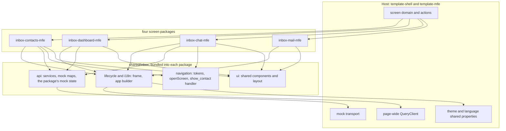
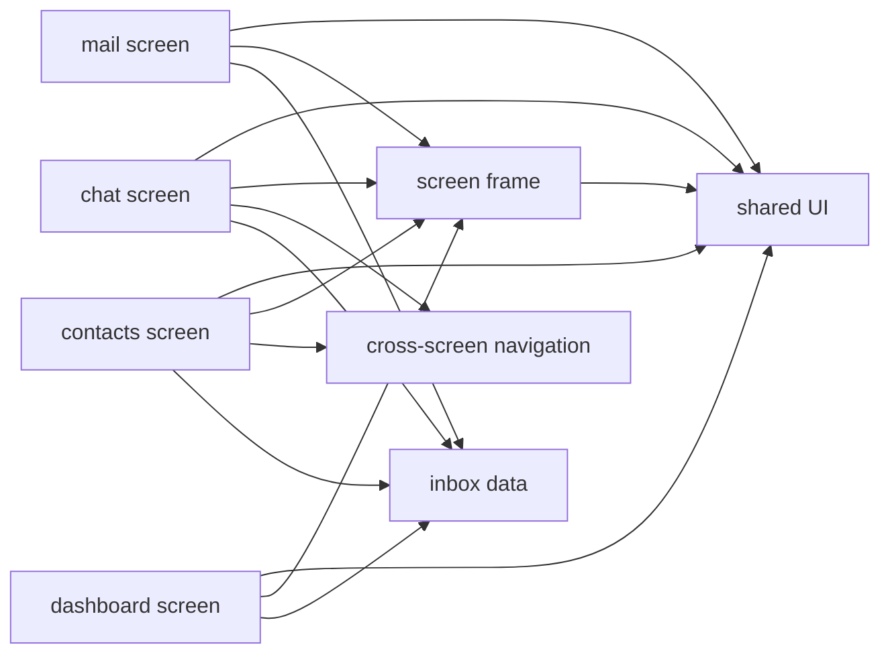
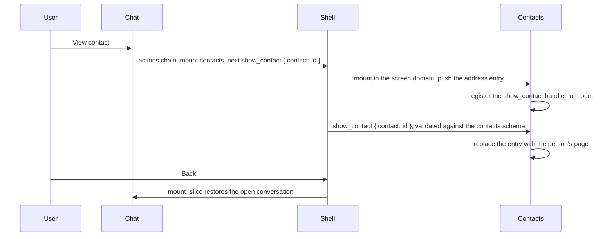
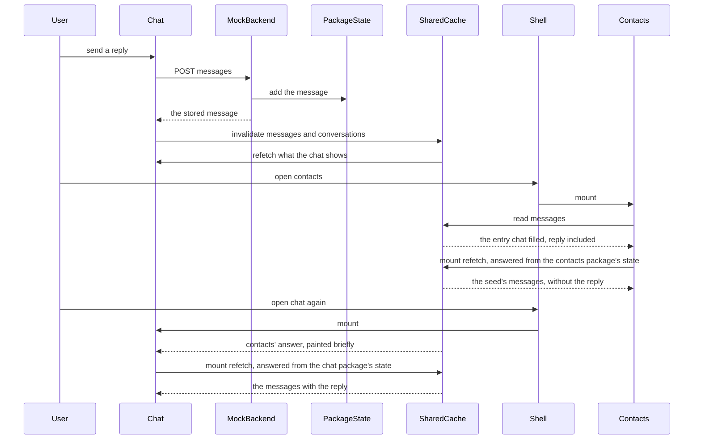
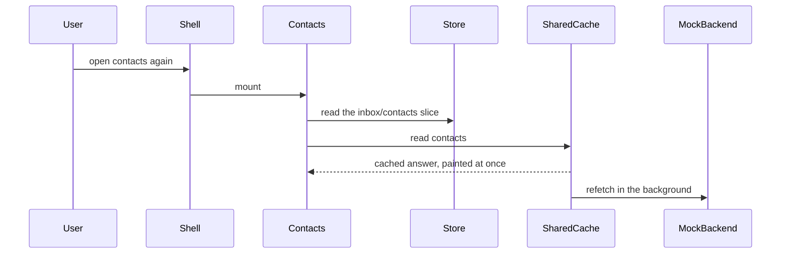
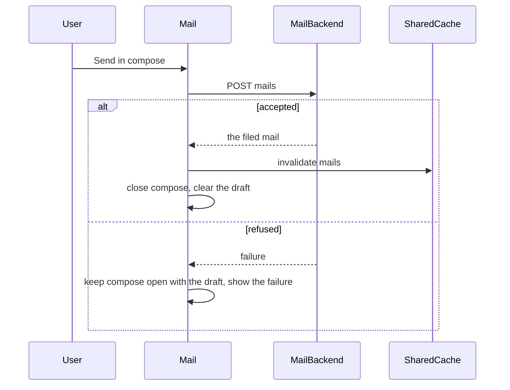
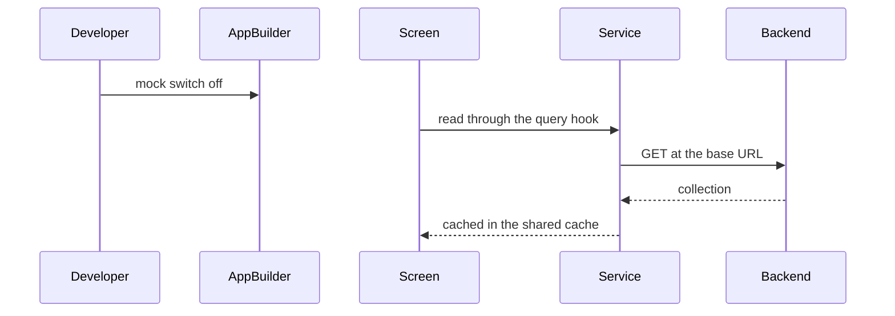

# Technical Design - template-inbox

<!-- toc -->

- [1. Architecture Overview](#1-architecture-overview)
  - [1.1 Architectural Vision](#11-architectural-vision)
  - [1.2 Architecture Drivers](#12-architecture-drivers)
  - [1.3 Architecture Layers](#13-architecture-layers)
- [2. Principles & Constraints](#2-principles--constraints)
  - [2.1 Design Principles](#21-design-principles)
  - [2.2 Constraints](#22-constraints)
- [3. Technical Architecture](#3-technical-architecture)
  - [3.1 Domain Model](#31-domain-model)
  - [3.2 Component Model](#32-component-model)
  - [3.3 API Contracts](#33-api-contracts)
  - [3.4 Internal Dependencies](#34-internal-dependencies)
  - [3.5 External Dependencies](#35-external-dependencies)
  - [3.6 Interactions & Sequences](#36-interactions--sequences)
  - [3.7 Database schemas & tables](#37-database-schemas--tables)
  - [3.8 Deployment Topology](#38-deployment-topology)
- [4. Additional context](#4-additional-context)
  - [4.1 Screens and routes](#41-screens-and-routes)
  - [4.2 Where the shared tests run](#42-where-the-shared-tests-run)
  - [4.3 Source](#43-source)
  - [4.4 Kit gaps the screens work around](#44-kit-gaps-the-screens-work-around)
- [5. Traceability](#5-traceability)

<!-- /toc -->

## 1. Architecture Overview

### 1.1 Architectural Vision

template-inbox is an overlay of four screen microfrontend packages and one shared folder, placed under a project's `src-app/mfe_packages/`, plus an AI bundle with two guidelines. The host (template-shell with template-mfe) mounts each package in its screen domain inside a shadow root and owns the chrome: the navigation, the page address, the document head, the theme and the language. Each package owns everything inside its screen: its route tree, its frame, its state and the services it reads.

The four screens act as one application although each is loaded and isolated on its own; they pass data through FrontX shared properties, actions chains and the host's shared query cache. Three layers carry their data, each with one job. The mock backend keeps one state per package, in a module variable of the package's copy of the data module, created from the same seed and kept across the screen's remounts, and stands for a server (`cpt-template-inbox-adr-package-mock-backend`); a write is visible on the screen whose package made it, and another screen package answers from its own copy of the seed, so the mocks do not share facts between screens the way a real backend does. The host's page-wide query cache holds what the screens have read under keys every package shares, so a read one package made can paint on another package's screen until that screen's own refetch answers, and a write invalidates exactly the reads it changed, in every package (`cpt-template-inbox-adr-frontx-data-and-state-layers`). Each screen's own choices live in a FrontX slice in its package's store, which outlives the screen's mount. Moving from one screen to a page inside another is one actions chain through the host: the screen domain mounts the target, and the action the target declares (contacts' `show_contact`) moves the target's own router, so no inbox code writes the page address or names another screen's routes.

What the four packages share is a plain folder, `shared/inbox/`, imported through an alias and bundled into each package. Packages never import one another, so a project keeps any subset of the screens. The design follows the uniform shape of the site that hosts this template; the site's design is in the repository's root tree ([architecture/DESIGN.md](../../architecture/DESIGN.md)).

### 1.2 Architecture Drivers

**ADRs**: `cpt-template-inbox-adr-package-mock-backend`, `cpt-template-inbox-adr-frontx-data-and-state-layers`

#### Functional Drivers

| Requirement | Design Response |
|-------------|------------------|
| `cpt-template-inbox-fr-contacts-directory` | The contacts screen component renders the directory from the shared contacts read, with filter counts derived on the client and the filter and search in its slice |
| `cpt-template-inbox-fr-contact-page` | The contacts route tree has a person's page route over the directory; an unknown id renders the contact-not-found state, an unknown path the screen's not-found page |
| `cpt-template-inbox-fr-dashboard` | The dashboard screen component reads one overview response; its activity rows are built from the dashboard package's own contacts on each request |
| `cpt-template-inbox-fr-chat` | The chat screen component over the inbox service: reads channels, conversations, messages and contacts; posts replies and notes and starts conversations; triage changes and created channels are kept in its slice |
| `cpt-template-inbox-fr-mail` | The mail screen component over the mail service and its package's mock state; compose keeps the draft until the send succeeds and shows the failure otherwise |
| `cpt-template-inbox-fr-view-contact` | The cross-screen navigation component sends the screen domain's mount action chained with contacts' own `show_contact` action and the person's id; contacts' handler replaces the entry the mount wrote with the person's page |
| `cpt-template-inbox-fr-screen-facts` | Each package's mock state, kept across the screen's remounts, and the host's shared query cache with per-write invalidation |
| `cpt-template-inbox-fr-screen-keeps-place` | One FrontX slice per stateful screen in its package's store, changed only by its effects |
| `cpt-template-inbox-fr-instant-return` | Reads answered from the shared cache; each package's app is built with the mock switch before the shared cache; a query with an answer never gates the first paint |
| `cpt-template-inbox-fr-host-navigation` | Each package's manifest declares a plain screen extension of the shell's screen type with its route token and menu entry, naming the site host's demos nav group instance in `presentation.group` |
| `cpt-template-inbox-fr-host-theme-language` | The screen frame reads the theme and language shared properties, sets the kit theme scope and the text direction, and merges each package's catalogue over the shared one |
| `cpt-template-inbox-fr-failure-isolation` | Error boundaries per root route and around the router, a load-error pane with retry, and a not-found page per route tree |
| `cpt-template-inbox-fr-page-metadata` | An `seo` block on each screen extension; contacts marks the person's page route not indexable |
| `cpt-template-inbox-fr-mock-backend` | Each service declares the host's mock transport with its mock map; the factories answer from the package's state with clones and refuse invalid writes with a status |
| `cpt-template-inbox-fr-backend-switch` | One app builder in the shared folder sets the mock switch for every package |
| `cpt-template-inbox-fr-screens-stand-alone` | Packages import only the shared folder; the shared tests read whichever sibling packages are present |
| `cpt-template-inbox-fr-agent-guidelines` | The AI bundle carries the data guideline and the chrome guideline, citing only paths under `src-app/mfe_packages/` |

#### NFR Allocation

| NFR ID | NFR Summary | Allocated To | Design Response | Verification Approach |
|--------|-------------|--------------|-----------------|----------------------|
| `cpt-template-inbox-nfr-accessibility` | One top-level heading, focus on arrival, 4.5:1 text contrast in both themes | screen frame, shared UI, each screen | One heading component per screen with focus requested on every mount of the screen and on a change of page; a hidden list pane's title is plain text; only badge and avatar tones that keep 4.5:1 in both themes | screen tests counting top-level headings; design guardrails checks |
| `cpt-template-inbox-nfr-container-layout` | Layout from the screen's own width | screen frame, shared UI | The frame root is a named size container, measured before the first paint; panes follow container rules on one breakpoint table; layout decisions in code read the measured layout | the shared layout test holds every package's stylesheet to the breakpoint table |
| `cpt-template-inbox-nfr-kit-only` | Kit controls and tokens only | every screen, shared UI | Components from `@gears-frontx/ui-kit` and the kit candidates (`@gears-frontx/kit-candidates`); screen components import no stylesheet and draw their panes, lists, threads, composers and cards through the blocks of the shared folder, whose stylesheets are layout on kit tokens with every other declaration a row of the exemptions ledger; logical properties only; kit gaps recorded in section 4.4 | checked by the hosting repository's own-styles check and lint |

### 1.3 Architecture Layers

- [x] `p3` - **ID**: `cpt-template-inbox-tech-layers`

| Layer | Responsibility | Technology |
|-------|---------------|------------|
| Presentation | Screens, blocks and shared components in each screen's shadow root | React 19, `@gears-frontx/ui-kit`, `@gears-frontx/kit-candidates`, block CSS modules on kit tokens, Recharts (dashboard) |
| Routing | Each screen's route tree inside its address entry | `@gears-frontx/routing`, `@gears-frontx/routing-tanstack`, the framework's extension router |
| Application | Package app, store and slices, query hooks, actions chains | `@gears-frontx/react` (framework, state, query cache, microfrontends) |
| Data | Services, mock maps, each package's mock state, seeds | `@gears-frontx/api` services through the framework, the host template's mock transport |
| Build | One Module Federation remote per package | Vite, the host's build plugin |

## 2. Principles & Constraints

### 2.1 Design Principles

#### Screens share only the shared folder

- [x] `p2` - **ID**: `cpt-template-inbox-principle-share-only-shared-folder`

A package imports its own code, the shared folder and ecosystem packages, never another package. The shared folder has no package manifest and is not a workspace; each package bundles its copy through the `@inbox-shared` alias. A project can drop any screen and the rest keep building and passing their tests.

**ADRs**: `cpt-template-inbox-adr-package-mock-backend`

#### The host owns the chrome

- [x] `p2` - **ID**: `cpt-template-inbox-principle-host-owns-chrome`

The navigation, the page address, the document head, the theme and the language belong to the host. No inbox code reads or writes the page address or the document title; a screen reaches the navigation only through its manifest and another screen only through the host's actions.

#### One server, one cache, one slice per screen

- [x] `p2` - **ID**: `cpt-template-inbox-principle-one-server-one-cache`

Each kind of data has one home: what a server holds lives in the mock backend (or the real backend), what a screen has read lives in the host's shared query cache, and what a screen keeps for itself lives in its slice. Nothing a screen keeps for itself is held in a module-level variable; the module variable of the mock store stands for the server.

**ADRs**: `cpt-template-inbox-adr-package-mock-backend`, `cpt-template-inbox-adr-frontx-data-and-state-layers`

#### Layout from the screen's own width

- [x] `p2` - **ID**: `cpt-template-inbox-principle-container-layout`

Pane layout follows the width the host leaves the screen, read from the frame's size container, never the viewport; package stylesheets use logical properties only, so the right-to-left direction needs no separate rules.

#### Kit first

- [x] `p2` - **ID**: `cpt-template-inbox-principle-kit-first`

Every control is a kit component or a kit candidate (the proposed kit component, delivered by template-kit-candidates until the kit releases it), every colour and size a kit token, and every popup renders into the frame's portal container so it stays inside the shadow root. Screens compose kit parts and blocks and carry no stylesheet; a block's stylesheet is layout on kit tokens. Where the kit has no fitting token, variant or part, the block that needs it keeps the declaration and the exemptions ledger (`shared/inbox/blocks/styles-exemptions.json`) names the gap it waits for.

### 2.2 Constraints

#### Applies onto template-shell and template-mfe at the host's releases

- [x] `p2` - **ID**: `cpt-template-inbox-constraint-host-prerequisite`

The template brings no host, build harness or workspace entry; it needs a project with template-shell and template-mfe applied, and pins every ecosystem package exactly to the version the host installs.

#### Collection endpoints only

- [x] `p2` - **ID**: `cpt-template-inbox-constraint-collection-endpoints`

A mock factory receives the request body only, so every read returns a whole collection and the screen selects within it; new data is a new collection endpoint, not a parameterised one.

#### The mock transport answers only with success

- [x] `p2` - **ID**: `cpt-template-inbox-constraint-mock-success-only`

The host template's mock transport answers a mapped route only with a successful response and passes an unmapped one to the network. A factory that must refuse a write throws an error carrying a status and no data, which the protocol reports as a failed request; no screen calls an unmapped route.

**ADRs**: `cpt-template-inbox-adr-frontx-data-and-state-layers`

#### The shared cache clears on the mock switch's announcement

- [x] `p2` - **ID**: `cpt-template-inbox-constraint-mock-before-shared-cache`

The shared query cache of a package clears the page's whole QueryClient on every mock toggle it hears, and the mock switch announces its initial state with a toggle. Every package therefore builds its app with the mock switch before the shared cache, through one app builder, so that a package loading for the first time leaves the page's reads in place.

**ADRs**: `cpt-template-inbox-adr-frontx-data-and-state-layers`

#### Background refetch on every mount

- [x] `p3` - **ID**: `cpt-template-inbox-constraint-refetch-on-mount`

The framework's query hook overrides the cache's default staleness, so a screen that mounts on cached data paints it at once and refetches it in the background on every mount. The data is the same, so nothing changes on screen; there is no workaround.

**ADRs**: `cpt-template-inbox-adr-frontx-data-and-state-layers`

#### One router copy

- [x] `p2` - **ID**: `cpt-template-inbox-constraint-one-router-copy`

The framework's extension router and a screen's route hooks must be one copy, so both routing packages are shared dependencies of every package's federation build and deduped like the kit in its build, test and type-check settings.

#### Contacts declares the action that shows a person's page

- [x] `p2` - **ID**: `cpt-template-inbox-constraint-contacts-show-action`

The mount action carries only the extension, so a page of another screen is reached through an action that screen declares. The contacts screen declares `show_contact` (`gts.frontx.mfes.comm.action.v1~frontx.inbox_contacts.nav.show_contact.v1~`, payload `{ contact }`) on its entry, with a closed schema whose target is the contacts screen only, carried once in its own manifest; a sender names the person, never the contacts screen's route. The site's decision on moving between screens is recorded in the root tree ([architecture/ADR/0006-cross-screen-deep-links.md](../../architecture/ADR/0006-cross-screen-deep-links.md)).

#### Kit contrast and token gaps

- [x] `p3` - **ID**: `cpt-template-inbox-constraint-kit-gaps`

In the light theme the kit's success, warning and danger badge tones stay under 4.5:1 text contrast; its item group takes the list role while a row rendered as a button cannot be the list item, so each such row sits in a list item box that lays nothing out; its chat bubble has no tail-at-bottom variant and no trailing time inside the bubble; it has no pane chrome, no static sidebar for a bounded container, no item density between its two smallest steps, no selected row state, no chart size and no tokens for the dashboard's large figures. The screens use only passing tones, and the blocks work around the rest, each declaration a row of the exemptions ledger.

## 3. Technical Architecture

### 3.1 Domain Model

**Technology**: TypeScript response types

**Location**: [shared/inbox/api/types.ts](../src-app/mfe_packages/shared/inbox/api/types.ts), [shared/inbox/api/dashboardTypes.ts](../src-app/mfe_packages/shared/inbox/api/dashboardTypes.ts), [inbox-mail-mfe/src/api/mailTypes.ts](../src-app/mfe_packages/inbox-mail-mfe/src/api/mailTypes.ts)

**Core Entities**:

| Entity | Description | Schema |
|--------|-------------|--------|
| Agent | The signed-in support agent: name, presence, workspace | `types.ts` |
| Channel | A conversation folder the chat lists | `types.ts` |
| Conversation | A customer conversation: contact, channel, assignee, priority, status, tags, team inbox | `types.ts` |
| Message | A reply, an inbound message or an internal note in a conversation, with attachments and links | `types.ts` |
| Contact | A person: type (user or lead), details, tickets, references to their conversations | `types.ts` |
| Dashboard overview | KPI cards, chart series, workload, stage funnel, conversion by source, top agents, activity rows | `dashboardTypes.ts` |
| Mailbox | Inbox, drafts, sent, archive, trash | `mailTypes.ts` |
| Mail | A mail thread in a mailbox | `mailTypes.ts` |
| Mail message | An earlier message behind a mail's history | `mailTypes.ts` |

**Relationships**:
- Conversation -> Contact: refers to one by id
- Contact -> Conversation: lists its conversations by id
- Message -> Conversation: belongs to one
- Activity row -> Contact: names a person of the dashboard package's contacts
- Mail -> Mailbox: filed in one

### 3.2 Component Model

#### Inbox data

- [x] `p1` - **ID**: `cpt-template-inbox-component-inbox-data`

##### Why this component exists

The screens need services to read and write, and a backend that answers while none is attached, keeping each screen's writes for the page session in the state of the package that made them.

##### Responsibility scope

The inbox service (agent, channels, conversations, messages, contacts; writes for messages and conversations) in the shared folder, the dashboard service in the dashboard package and the mail service in the mail package; one registrar per service; the mock maps over the host's mock transport; the mock states (inbox and mail), each kept in a module variable of its store, so every package has its own copy created from the same seed; the seeds and the seed clock, anchored at the moment the package's copy loads; the refusal error for invalid writes; the response types.

##### Responsibility boundaries

Keeps no screen state and no read cache: reads live in the host's query cache and screen choices in the slices. Does not persist the chat's triage changes or created channels. A package registers only the services its screen reads, so mail never bundles the inbox seed and the inbox screens never bundle mail's.

##### Related components (by ID)

- `cpt-template-inbox-component-screen-frame` - its app builder sets the mock switch for the services registered before build

#### Screen frame

- [x] `p1` - **ID**: `cpt-template-inbox-component-screen-frame`

##### Why this component exists

Every screen needs the same host integration inside its shadow root: theme, direction, translations, a portal for popups, a router over its route tree, error boundaries, heading focus and a measured layout, and every package needs the same app.

##### Responsibility scope

The lifecycle base class each package's lifecycle extends (kit tokens anchored on the shadow host once per root); the frame (kit theme scope from the host theme, direction from the language, the portal container, the size container measured before the first paint, the extension router over the package app's registry, an error boundary around it, heading focus on every mount); the app builder every package's init calls, in its fixed plugin order; the shared catalogue and the translator that merges a package's catalogue over it for the host's language with a whole-language fallback to English.

##### Responsibility boundaries

Writes no document title or head tag and reads no page address. Holds no screen-specific content.

##### Related components (by ID)

- `cpt-template-inbox-component-shared-ui` - renders the screen heading, route roots and not-found page from it
- `cpt-template-inbox-component-inbox-data` - builds the app whose mock switch covers the registered services

#### Shared UI

- [x] `p2` - **ID**: `cpt-template-inbox-component-shared-ui`

##### Why this component exists

The four screens draw the same pieces: headings, avatars, field rows, loading and error panes, side columns, list and detail panes, threads, composers, cards and the layout breakpoints.

##### Responsibility scope

The screen heading and its focus request; the route roots with their per-page error boundary and the not-found page; the first-paint gate over the queries a screen needs, the loading pane and the load-error pane with retry; identity and presence avatars on contrast-safe tones; field rows on the kit candidate description list; the side column toggle; the breakpoint table and the layout hook; date, time and label formatting; the submit shortcut; the automatic first selection. And the blocks (`shared/inbox/blocks/`), the section-level compositions every screen draws with, each a folder with its component, a layout-only stylesheet, a card and a test: the state pane (`PaneState`), the page pane (`PagePane`), the side column (`NavColumn`), the list and detail panes (`ListPane`, `ThreadListItem`, `DetailPane`), the thread (`ThreadPane`, `TranscriptMessage`, `ReplyComposer`), the side panel (`InspectorPanel`), the contact summary and the presence avatar (`ContactSummary`, `PresenceAvatar`), the chip row (`ChipRow`), the contact page's columns and record lists (`ColumnsLayout`, `RecordList`), the table cells and sections (`CellActions`, `DataTableSection`), and the dashboard's board and cards (`CardGrid`, `StatCard`); the exemptions ledger next to them.

##### Responsibility boundaries

Holds no data and no state beyond a component's own; every piece is built from kit components and kit candidates. A block takes content and behaviour props only: a different arrangement is a different block or part, never a variant prop.

##### Related components (by ID)

- `cpt-template-inbox-component-screen-frame` - provides the translator, the portal container and the layout context it reads

#### Cross-screen navigation

- [x] `p1` - **ID**: `cpt-template-inbox-component-cross-screen-navigation`

##### Why this component exists

A screen must open another screen at a page inside it with one history entry, without writing the page address.

##### Responsibility scope

The screens' address tokens and extension ids, held to the manifests by a shared test; the check whether a bridge occupies the host's screen domain; `openScreen`, which sends the screen domain's mount action with the target's extension and, for a page, the target's own action as the chain's next step; contacts' `show_contact` action type and its handler, which moves the contacts screen's own router to the person's page with a replace through its app's navigation facade.

##### Responsibility boundaries

Writes no address and names no other screen's routes; the contacts manifest declares the action's schema and its lifecycle registers the handler.

##### Related components (by ID)

- `cpt-template-inbox-component-chat-screen` - sends the chain from "View contact"
- `cpt-template-inbox-component-contacts-screen` - registers the handler when it mounts

#### Contacts screen

- [x] `p1` - **ID**: `cpt-template-inbox-component-contacts-screen`

##### Why this component exists

The directory and each person's page, the target other screens link to.

##### Responsibility scope

The package `inbox-contacts-mfe`: the directory (filters with counts, search, sort, paging), the person's page with details, tickets and activity, the contact-not-found state, the `inbox/contacts` slice, the `show_contact` action declaration and handler registration, and the home of the shared folder's tests.

##### Responsibility boundaries

Reads contacts, conversations and messages; writes nothing to the backend.

##### Related components (by ID)

- `cpt-template-inbox-component-inbox-data` - reads from
- `cpt-template-inbox-component-cross-screen-navigation` - accepts the `show_contact` action through
- `cpt-template-inbox-component-screen-frame` - is rendered in

#### Dashboard screen

- [x] `p2` - **ID**: `cpt-template-inbox-component-dashboard-screen`

##### Why this component exists

The team's view of the inbox's people and work.

##### Responsibility scope

The package `inbox-dashboard-mfe`: the overview service and its seed, KPI cards with sparklines, the resolved, records-created and new-contacts charts each with a text summary, workload, the stage funnel, conversion by source, top agents and the activity table.

##### Responsibility boundaries

Keeps no state of its own and writes nothing.

##### Related components (by ID)

- `cpt-template-inbox-component-inbox-data` - reads the overview, whose activity rows are built from the dashboard package's contacts
- `cpt-template-inbox-component-screen-frame` - is rendered in

#### Chat screen

- [x] `p1` - **ID**: `cpt-template-inbox-component-chat-screen`

##### Why this component exists

Where the user acts on conversations.

##### Responsibility scope

The package `inbox-chat-mfe`: folders and channels, the conversation list with search and sort, the thread, the reply-and-note composer with per-conversation drafts and a failure state, starting a conversation with an existing contact, the customer-details panel with session triage changes, the `inbox/chat` slice, and "View contact".

##### Responsibility boundaries

Persists only replies, notes and new conversations; triage changes and created channels stay in its slice.

##### Related components (by ID)

- `cpt-template-inbox-component-inbox-data` - reads from and writes to
- `cpt-template-inbox-component-cross-screen-navigation` - opens contacts through
- `cpt-template-inbox-component-screen-frame` - is rendered in

#### Mail screen

- [x] `p1` - **ID**: `cpt-template-inbox-component-mail-screen`

##### Why this component exists

The mail channel of the product, with its own data.

##### Responsibility scope

The package `inbox-mail-mfe`: the mail service, its seed and its package mock state; mailboxes, the mail list with search and tabs, the reading pane with the history toggle, reply, compose with draft kept until sent and a send-failure state, and the `inbox/mail` slice.

##### Responsibility boundaries

Does not read the inbox service and does not bundle its seed.

##### Related components (by ID)

- `cpt-template-inbox-component-inbox-data` - follows its registration and mock-state pattern
- `cpt-template-inbox-component-screen-frame` - is rendered in

### 3.3 API Contracts

- [x] `p2` - **ID**: `cpt-template-inbox-interface-inbox-services`

- **Contracts**: `cpt-template-inbox-contract-backend-data`, `cpt-template-inbox-contract-host-services`, `cpt-template-inbox-interface-screen-addresses`, `cpt-template-inbox-interface-open-person-page`, `cpt-template-inbox-interface-overlay`
- **Technology**: REST over the FrontX API protocol; the host's URL grammar; GTS actions; the template manifest
- **Location**: the services in `shared/inbox/api/`, `inbox-dashboard-mfe/src/api/`, `inbox-mail-mfe/src/api/`; each package's `mfe.json`; `frontx-template.json`

**Endpoints Overview**:

| Method | Path | Description | Stability |
|--------|------|-------------|-----------|
| `GET` | `/api/inbox/me` | The agent | unstable |
| `GET` | `/api/inbox/channels` | Every channel | unstable |
| `GET` | `/api/inbox/conversations` | Every conversation, including those started in the session | unstable |
| `GET` | `/api/inbox/messages` | Every message, including those posted in the session | unstable |
| `GET` | `/api/inbox/contacts` | Every contact with details | unstable |
| `POST` | `/api/inbox/messages` | Store a reply or a note; refused without a conversation, text or kind, or for an unknown conversation | unstable |
| `POST` | `/api/inbox/conversations` | Start a conversation with an existing contact; refused without a channel or contact, or for an unknown contact | unstable |
| `GET` | `/api/dashboard/overview` | The whole dashboard in one response | unstable |
| `GET` | `/api/mail/mailboxes` | The mailboxes | unstable |
| `GET` | `/api/mail/mails` | Every mail, including those sent in the session | unstable |
| `GET` | `/api/mail/messages` | The earlier messages behind a mail's history | unstable |
| `POST` | `/api/mail/mails` | File a sent mail under Sent; refused without a recipient, or without both subject and body | unstable |
| `URL` | `/?screen=inbox-contacts`, `inbox-dashboard`, `inbox-chat`, `inbox-mail` | The screens' addresses | stable |
| `URL` | `/?screen=inbox-contacts;route=<id>` | A person's page | stable |
| `action` | `gts.frontx.mfes.comm.action.v1~frontx.inbox_contacts.nav.show_contact.v1~`, payload `{ contact }` | Shows a person's page in the mounted contacts screen; the schema's target is the contacts screen only | experimental |

The host contract is the screen domain with its mount action, the theme and language shared properties, the page-wide QueryClient the shared cache joins, and the mock transport the services declare.

### 3.4 Internal Dependencies

| Dependency Module | Interface Used | Purpose |
|-------------------|----------------|----------|
| template-shell (host) | screen domain, shared properties, the mock transport, the test harness | Mounting, theme and language, mocks, package tests |
| template-mfe (host) | the package skeleton and the host build plugin | Package shape and federation build |
| `@gears-frontx/react` | app builder plugins, query and mutation hooks, store and slices, actions chains and handlers, the extension router | Data, state, navigation and routing inside each screen |
| `@gears-frontx/routing`, `@gears-frontx/routing-tanstack` | route trees, route hooks | Pages inside a screen, as one shared copy |
| `@gears-frontx/ui-kit` | components and tokens | Every control |
| `@gears-frontx/kit-candidates` (template-kit-candidates) | `Heading`, `Text`, `Link`, `VisuallyHidden`, `DescriptionList`, and `EmptyTitle`, `AlertTitle` with `render` | Typography, description lists and titles that are the screen's heading, until the kit releases them |

**Dependency Rules**:
- A package imports only its own code, the shared folder and ecosystem packages; never another package
- The shared folder imports no package of the template
- No circular dependencies

### 3.5 External Dependencies

#### Inbox Backend

| Dependency Module | Interface Used | Purpose |
|-------------------|---------------|---------|
| A project's backend | the endpoints of section 3.3 at the services' base URLs | Replaces the mock backend when the mock switch is off |

**Dependency Rules**:
- Only the services talk to a backend; screens use the services through the query hooks

### 3.6 Interactions & Sequences

#### View a contact from a conversation

**ID**: `cpt-template-inbox-seq-view-contact`

**Use cases**: `cpt-template-inbox-usecase-answer-and-view-contact`

**Actors**: `cpt-template-inbox-actor-inbox-user`, `cpt-template-inbox-actor-application-shell`

**Description**: One chain through the host opens the person's page with one history entry; Back returns to the conversation as it was.

#### A write and the shared query cache

**ID**: `cpt-template-inbox-seq-write-propagation`

**Use cases**: `cpt-template-inbox-usecase-answer-and-view-contact`

**Actors**: `cpt-template-inbox-actor-inbox-user`

**Description**: The chat package's mock state holds the write, and the shared cache's invalidation makes every read of it fetch again; the chat shows the reply in every view and after a remount once its own read has answered. The contacts screen first paints the cached entry chat filled, reply included, until its own mount refetch answers from its own copy of the seed and the reply disappears there; a return to chat can briefly paint contacts' answer until chat's refetch brings the reply back. A real backend gives one set of facts to every screen; the mocks do not simulate that.

#### Return to a screen

**ID**: `cpt-template-inbox-seq-return-to-screen`

**Use cases**: `cpt-template-inbox-usecase-browse-directory`

**Actors**: `cpt-template-inbox-actor-inbox-user`

**Description**: The slice restores the filter and search and the cache paints without a loading state.

#### Send a mail

**ID**: `cpt-template-inbox-seq-send-mail`

**Use cases**: `cpt-template-inbox-usecase-send-mail`

**Actors**: `cpt-template-inbox-actor-inbox-user`

**Description**: Compose holds the draft until the send succeeds.

#### Attach a backend

**ID**: `cpt-template-inbox-seq-attach-backend`

**Use cases**: `cpt-template-inbox-usecase-attach-backend`

**Actors**: `cpt-template-inbox-actor-project-developer`, `cpt-template-inbox-actor-inbox-backend`

**Description**: With the mock switch off, the same services and hooks reach the backend; the registrars and invalidations stay.

### 3.7 Database schemas & tables

Not applicable: the template has no database; the mock backend keeps its state in memory for the page session.

### 3.8 Deployment Topology

- [x] `p3` - **ID**: `cpt-template-inbox-topology-remotes`

Each package builds to its own Module Federation remote, which the host loads on demand. A package runs alone for development on its own port (contacts 3010, dashboard 3020, chat 3030, mail 3040); in a hosting project's production build the remotes are placed by that project's deploy layout.

## 4. Additional context

### 4.1 Screens and routes

| Token | Package | Pages inside the screen | Menu label and order | Port |
|---|---|---|---|---|
| `inbox-contacts` | `inbox-contacts-mfe` | `/` directory, `/$contactId` a person's page (not indexable) | Contacts, 61 | 3010 |
| `inbox-dashboard` | `inbox-dashboard-mfe` | `/` | Dashboard, 62 | 3020 |
| `inbox-chat` | `inbox-chat-mfe` | `/` | Chat, 63 | 3030 |
| `inbox-mail` | `inbox-mail-mfe` | `/` | Mail, 64 | 3040 |

Every screen names the site host's demos nav group (`gts.frontx.screensets.layout.nav_group.v1~frontx.site.layout.demos.v1`) in `presentation.group`; a screen added beside them takes the next free order.

### 4.2 Where the shared tests run

The shared folder has no package manifest, so its tests run in `inbox-contacts-mfe/src/shared-inbox/`. Three of them read the sibling packages present (stylesheets against the breakpoint table, manifests against the tokens and extension ids, sources against the data and state layers), so dropping a screen leaves them passing. A project that drops contacts moves that folder into a package it keeps.

### 4.3 Source

The packages are adapted copies of the inbox app of gears-frontx-templates draft PR #13 at `3c468ef`. The template README lists every adapted file and the reason for each adaptation; it is the consumer-facing document and the record of the divergence from that source.

### 4.4 Kit gaps the screens work around

The badge tones, the missing parts and the missing tokens of `cpt-template-inbox-constraint-kit-gaps`; the design guardrails' false findings on the mail lists' control heights. Every declaration a block keeps for a kit gap or a kit defect is a row of `shared/inbox/blocks/styles-exemptions.json` naming what it waits for; when the kit closes the gap, the declaration and its row go together.

## 5. Traceability

- **PRD**: [PRD.md](./PRD.md)
- **ADRs**: [ADR/](./ADR/)
- **Features**: [features/](./features/)
