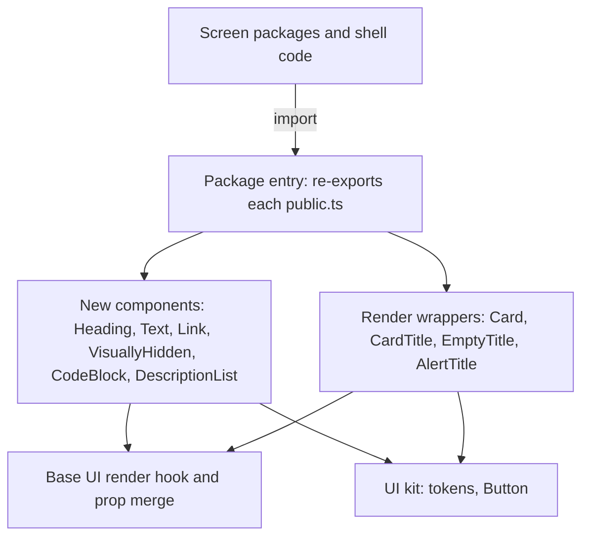
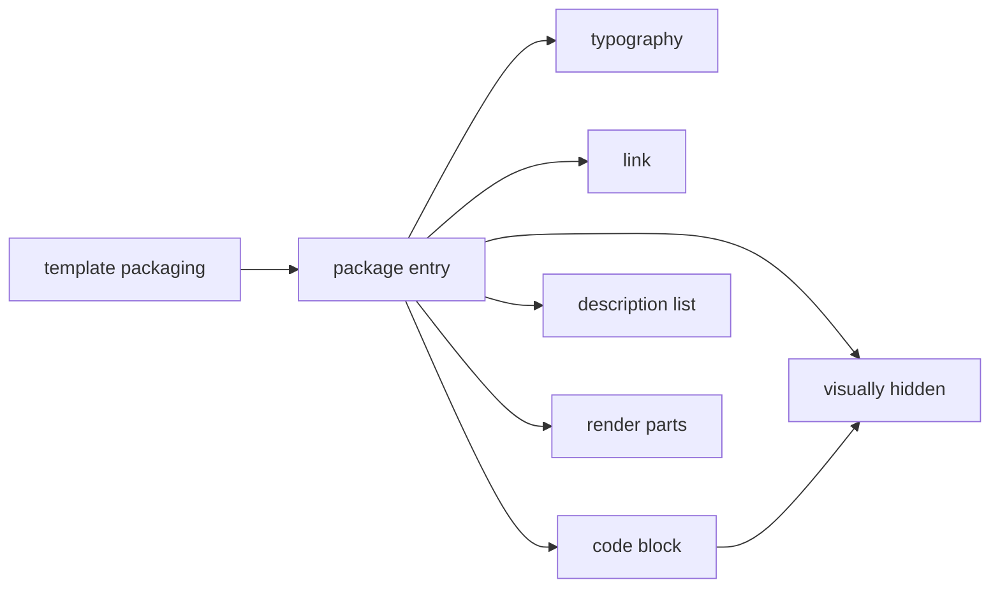
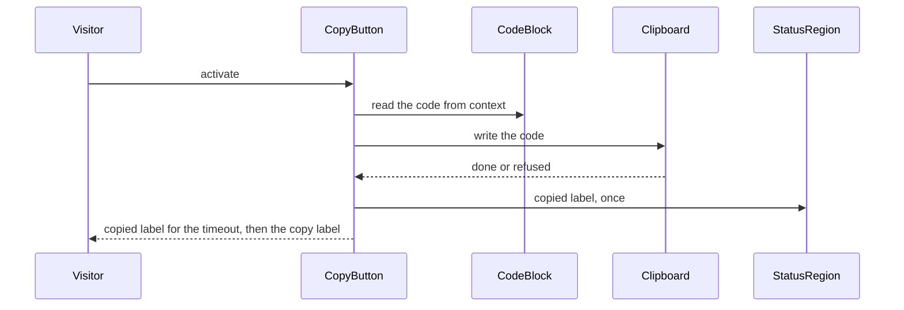
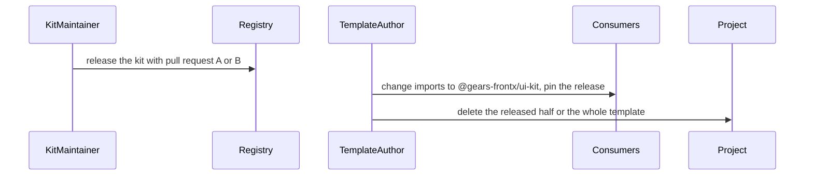

# Technical Design - template-kit-candidates

<!-- toc -->

- [1. Architecture Overview](#1-architecture-overview)
  - [1.1 Architectural Vision](#11-architectural-vision)
  - [1.2 Architecture Drivers](#12-architecture-drivers)
  - [1.3 Architecture Layers](#13-architecture-layers)
- [2. Principles & Constraints](#2-principles--constraints)
  - [2.1 Design Principles](#21-design-principles)
  - [2.2 Constraints](#22-constraints)
- [3. Technical Architecture](#3-technical-architecture)
  - [3.1 Domain Model](#31-domain-model)
  - [3.2 Component Model](#32-component-model)
  - [3.3 API Contracts](#33-api-contracts)
  - [3.4 Internal Dependencies](#34-internal-dependencies)
  - [3.5 External Dependencies](#35-external-dependencies)
  - [3.6 Interactions & Sequences](#36-interactions--sequences)
  - [3.7 Database schemas & tables](#37-database-schemas--tables)
- [4. Additional context](#4-additional-context)
  - [4.1 Package layout](#41-package-layout)
  - [4.2 Checks that hold the design](#42-checks-that-hold-the-design)
- [5. Traceability](#5-traceability)

<!-- /toc -->

- [x] `p3` - **ID**: `cpt-template-kit-candidates-design-template`

template-kit-candidates is a FrontX template of the FrontX site repository: an overlay with one workspace package, `kit-candidates` (`@gears-frontx/kit-candidates`, private, source only), in the shell's workspace root for template-delivered packages, and one AI bundle. The repository composes it into the site with the other templates; the site-level design is in the [root DESIGN](../../architecture/DESIGN.md), and this document covers only the template.

## 1. Architecture Overview

### 1.1 Architectural Vision

The package is a working copy of two proposed kit pull requests. Its shape is the kit's, not the site's: one folder per component with the component, its CSS Module, its card, its contract overlay, its tests and a `public.ts`; cva recipes on kit tokens; element polymorphism through Base UI's render hook, as in the kit's `StatusDot`, `Badge` and `Item`. Moving a component into the kit is then a copy of its folder plus the registration edits the pull request lists, and switching a consumer is an import-specifier change.

New components (`Heading`, `Text`, `Link`, `VisuallyHidden`, `CodeBlock`, `DescriptionList`) are written whole. The four parts that pull request B changes in the kit (`Card`, `CardTitle`, `EmptyTitle`, `AlertTitle`) cannot be changed here, so they are wrappers under the kit's names: they read the class the installed kit part computes and render it on the element the caller chooses, adding only the rules the pull request adds. That keeps the candidates on the installed kit's stylesheet with no copy of it.

### 1.2 Architecture Drivers

**ADRs**: `cpt-template-kit-candidates-adr-mirror-kit-pull-requests` (the candidates mirror kit pull requests A and B exactly and are removed on release). The template follows the site repository's decisions on composition by copy, the template boundary and exact registry pins, cited by link (root [ADR folder](../../architecture/ADR/)).

#### Functional Drivers

| Requirement | Design Response |
|-------------|------------------|
| `cpt-template-kit-candidates-fr-ramp-text` | Heading and Text recipes map each ramp role to a class that reads the role's four tokens; the render hook picks the element (`cpt-template-kit-candidates-component-typography`) |
| `cpt-template-kit-candidates-fr-inline-link` | An anchor recipe that inherits the line's font, three colour variants, a focus outline on the ring token, the render hook for router links, and an `external` branch (`cpt-template-kit-candidates-component-link`) |
| `cpt-template-kit-candidates-fr-visually-hidden` | A span through the render hook with the clipped one-pixel box, and the same rule as the global `sr-only` class (`cpt-template-kit-candidates-component-visually-hidden`) |
| `cpt-template-kit-candidates-fr-code-block` | A frame that provides its code through context, a named focusable `pre` unless wrapping, and a copy button on the kit's `Button` with a timer and a hidden status region (`cpt-template-kit-candidates-component-code-block`) |
| `cpt-template-kit-candidates-fr-description-list` | `dl`/`div`/`dt`/`dd` parts with orientation, size and details recipes; horizontal items on a subgrid (`cpt-template-kit-candidates-component-description-list`) |
| `cpt-template-kit-candidates-fr-render-on-parts` | Wrappers that reuse the kit part's computed class and add an interactive or a title-reset class only with `render` (`cpt-template-kit-candidates-component-render-parts`) |
| `cpt-template-kit-candidates-fr-proposed-api` | One folder per component in the kit's layout; the package entry re-exports each `public.ts` and nothing else (`cpt-template-kit-candidates-principle-proposed-api`) |
| `cpt-template-kit-candidates-fr-self-contained` | The manifest claims the package and the AI bundle and no shared file; the guideline states use and release (`cpt-template-kit-candidates-component-template-packaging`) |

#### NFR Allocation

| NFR ID | NFR Summary | Allocated To | Design Response | Verification Approach |
|--------|-------------|--------------|-----------------|----------------------|
| `cpt-template-kit-candidates-nfr-accessible` | Zero axe violations; visible focus, also in forced colours | every component | Real elements, named regions, hidden decorative icons, a single status announcement; focus rules on the ring tokens with a forced-colours rule | axe-core in every component test; stylesheet assertions in the tests |
| `cpt-template-kit-candidates-nfr-tokens-only` | Kit tokens only; no colour literal; no utility-class framework | every stylesheet | Each rule reads ramp, colour, radius, space, motion and focus tokens | Stylesheet assertions in the tests; the site's own-styles policy |

### 1.3 Architecture Layers

- [x] `p3` - **ID**: `cpt-template-kit-candidates-tech-layers`

| Layer | Responsibility | Technology |
|-------|---------------|------------|
| Presentation | The components and their stylesheets | React 19, CSS Modules on `@gears-frontx/ui-kit` tokens, `lucide-react` icons |
| Composition | Element polymorphism and variant recipes | `@base-ui/react` render hook and prop merge, `class-variance-authority` |
| Integration | Delivery as a workspace package of the shell | npm workspaces under `src-app/verify_packages/*`, source bundled by the consumer's Vite build |
| Infrastructure | Tests and type check | Vitest with jsdom, Testing Library, axe-core, `yaml` for the overlay check, TypeScript |

## 2. Principles & Constraints

### 2.1 Design Principles

#### Equal to the proposed API

- [x] `p1` - **ID**: `cpt-template-kit-candidates-principle-proposed-api`

Each candidate has the names, props, defaults and folder layout its pull request proposes, and nothing more. A need neither pull request covers is a new kit proposal, never a candidate extension. The package entry's export list is pinned by a test.

**ADRs**: `cpt-template-kit-candidates-adr-mirror-kit-pull-requests`

#### The kit's conventions

- [x] `p2` - **ID**: `cpt-template-kit-candidates-principle-kit-conventions`

Components follow the kit's own rules: cva for `size`, `variant`, `tone` and `orientation`; an explicit `null` on an axis resolves to its default; the render hook with no reflected data attributes; tokens only; a card and a contract overlay per component; the client boundary banner on parts that call the render hook.

**ADRs**: `cpt-template-kit-candidates-adr-mirror-kit-pull-requests`

#### Reuse the kit's classes, never copy its stylesheet

- [x] `p2` - **ID**: `cpt-template-kit-candidates-principle-reuse-kit-classes`

A wrapper of a kit part reads the class the installed part computes for the given props and renders it on the caller's element; its own stylesheet holds only what the pull request adds (the interactive card state, the heading reset). A kit upgrade then reaches the wrappers with no edit.

**ADRs**: `cpt-template-kit-candidates-adr-mirror-kit-pull-requests`

### 2.2 Constraints

#### Host prerequisites

- [x] `p2` - **ID**: `cpt-template-kit-candidates-constraint-host-prerequisites`

The package installs, type-checks and tests only inside a project with template-shell applied, in its `src-app/verify_packages/*` workspace root; consumers bundle its source with their own build and load the kit's token stylesheet.

**ADRs**: none.

#### Exact released versions only

- [x] `p2` - **ID**: `cpt-template-kit-candidates-constraint-exact-pins`

The package pins `@gears-frontx/ui-kit` `0.4.0`, `@base-ui/react` and `class-variance-authority` at the kit's versions, `lucide-react` at the kit's own version, and the shared toolchain at the shell's versions, exactly; React is a peer.

**ADRs**: none of this template; the exact registry pins are the site repository's decision (root [ADR folder](../../architecture/ADR/)).

#### Hook-free kit parts

- [x] `p2` - **ID**: `cpt-template-kit-candidates-constraint-hook-free-kit-parts`

The wrappers rest on the pinned kit's `Card`, `CardTitle`, `EmptyTitle` and `AlertTitle` being plain functions that return one element. The tests compare each wrapper's markup without `render` with the kit part's, so a kit release that breaks the assumption fails them.

**ADRs**: `cpt-template-kit-candidates-adr-mirror-kit-pull-requests`

## 3. Technical Architecture

### 3.1 Domain Model

**Technology**: TypeScript, CSS Modules, YAML overlays

**Location**: [package](../src-app/verify_packages/kit-candidates/), [frontx-template.json](../frontx-template.json), [AI bundle](../.frontx/ai/@gears-frontx/frontx-template-kit-candidates/)

**Core Entities**:

| Entity | Description | Schema |
|--------|-------------|--------|
| Template manifest | Name, version and the exclusive subtrees of the overlay | [frontx-template.json](../frontx-template.json) |
| Component folder | One candidate: component, stylesheet, card, overlay, tests, `public.ts` | `src/components/<name>/` |
| Contract overlay | Intent, typical uses, alternatives, invariants, anti-patterns, attestations, examples | `<name>.contract.yaml` |
| Package entry | The export list | `src/index.ts` |
| Utility stylesheet | The global `sr-only` class | `src/utilities.css` |
| AI bundle | The registry of the template's guideline | [extension.json](../.frontx/ai/@gears-frontx/frontx-template-kit-candidates/extension.json) |

**Relationships**:
- Template manifest -> package, AI bundle: claims both as exclusive subtrees
- Package entry -> component folder: re-exports its `public.ts`
- Component folder -> contract overlay: one per exported component family root or changed part

### 3.2 Component Model

#### Typography

- [x] `p1` - **ID**: `cpt-template-kit-candidates-component-typography`

##### Why this component exists

The kit's type ramp has no component that applies it.

##### Responsibility scope

`Heading` (default `h2`, sizes display, heading-1, heading-2, family `--font-heading`) and `Text` (default `p`, variants body, label, meta, mono, micro, tones default and muted). Each recipe class reads the role's size, line height, weight and tracking tokens; margins are zero; the render hook picks the element. Both export their recipe builders.

##### Responsibility boundaries

No spacing, no layout props, no size above display; a brand display size is a brand override of the ramp tokens.

##### Related components (by ID)

- `cpt-template-kit-candidates-component-link` - sits inside Text

#### Link

- [x] `p1` - **ID**: `cpt-template-kit-candidates-component-link`

##### Why this component exists

The kit's link button variant is a control, not a link inside text.

##### Responsibility scope

An anchor that inherits its line's font; variants default (`--link-foreground`), muted (`--muted-foreground`, link colour on hover) and inherit (current colour, always underlined); hover underline; a focus outline on `--ring` at `--border-width-focus`, Highlight in forced colours; the render hook for the application's router link; `external` sets a new-tab target and a safe `rel` unless given and appends an arrow hidden from assistive technology. Exports its recipe builder.

##### Responsibility boundaries

Does no routing; the accessible wording of an external link stays with the caller.

##### Related components (by ID)

- `cpt-template-kit-candidates-component-typography` - is placed inside

#### Visually Hidden

- [x] `p1` - **ID**: `cpt-template-kit-candidates-component-visually-hidden`

##### Why this component exists

The visually hidden rule has no public copy in the kit.

##### Responsibility scope

A span through the render hook carrying the one-pixel clipped box; the global `sr-only` class in the utility stylesheet carries the same declarations.

##### Responsibility boundaries

Does not name kit buttons: an icon-only `Button` takes `icon` and `aria-label`.

##### Related components (by ID)

- `cpt-template-kit-candidates-component-code-block` - announces the copy through it

#### Code Block

- [x] `p1` - **ID**: `cpt-template-kit-candidates-component-code-block`

##### Why this component exists

Commands and file excerpts on screens had no kit frame.

##### Responsibility scope

`CodeBlock` provides its `code` through context, renders the header children and a `pre > code` with the code verbatim; without `wrap` the `pre` is a region named by `label` with a tab stop. `CodeBlockHeader` is the header row; `CodeBlockTitle` its title on the label role, with the render hook. `CodeBlockCopyButton` is a kit ghost `Button` with an icon in its icon slot that writes the code to the clipboard, shows the copied label for `timeout` milliseconds, puts the copied label in a visually hidden status region and calls `onCopy`, or calls `onError` when the clipboard is missing or refuses. Sizes: default (mono on the body size) and sm (the mono role).

##### Responsibility boundaries

No syntax highlighting; `language` is only reflected as data.

##### Related components (by ID)

- `cpt-template-kit-candidates-component-visually-hidden` - renders the status region

#### Description List

- [x] `p1` - **ID**: `cpt-template-kit-candidates-component-description-list`

##### Why this component exists

Name and value pairs had no kit part and were built from `div`s.

##### Responsibility scope

`DescriptionList` (`dl`, orientation vertical or horizontal, size default or sm), `DescriptionItem` (`div`), `DescriptionTerm` (`dt`, label role, muted) and `DescriptionDetails` (`dd`, body or meta role, variant default or mono). Horizontal is a two-column grid sized to the widest term with each item on a subgrid.

##### Responsibility boundaries

No render hook on the parts: the elements are the component.

##### Related components (by ID)

- `cpt-template-kit-candidates-component-typography` - shares the ramp roles

#### Render Parts

- [x] `p1` - **ID**: `cpt-template-kit-candidates-component-render-parts`

##### Why this component exists

The kit's card and title parts always render a `div`, and a card cannot be a link.

##### Responsibility scope

`Card`, `CardTitle`, `EmptyTitle` and `AlertTitle` under the kit's names. Each reads the class the installed kit part computes for its props and renders it through the render hook on the caller's element; with `render`, a card adds an interactive class (no underline or button font, a `--ring` border on hover, the border recolour plus `--ring-inset` ring on keyboard focus, an outline in forced colours, only when the root is a link or a button) and a title adds a zero-specificity reset of the user agent's heading margins and font sizes. Without `render` the markup equals the kit part's.

##### Responsibility boundaries

Every other part of the card, empty and alert families comes from the kit unchanged.

##### Related components (by ID)

- `cpt-template-kit-candidates-component-typography` - Heading is the alternative outside these parts

#### Template Packaging

- [x] `p2` - **ID**: `cpt-template-kit-candidates-component-template-packaging`

##### Why this component exists

A project copies, validates and removes the template as a unit, and agents need the rules in writing.

##### Responsibility scope

The template manifest (`@gears-frontx/frontx-template-kit-candidates`, version `0.1.0-alpha.0`) claims the package and the AI bundle and no shared file. The package entry re-exports each component's `public.ts`. The AI bundle registers one guideline: the components, the rules of use and the release step.

##### Responsibility boundaries

The README is the consumer-facing description and is not part of the bundle.

##### Related components (by ID)

- `cpt-template-kit-candidates-component-typography` - is exported by

### 3.3 API Contracts

- [x] `p2` - **ID**: `cpt-template-kit-candidates-interface-package-surface`

- **Contracts**: `cpt-template-kit-candidates-interface-package-exports`, `cpt-template-kit-candidates-interface-template-overlay`, `cpt-template-kit-candidates-contract-ui-kit`
- **Technology**: TypeScript module, CSS Modules, a global stylesheet, template manifest
- **Location**: [src/index.ts](../src-app/verify_packages/kit-candidates/src/index.ts), [utilities.css](../src-app/verify_packages/kit-candidates/src/utilities.css), [frontx-template.json](../frontx-template.json)

**Endpoints Overview**:

| Method | Path | Description | Stability |
|--------|------|-------------|-----------|
| `module` | `@gears-frontx/kit-candidates` | The components of pull requests A and B and their prop types | experimental |
| `file` | `@gears-frontx/kit-candidates/utilities.css` | The `sr-only` class | experimental |
| `file` | `frontx-template.json` | Overlay manifest with two exclusive subtrees | unstable |

### 3.4 Internal Dependencies

| Dependency Module | Interface Used | Purpose |
|-------------------|----------------|----------|
| template-shell (in the project) | the `src-app/verify_packages/*` workspace root | Install, type check and tests |
| `@gears-frontx/ui-kit` | tokens, `Button`, `Card`, `CardTitle`, `EmptyTitle`, `AlertTitle` | Styling, the copy button, the wrapped parts |
| `@base-ui/react` | `useRender`, `mergeProps` | Element polymorphism |

**Dependency Rules**:
- The package imports nothing outside its own directory except its declared dependencies
- No circular dependencies between component folders; the code block uses the visually hidden part

### 3.5 External Dependencies

#### npm registry

| Dependency Module | Interface Used | Purpose |
|-------------------|---------------|---------|
| `@gears-frontx/ui-kit`, `@base-ui/react`, `class-variance-authority`, `lucide-react`, `react` | npm install at exact versions | Runtime of the components |
| `vitest`, `jsdom`, `@testing-library/react`, `axe-core`, `yaml`, `typescript` | npm install at exact versions | Tests and type check |

### 3.6 Interactions & Sequences

#### Copy the code of a code block

**ID**: `cpt-template-kit-candidates-seq-copy-code`

**Use cases**: `cpt-template-kit-candidates-usecase-build-screen`

**Actors**: `cpt-template-kit-candidates-actor-visitor`

**Description**: A successful write confirms visually and through a single announcement; a refusal is reported to the caller and changes nothing.

#### Switch to the kit release

**ID**: `cpt-template-kit-candidates-seq-release`

**Use cases**: `cpt-template-kit-candidates-usecase-release`

**Actors**: `cpt-template-kit-candidates-actor-kit-maintainer`, `cpt-template-kit-candidates-actor-template-author`

**Description**: Because the API is equal, the switch changes import specifiers and pins only.

### 3.7 Database schemas & tables

Not applicable: the template has no database and no server process.

## 4. Additional context

### 4.1 Package layout

| Path (under `src-app/verify_packages/kit-candidates/`) | Component |
|---|---|
| `src/components/heading/`, `src/components/text/` | typography |
| `src/components/link/` | link |
| `src/components/visually-hidden/`, `src/utilities.css` | visually hidden |
| `src/components/code-block/` | code block |
| `src/components/description-list/` | description list |
| `src/components/card/`, `src/components/empty/`, `src/components/alert/`, `src/kit-parts/` | render parts |
| `src/index.ts`, `package.json` | template packaging |
| `src/test-support/` | test helpers (axe run, overlay check, cleanup) |
| `vitest.config.ts`, `tsconfig.json`, `src/vite-env.d.ts` | test and type configuration |

The template manifest and the AI bundle (`.frontx/ai/@gears-frontx/frontx-template-kit-candidates/`) sit at the template root.

### 4.2 Checks that hold the design

- Each component's test: elements, classes per axis value, null resolution, render, behaviour, stylesheet token rules and an axe run.
- Each overlay's test: component name, intent, typical uses, alternatives that name real kit or candidate components, invariants, examples, no machine-extracted fact.
- The package surface test pins the export list; the wrapper tests compare markup with the kit parts'.
- In the site repository: the template shape check, the composition drift check, the pin policy, and the own-styles and text policies (root [DESIGN](../../architecture/DESIGN.md)).

## 5. Traceability

- **PRD**: [PRD.md](./PRD.md)
- **ADRs**: [ADR/](./ADR/); root decisions in [../../architecture/ADR/](../../architecture/ADR/)
- **Features**: [features/](./features/)
