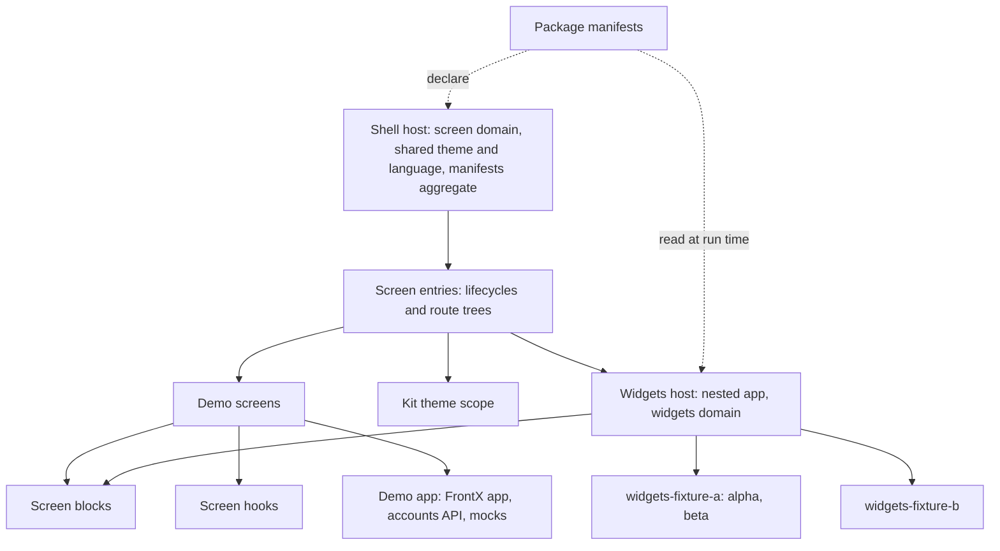
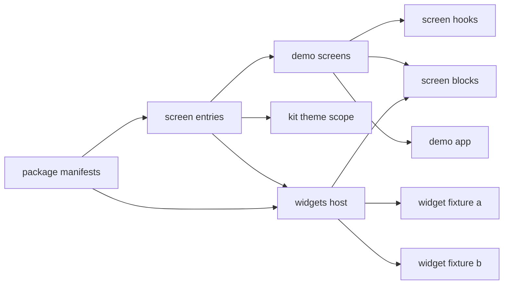
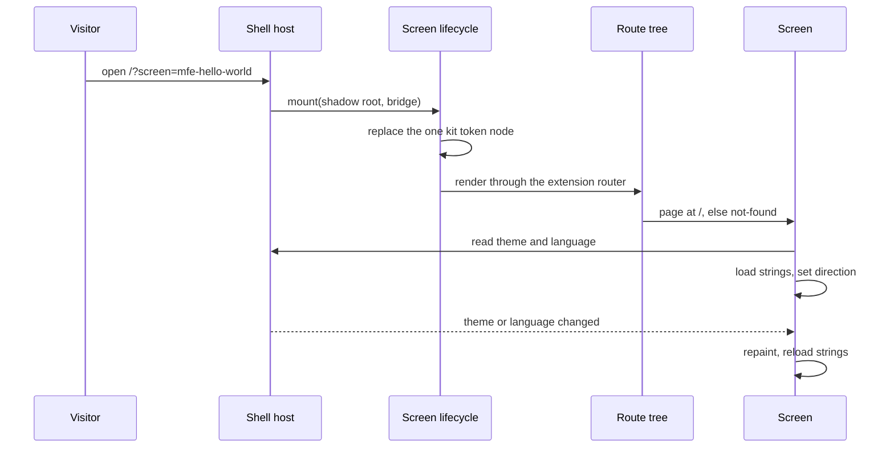
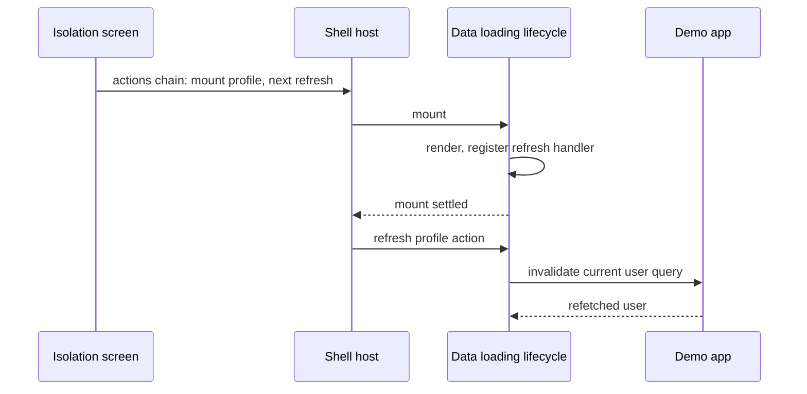
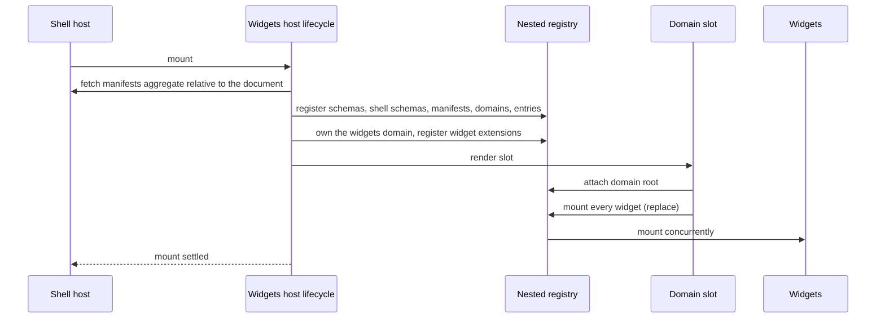
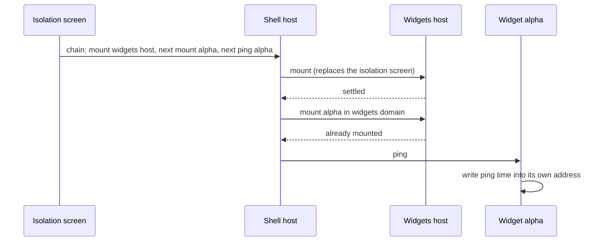

# Technical Design - template-mfe-demo

<!-- toc -->

- [1. Architecture Overview](#1-architecture-overview)
  - [1.1 Architectural Vision](#11-architectural-vision)
  - [1.2 Architecture Drivers](#12-architecture-drivers)
  - [1.3 Architecture Layers](#13-architecture-layers)
- [2. Principles & Constraints](#2-principles--constraints)
  - [2.1 Design Principles](#21-design-principles)
  - [2.2 Constraints](#22-constraints)
- [3. Technical Architecture](#3-technical-architecture)
  - [3.1 Domain Model](#31-domain-model)
  - [3.2 Component Model](#32-component-model)
  - [3.3 API Contracts](#33-api-contracts)
  - [3.4 Internal Dependencies](#34-internal-dependencies)
  - [3.5 External Dependencies](#35-external-dependencies)
  - [3.6 Interactions & Sequences](#36-interactions--sequences)
  - [3.7 Database schemas & tables](#37-database-schemas--tables)
- [4. Additional context](#4-additional-context)
  - [4.1 Screens and widgets](#41-screens-and-widgets)
  - [4.2 Relation to the site](#42-relation-to-the-site)
- [5. Traceability](#5-traceability)

<!-- /toc -->

- [x] `p3` - **ID**: `cpt-template-mfe-demo-design-template`

template-mfe-demo is a FrontX template of three MFE packages and an AI bundle: `demo-mfe` with four screen entries, and `widgets-fixture-a` and `widgets-fixture-b` with the widgets the fifth screen mounts. It is applied onto a project with template-shell, as an overlay that contributes only its own directories. The packages are an adapted copy of template-mfe's demo packages at gears-frontx-templates commit `3b6cddb`; the template's README lists every adapted file with its reason.

## 1. Architecture Overview

### 1.1 Architectural Vision

Each package is a Module Federation remote that the shell loads at run time, and each loaded runtime builds exactly one FrontX app of its own: its own state, event bus and API registry, joined to the page only through the shell's shared properties, the actions the runtime delivers, and the query cache the host owns. A screen is an entry: an exposed lifecycle that the shell mounts into a Shadow DOM in its screen domain, and that renders the screen's route tree through the framework's extension router over its app's registry. The isolation, data loading and shared state mechanics are each one screen of `demo-mfe`, and the nested widgets screen builds a second, nested FrontX app that owns the `widgets` extension domain and mounts the widget packages' extensions concurrently into it. Every screen and widget is drawn from the FrontX UI kit, the kit candidates and the package's own blocks; no screen carries a stylesheet.

Everything the runtime knows about the packages is declared in their manifests (`mfe.json`): the schemas of the actions, the remote's manifest, the `widgets` domain, the entries, the screen and widget extensions with their routes, menu placement and page metadata. The shell's build turns those declarations into registered entities and publishes their aggregate next to its document; the nested app reads that aggregate at run time and registers the entities unchanged. No package defines an entity in code, and no package imports from another.

Two decisions shape the template: it is an adapted copy that keeps template-mfe's names and identifiers (`cpt-template-mfe-demo-adr-adapted-copy-under-upstream-identity`), and every screen carries the kit's tokens in its own shadow root while the widgets inherit them from the nested widgets screen (`cpt-template-mfe-demo-adr-kit-tokens-in-shadow-root`). How the site composes the template, the site's deep-link action, its deploy layout and its metadata pipeline are the site's decisions, recorded in the site's own tree: [DESIGN.md](../../architecture/DESIGN.md).

### 1.2 Architecture Drivers

**ADRs**: `cpt-template-mfe-demo-adr-adapted-copy-under-upstream-identity`, `cpt-template-mfe-demo-adr-kit-tokens-in-shadow-root`

#### Functional Drivers

| Requirement | Design Response |
|-------------|------------------|
| `cpt-template-mfe-demo-fr-demo-screens` | Four screen extensions of the shell's screen extension type in `demo-mfe`'s manifest, each with a route token, a menu label, order and the id of the host's demos nav group (package manifests component) |
| `cpt-template-mfe-demo-fr-not-found` | Every screen entry renders a one-page route tree with a not-found page; the nested widgets screen's not-found page settles its mount (screen entries and widgets host components) |
| `cpt-template-mfe-demo-fr-isolation-screen` | The isolation screen reads the theme and language through the bridge hooks and shows the bridge's domain and instance (demo screens, screen hooks) |
| `cpt-template-mfe-demo-fr-screen-translations` | A translations hook loads each screen's strings per language with an English fallback, and applies only the latest load; a direction hook sets the shadow host's direction (screen hooks) |
| `cpt-template-mfe-demo-fr-cross-screen-actions` | The isolation screen sends actions chains with `next` continuations through its bridge; the targets register their handlers before their mount settles (demo screens, screen entries) |
| `cpt-template-mfe-demo-fr-data-loading-screen` | The accounts API service with mocks; the data loading screen's cached query and optimistic mutation with rollback and refetch; the refresh handler registered on mount (demo app, demo screens, screen entries) |
| `cpt-template-mfe-demo-fr-shared-state-screen` | The shared state screen paints swatches with the token names its screen frame scopes to the shell's theme, so they show the palette the page's kit components are drawn in (demo screens, screen blocks, kit theme scope) |
| `cpt-template-mfe-demo-fr-kit-built-screens` | Screens compose the package's blocks, kit components and kit candidates and import no stylesheet; each block lays its parts out on the kit's tokens and records any other declaration in the package's exemptions ledger; every screen entry carries the kit's tokens (screen blocks, kit theme scope) |
| `cpt-template-mfe-demo-fr-nested-widgets` | The widgets host builds a nested app, registers the published manifests' entities, owns the `widgets` domain with concurrent mounting and mounts every widget extension when its slot attaches (widgets host) |
| `cpt-template-mfe-demo-fr-widget-instances` | widgets-fixture-a's one entry backs two extensions, each loaded as its own module copy, with a ping handler that writes the ping time into the instance's own address; widgets-fixture-b mounts next to them (widget fixture components) |
| `cpt-template-mfe-demo-fr-screen-metadata` | A `seo` block on each screen extension; each package's manifest test holds it to the route tree (package manifests) |
| `cpt-template-mfe-demo-fr-self-contained-overlay` | The template manifest's exclusive subtrees, per-package dependencies and test setup, and no import across package directories (package manifests, all packages) |

#### NFR Allocation

| NFR ID | NFR Summary | Allocated To | Design Response | Verification Approach |
|--------|-------------|--------------|-----------------|----------------------|
| `cpt-template-mfe-demo-nfr-runtime-isolation` | No state shared between packages; one kit token node per shadow root | Demo app, widgets host, widget fixtures, kit theme scope | One app per loaded runtime, built at module level; the kit-themed lifecycle base replaces its one style node on every mount | Lifecycle tests count the kit style nodes after remounts; widget tests check one app per module copy reused across remounts and a separate root per container |
| `cpt-template-mfe-demo-nfr-mount-independence` | Widgets mount under any mount path | Widgets host | The manifests aggregate is resolved against the shell document's base address, never against the remote's own build base | A widgets host test with a document base under a sub-path checks the fetched address; the site's built preview at a sub-path |
| `cpt-template-mfe-demo-nfr-cache-continuity` | Loading a package does not clear the page's cached data | Demo app, widgets host, widget fixtures | Every app adds the mocks before it joins the shared query cache | The demo app's init test (`demo-mfe/src/init.test.ts`) holds the order of the package app; the hosting repository's checks hold it for every app builder |
| `cpt-template-mfe-demo-nfr-accessible-screens` | No duplicate landmarks, named controls and regions, announced loading | Demo screens, screen blocks | Screens add no landmark; every card title, page title and not-found title is a real heading; form controls are labelled; loading frames and cards are busy status regions | Screen tests query by role and name; each block's test runs axe on its showcase fixture |

### 1.3 Architecture Layers

- [x] `p3` - **ID**: `cpt-template-mfe-demo-tech-mfe-runtime`

| Layer | Responsibility | Technology |
|-------|---------------|------------|
| Declarations | Schemas, remote manifest, domain, entries, extensions, routes, placement, page metadata | `mfe.json` per package, GTS identifiers, JSON Schema |
| Lifecycle | Mounting into Shadow DOM, theme awareness, action handler registration, route tree rendering | FrontX react lifecycles, extension router, routing-tanstack route trees |
| Presentation | Screen and widget pages, the package's blocks | React 19, FrontX UI kit, the kit candidates, CSS Modules in blocks only |
| Application | Per-runtime app, cached queries, mutations, actions chains, nested domain ownership | FrontX app builder with effects, mocks, shared query cache and microfrontends plugins |
| Infrastructure | Remote build and loading | Vite, Module Federation with the shell's build plugin; shared dependencies externalized and supplied by the host |

## 2. Principles & Constraints

### 2.1 Design Principles

#### One FrontX app per loaded runtime

- [x] `p1` - **ID**: `cpt-template-mfe-demo-principle-one-app-per-runtime`

Each loaded copy of a package builds exactly one FrontX app, at module level, and every mount of that copy reuses it; a widget entry registered as two extensions is loaded twice, so each instance has its own app. A runtime touches the page only through shared properties, actions and the host's query cache.

#### Entities are declared, never built in code

- [x] `p1` - **ID**: `cpt-template-mfe-demo-principle-declared-entities`

Every GTS entity (schema, manifest, domain, entry, extension) is authored in a package manifest and reaches a registry unchanged, through the shell's build or the published aggregate; code refers to entities by identifier and never constructs, spreads or overrides one.

#### Handlers are in place before a mount settles

- [x] `p1` - **ID**: `cpt-template-mfe-demo-principle-handlers-before-settle`

A lifecycle registers its action handlers, and the nested app takes ownership of its domain and attaches it, before the lifecycle's `mount()` settles, because the runtime delivers a chain's next step as soon as the mount settles.

#### The upstream identity is kept

- [x] `p2` - **ID**: `cpt-template-mfe-demo-principle-upstream-identity`

Package names, directories and identifiers stay template-mfe's, the screen extension identifiers included; every other difference is an adaptation the site needs, recorded with its reason.

**ADRs**: `cpt-template-mfe-demo-adr-adapted-copy-under-upstream-identity`

#### Each screen carries the tokens it renders with

- [x] `p2` - **ID**: `cpt-template-mfe-demo-principle-kit-tokens-in-shadow-root`

Every screen carries the kit's tokens in its own shadow root and, when it receives the shell's theme, selects the kit's light or dark scope from it; a screen without the theme takes the scope its shadow host carries, and a widget reads the tokens of the screen that hosts it.

**ADRs**: `cpt-template-mfe-demo-adr-kit-tokens-in-shadow-root`

### 2.2 Constraints

#### template-shell is applied first

- [x] `p1` - **ID**: `cpt-template-mfe-demo-constraint-shell-prerequisite`

The packages build and run only in a project with template-shell and template-kit-candidates applied: the shell supplies the host, the screen domain, the shared property schemas the nested app registers, the mock plugin the API service uses, the build plugin and the test base; template-kit-candidates supplies the kit candidates the screens and blocks are built from.

#### Exclusive with template-mfe's demo packages

- [x] `p1` - **ID**: `cpt-template-mfe-demo-constraint-exclusive-with-upstream-demo`

The template claims the directories and package names of template-mfe's `demo-mfe`, `widgets-fixture-a` and `widgets-fixture-b`; a project carries either these or template-mfe's, never both.

**ADRs**: `cpt-template-mfe-demo-adr-adapted-copy-under-upstream-identity`

#### Shared dependencies come from the host

- [x] `p1` - **ID**: `cpt-template-mfe-demo-constraint-shared-dependencies`

Every package externalizes the same shared set (React, the FrontX packages, both routing packages, the query and state libraries) for the host to supply at run time, so that the extension router and each route tree use one router copy and one router context.

#### Exact pins equal to the site's installs

- [x] `p2` - **ID**: `cpt-template-mfe-demo-constraint-exact-pins`

Every dependency is pinned to the exact version the site installs, including the UI kit and both routing packages.

#### CSS Modules in blocks only

- [x] `p2` - **ID**: `cpt-template-mfe-demo-constraint-css-modules`

Only the package's blocks carry stylesheets, as CSS Modules laying their parts out on the kit's tokens; a declaration that is not layout on a token is a row of the blocks' exemptions ledger with the kit gap it waits for. Screens, pages and widgets import no stylesheet and pass no inline style; no utility class framework, no `@apply`. Because the screen entries share blocks, the federation build attributes the package's whole CSS to every expose.

#### The manifests aggregate is read relative to the document

- [x] `p1` - **ID**: `cpt-template-mfe-demo-constraint-document-relative-aggregate`

The nested app reads the shell's published manifests aggregate relative to the shell's document, because a remote cannot know the shell's base and its own build base names the remote's folder.

#### Mocks before the shared query cache

- [x] `p1` - **ID**: `cpt-template-mfe-demo-constraint-mocks-before-shared-cache`

Every app adds the mock plugin before it joins the host's shared query cache: the shared cache clears the page's whole cache on every mock toggle it hears, and the mock plugin announces its initial state with one, so the reverse order wipes the page's cached data the first time a package loads.

## 3. Technical Architecture

### 3.1 Domain Model

**Technology**: GTS identifiers and JSON Schema in package manifests; TypeScript types for the accounts API.

**Location**: [demo-mfe/mfe.json](../src-app/mfe_packages/demo-mfe/mfe.json), [widgets-fixture-a/mfe.json](../src-app/mfe_packages/widgets-fixture-a/mfe.json), [widgets-fixture-b/mfe.json](../src-app/mfe_packages/widgets-fixture-b/mfe.json), [api/types.ts](../src-app/mfe_packages/demo-mfe/src/api/types.ts)

**Core Entities**:

| Entity | Description | Schema |
|--------|-------------|--------|
| Remote manifest | One per package: identifier and remote entry address | [demo-mfe/mfe.json](../src-app/mfe_packages/demo-mfe/mfe.json) |
| Entry | An exposed lifecycle module with the shared properties it requires and the actions it handles | package manifests |
| Screen extension | An extension of the shell's screen extension type in the shell's screen domain: route token, presentation (label, icon, order, group), page metadata | [demo-mfe/mfe.json](../src-app/mfe_packages/demo-mfe/mfe.json) |
| Widgets domain | The `widgets` extension domain: route key `widgets`, load, mount and unmount actions, lifecycle stages, default action timeout | [demo-mfe/mfe.json](../src-app/mfe_packages/demo-mfe/mfe.json) |
| Widget extension | An extension in the widgets domain with its own route; alpha and beta share one entry | [widgets-fixture-a/mfe.json](../src-app/mfe_packages/widgets-fixture-a/mfe.json), [widgets-fixture-b/mfe.json](../src-app/mfe_packages/widgets-fixture-b/mfe.json) |
| Refresh profile action | A closed action type targeted at the data loading screen, no payload fields | [demo-mfe/mfe.json](../src-app/mfe_packages/demo-mfe/mfe.json) |
| Widget ping action | A closed action type a widget instance handles | [widgets-fixture-a/mfe.json](../src-app/mfe_packages/widgets-fixture-a/mfe.json) |
| Demos nav group | The host's instance of the shell's nav group type (`gts.frontx.screensets.layout.nav_group.v1~frontx.site.layout.demos.v1`) the screens name in `presentation.group`; the site host defines it on the shell's `nav_group.v1.json` type, and the package mirrors its id as `DEMOS_NAV_GROUP_ID` | [navGroups.ts](../../site/src-app/app/layout/navGroups.ts), [extension-ids.ts](../src-app/mfe_packages/demo-mfe/src/shared/extension-ids.ts) |
| User | The accounts API's current user: names, email, role, language, avatar, timestamps, department | [api/types.ts](../src-app/mfe_packages/demo-mfe/src/api/types.ts) |

**Relationships**:
- Entry -> Remote manifest: each entry names its package's manifest.
- Screen extension -> Entry: each screen is mounted from one entry; widget extensions alpha and beta share one entry.
- Widget extension -> Widgets domain: every widget extension targets the domain `demo-mfe` declares.
- Refresh profile action -> Screen extension: the action's target is the data loading screen.
- Screen extension -> Demos nav group: each screen's `presentation.group` is the group's id.

### 3.2 Component Model

#### Package manifests

- [x] `p1` - **ID**: `cpt-template-mfe-demo-component-package-manifests`

##### Why this component exists

The runtime and the shell learn everything about the packages from declarations; this component is those declarations and the template's own manifest.

##### Responsibility scope

The three `mfe.json` files: the refresh and ping action schemas, the remote manifests, the `widgets` domain, the entries, the four screen extensions with route token, presentation and page metadata, and the three widget extensions with their routes. The template manifest with its exclusive subtrees, and the AI bundle's contract guideline.

##### Responsibility boundaries

Declares and never executes; the remote entry addresses are the local preview ports, and the site's production build places each remote in a folder of its own and points the published aggregate at it. Page metadata is declared here and generated into pages by the site.

##### Related components (by ID)

- `cpt-template-mfe-demo-component-screen-entries` - declares the entries and exposed modules of
- `cpt-template-mfe-demo-component-widgets-host` - declares the domain owned by

#### Demo app

- [x] `p1` - **ID**: `cpt-template-mfe-demo-component-demo-app`

##### Why this component exists

`demo-mfe`'s screens need one FrontX app of their own, with an API service and mocks, joined to the host's query cache.

##### Responsibility scope

The package app built once with effects, mocks, the shared query cache and the microfrontends plugin (whose registry each screen's router is built from); the accounts API service with the current user query and the profile mutation; the mock map and the in-browser mock user store; the refresh function that invalidates the current user query.

##### Responsibility boundaries

Owns no screen and no route; does not own the query cache, which the host owns; holds no real backend address.

##### Related components (by ID)

- `cpt-template-mfe-demo-component-demo-screens` - provides data and services to
- `cpt-template-mfe-demo-component-screen-entries` - provides the app and registry to

#### Screen entries

- [x] `p1` - **ID**: `cpt-template-mfe-demo-component-screen-entries`

##### Why this component exists

The shell mounts entries, not React components; each screen needs a lifecycle that mounts into Shadow DOM, renders its route tree and registers its handlers.

##### Responsibility scope

The four exposed lifecycles, each on the kit-themed lifecycle base; the one-page route tree per screen entry with its not-found page (a kit `Empty` with a level-one title); the provider that hands the mounted bridge to route components; the data loading screen's refresh handler, registered after the first render and before `mount()` returns.

##### Responsibility boundaries

Renders no screen content of its own beyond the not-found page; the nested widgets entry's runtime is the widgets host component.

##### Related components (by ID)

- `cpt-template-mfe-demo-component-demo-screens` - renders
- `cpt-template-mfe-demo-component-kit-theme-scope` - extends, for every screen
- `cpt-template-mfe-demo-component-widgets-host` - contains

#### Kit theme scope

- [x] `p2` - **ID**: `cpt-template-mfe-demo-component-kit-theme-scope`

##### Why this component exists

Kit components inside a shadow root resolve no token the kit declares on `:root`.

##### Responsibility scope

The kit-themed lifecycle base that keeps one style node of the kit's tokens in the shadow root; the textual rewrite of the kit's `:root` selectors to the shadow host; the mapping from the shell's theme to the kit's light or dark scope.

##### Responsibility boundaries

Used by every screen entry; the widget packages do not use it and inherit the tokens of the nested widgets screen that hosts them. Does not change the shell's document.

##### Related components (by ID)

- `cpt-template-mfe-demo-component-screen-entries` - is the lifecycle base of every one of
- `cpt-template-mfe-demo-component-demo-screens` - supplies the theme scope to

#### Screen blocks

- [x] `p2` - **ID**: `cpt-template-mfe-demo-component-screen-blocks`

##### Why this component exists

Screens and pages carry no stylesheet; the arrangements they repeat (the screen's frame and header, the bridge information card, a row of actions, a reading column, loading placeholders, the palette swatches, a token list, the widget slot) need one owner that lays kit parts out.

##### Responsibility scope

The blocks under `demo-mfe/src/blocks/`: ScreenFrame (the screen's column and its kit theme scope), PageHeader, BridgeInfoCard, ActionRow, ReadingColumn, ScreenSkeleton, SkeletonCard, SwatchGrid, TokenList and WidgetSlot. Each is built from kit components and kit candidates, takes content and behaviour props only, and lays its parts out on the kit's tokens; each has a card, a showcase fixture and a test with an accessibility check. The exemptions ledger lists every declaration that is not layout on a token, with its kit gap.

##### Responsibility boundaries

Holds no screen state, reads no bridge and loads no data; a different arrangement is a different block, never a variant prop.

##### Related components (by ID)

- `cpt-template-mfe-demo-component-demo-screens` - is composed by
- `cpt-template-mfe-demo-component-widgets-host` - is composed by
- `cpt-template-mfe-demo-component-kit-theme-scope` - maps the theme through

#### Screen hooks

- [x] `p2` - **ID**: `cpt-template-mfe-demo-component-screen-hooks`

##### Why this component exists

Every screen follows the shell's theme and language and loads its own strings; the logic is shared inside the package.

##### Responsibility scope

A hook returning the live value of a shared property with a fallback; a translations hook that loads a language's strings, falls back to English, numbers its loads and applies only the latest while mounted; a hook that sets the shadow host's direction for right-to-left languages.

##### Responsibility boundaries

Internal to `demo-mfe`; validates no property value (the type system does).

##### Related components (by ID)

- `cpt-template-mfe-demo-component-demo-screens` - is used by

#### Demo screens

- [x] `p1` - **ID**: `cpt-template-mfe-demo-component-demo-screens`

##### Why this component exists

Each mechanic needs a page that shows it.

##### Responsibility scope

The isolation screen (bridge information, the three actions chains), the data loading screen (query states, profile card with trimmed, null-safe values, optimistic edit with rollback), the shared state screen (theme name and seven swatches with token captions); each composed of the screen blocks, kit components and kit candidates, with its translations and no stylesheet.

##### Responsibility boundaries

Contains no lifecycle and no route; the nested widgets page belongs to the widgets host.

##### Related components (by ID)

- `cpt-template-mfe-demo-component-screen-hooks` - uses
- `cpt-template-mfe-demo-component-screen-blocks` - is composed of
- `cpt-template-mfe-demo-component-demo-app` - reads and writes data through

#### Widgets host

- [x] `p1` - **ID**: `cpt-template-mfe-demo-component-widgets-host`

##### Why this component exists

The nested domains mechanic needs a screen that is itself a host.

##### Responsibility scope

A nested FrontX app with the Module Federation handler; the bootstrap that reads the published manifests aggregate relative to the shell's document, registers every package's schemas first, then the shell's theme, language and screen extension schemas, then manifests, domains and entries, then the screen domain declaration, takes ownership of the `widgets` domain with a concurrent mount strategy, and registers every extension (admitting the widgets-domain ones) without repeating a registration on remount; the page, on the kit-themed lifecycle base and composed of the screen blocks and kit parts, with a labelled spinner while it starts and an alert when it fails, one ping button per widget whose entry handles the ping action, and the domain slot whose attach mounts every widget with the replace history intent; a `mount()` that settles only after the domain is owned and attached; a route tree whose not-found page settles the mount.

##### Responsibility boundaries

Does not own the screen domain; registers the screen domain's declaration only to resolve references. Builds no address handling of its own: the nested app's router reflects the domain's settled mounts into the address.

##### Related components (by ID)

- `cpt-template-mfe-demo-component-widget-fixture-a` - mounts
- `cpt-template-mfe-demo-component-widget-fixture-b` - mounts
- `cpt-template-mfe-demo-component-screen-blocks` - is composed of
- `cpt-template-mfe-demo-component-package-manifests` - reads at run time

#### Widget fixture A

- [x] `p2` - **ID**: `cpt-template-mfe-demo-component-widget-fixture-a`

##### Why this component exists

Several instances of one entry, per-instance routing state and upward delivery each need a widget that shows them.

##### Responsibility scope

`widgets-fixture-a`: one entry backing the alpha and beta extensions; a per-instance random value as the witness of separate module evaluation; one app per loaded copy; a separate React root per container; the ping handler, registered before `mount()` returns, that rejects pings while the instance is not mounted and writes the ping time into the instance's own address; a route tree with the instance page and a not-found page; the button that asks the shell's screen domain to mount the isolation screen; the instance drawn as a kit item with an outline.

##### Responsibility boundaries

Does not know the widgets host; reaches the shell only through actions.

##### Related components (by ID)

- `cpt-template-mfe-demo-component-widgets-host` - is mounted by

#### Widget fixture B

- [x] `p3` - **ID**: `cpt-template-mfe-demo-component-widget-fixture-b`

##### Why this component exists

Concurrent mounting needs a second package in the same domain.

##### Responsibility scope

`widgets-fixture-b`: one widget with its own app that renders a labelled kit item on the muted surface and logs its mount.

##### Responsibility boundaries

No route tree, no action handler, no page metadata.

##### Related components (by ID)

- `cpt-template-mfe-demo-component-widgets-host` - is mounted by

### 3.3 API Contracts

The template exposes no network API. Its contracts are FrontX protocol surfaces declared in the package manifests and the address grammar the shell writes.

- **Contracts**: `cpt-template-mfe-demo-interface-screen-addresses`, `cpt-template-mfe-demo-interface-refresh-profile-action`, `cpt-template-mfe-demo-interface-widgets-domain`, `cpt-template-mfe-demo-contract-shell-host`, `cpt-template-mfe-demo-contract-manifest-aggregate`, `cpt-template-mfe-demo-contract-demos-nav-group`
- **Technology**: FrontX actions, extension domains and shared properties; GTS and JSON Schema; the FrontX URL grammar
- **Location**: [demo-mfe/mfe.json](../src-app/mfe_packages/demo-mfe/mfe.json), [widgets-fixture-a/mfe.json](../src-app/mfe_packages/widgets-fixture-a/mfe.json), [widgets-fixture-b/mfe.json](../src-app/mfe_packages/widgets-fixture-b/mfe.json)

| Contract | Direction | Surface | Stability |
|----------|-----------|---------|-----------|
| `cpt-template-mfe-demo-interface-screen-addresses` | provided | Screen tokens `mfe-hello-world`, `mfe-profile`, `mfe-theme`, `mfe-widgets`; the nested widgets screen's address adds `widgets` entries such as `widget-alpha` | stable |
| `cpt-template-mfe-demo-interface-refresh-profile-action` | provided | The refresh profile action type, targeted at the data loading screen, with an empty closed payload | stable |
| `cpt-template-mfe-demo-interface-widgets-domain` | provided | The `widgets` domain: load, mount and unmount actions, route key `widgets`, a 5000 ms default action timeout; a widget entry may declare the ping action | unstable |
| `cpt-template-mfe-demo-contract-shell-host` | required | The screen domain and its mount action, the shared theme and language properties, the shell package's shared property and screen extension schemas and mock plugin, the build plugin, the test base | per shell pin |
| `cpt-template-mfe-demo-contract-manifest-aggregate` | required | The JSON array of package manifests (schemas, manifest, domains, entries, extensions) next to the shell's document | per shell pin |
| `cpt-template-mfe-demo-contract-demos-nav-group` | required | The host's demos nav group, an instance of the shell's nav group type, named by its id (`gts.frontx.screensets.layout.nav_group.v1~frontx.site.layout.demos.v1`) in each screen's `presentation.group` | follows the site's host |

### 3.4 Internal Dependencies

| Dependency Module | Interface Used | Purpose |
|-------------------|----------------|----------|
| demo-mfe -> widgets-fixture-a, widgets-fixture-b | The `widgets` domain and the published manifests aggregate, at run time | The nested widgets screen mounts them; no import |
| widgets-fixture-a -> demo-mfe | The isolation screen's extension identifier, through an action to the shell's screen domain | Upward delivery; no import |

**Dependency Rules**:
- No package imports from another; packages meet only through declared identifiers and actions.
- No circular dependencies at build time; each package builds and tests on its own.

### 3.5 External Dependencies

#### template-shell

| Dependency Module | Interface Used | Purpose |
|-------------------|---------------|---------|
| `@gears-frontx/frontx-template-shell` | Shared property and screen extension schemas, REST mock plugin, build plugin, test base | Host integration, nested app registration, API mocks, remote build, tests |

#### template-kit-candidates

| Dependency Module | Interface Used | Purpose |
|-------------------|---------------|---------|
| `@gears-frontx/kit-candidates` | `Heading`, `Text`, `DescriptionList` parts, `Card`, `CardTitle` and `EmptyTitle` with `render` | Page and card titles as real headings, muted text, label and value pairs, until the kit releases them |

#### FrontX ecosystem packages

| Dependency Module | Interface Used | Purpose |
|-------------------|---------------|---------|
| `@gears-frontx/react` | App builder and plugins, lifecycles, bridge, actions, extension domain classes and slot, extension router, API services, query hooks | Every runtime and screen |
| `@gears-frontx/routing`, `@gears-frontx/routing-tanstack` | Route tree, router hooks | Route trees inside screens and widgets |
| `@gears-frontx/ui-kit` | Components and theme stylesheet | Every screen and widget |

#### npm registry

| Dependency Module | Interface Used | Purpose |
|-------------------|---------------|---------|
| React, TanStack Query, Vite, Module Federation plugin, Vitest | Published packages at exact versions | Rendering, caching, build, tests |

### 3.6 Interactions & Sequences

#### Mount a screen

**ID**: `cpt-template-mfe-demo-seq-mount-screen`

**Use cases**: `cpt-template-mfe-demo-usecase-explore-isolation`

**Actors**: `cpt-template-mfe-demo-actor-visitor`, `cpt-template-mfe-demo-actor-shell-host`

**Description**: The shell mounts the entry into its shadow root; the lifecycle carries the kit's tokens, renders the route tree and the screen follows the shared properties.

#### Open the profile and refresh it

**ID**: `cpt-template-mfe-demo-seq-open-and-refresh`

**Use cases**: `cpt-template-mfe-demo-usecase-edit-profile`

**Actors**: `cpt-template-mfe-demo-actor-visitor`

**Description**: One chain opens the data loading screen and, once its mount settles with the handler in place, delivers the refresh.

#### Start the nested widgets runtime

**ID**: `cpt-template-mfe-demo-seq-widgets-bootstrap`

**Use cases**: `cpt-template-mfe-demo-usecase-ping-across-nesting`

**Actors**: `cpt-template-mfe-demo-actor-shell-host`

**Description**: The widgets host settles its mount only after it owns the domain and the slot has attached, so a chained step targeting the domain finds it routable and mountable.

#### Ping a widget two levels down

**ID**: `cpt-template-mfe-demo-seq-ping-across-nesting`

**Use cases**: `cpt-template-mfe-demo-usecase-ping-across-nesting`

**Actors**: `cpt-template-mfe-demo-actor-visitor`

**Description**: The chain keeps running after its sender is replaced, and each step reaches its target through the nesting.

### 3.7 Database schemas & tables

Not applicable: the template has no database; the accounts data is a mock held in the browser for the page's lifetime.

## 4. Additional context

### 4.1 Screens and widgets

| Token | Package (entry) | Menu label | Order | Kit tokens | Port |
|---|---|---|---|---|---|
| `mfe-hello-world` | demo-mfe (helloworld) | MFE mechanics: isolation | 65 | yes | 3001 |
| `mfe-profile` | demo-mfe (profile) | MFE mechanics: data loading | 66 | yes | 3001 |
| `mfe-theme` | demo-mfe (theme) | MFE mechanics: shared state | 67 | yes | 3001 |
| `mfe-widgets` | demo-mfe (widgets_host) | MFE mechanics: nested widgets | 69 | yes, scope from the host | 3001 |
| (widgets) `widget-alpha`, `widget-beta` | widgets-fixture-a | | | inherited | 3201 |
| (widgets) `widget-b` | widgets-fixture-b | | | inherited | 3202 |

Every screen names the host's demos nav group in `presentation.group` (`DEMOS_NAV_GROUP_ID`). The screens have no internal route besides `/`, so they declare no route-level metadata. template-mfe's fifth screen, UI Kit Elements, is not carried: the site's catalogue is the kit's showcase (`cpt-template-mfe-demo-adr-adapted-copy-under-upstream-identity`).

### 4.2 Relation to the site

The site composes the template's packages into its application and removes template-mfe's demo packages before it does; it generates each screen's head, sitemap entry and crawler files from the screens' metadata; and its shell layout lists the screens that name a nav group it defines under that group, keeping the `demos` group out of its header. These are the site's design, in its own tree: [DESIGN.md](../../architecture/DESIGN.md).

## 5. Traceability

- **PRD**: [PRD.md](./PRD.md)
- **ADRs**: [ADR/](./ADR/)
- **Features**: [features/](./features/)
