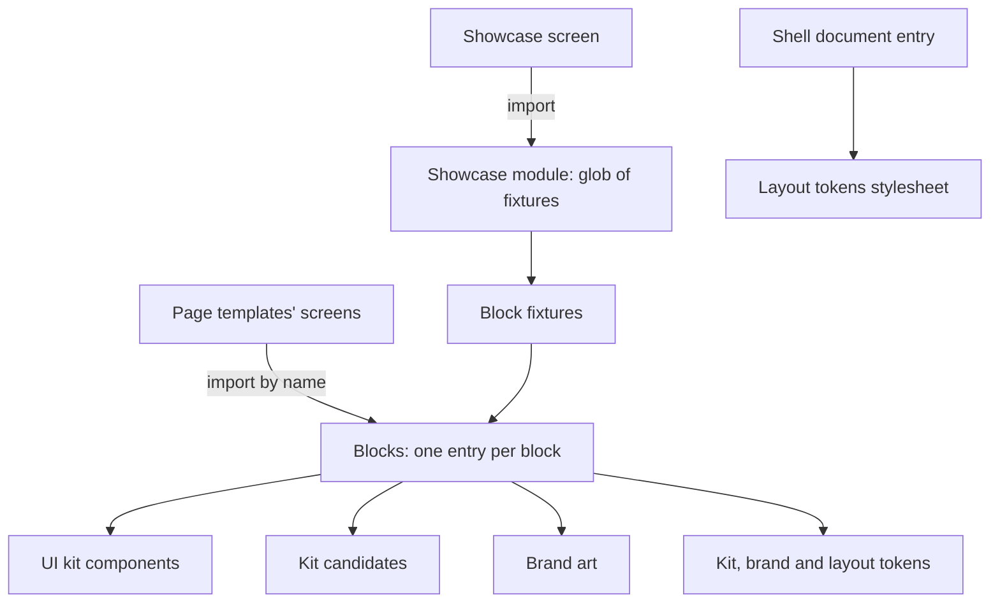
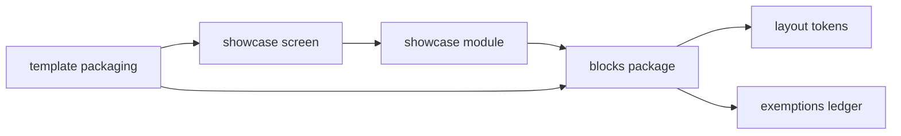
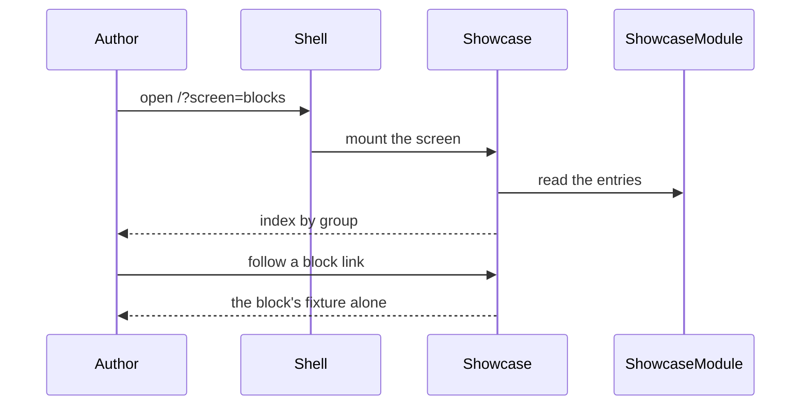
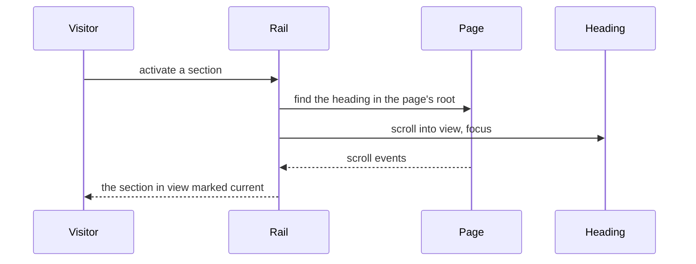

# Technical Design - template-site-blocks

<!-- toc -->

- [1. Architecture Overview](#1-architecture-overview)
  - [1.1 Architectural Vision](#11-architectural-vision)
  - [1.2 Architecture Drivers](#12-architecture-drivers)
  - [1.3 Architecture Layers](#13-architecture-layers)
- [2. Principles & Constraints](#2-principles--constraints)
  - [2.1 Design Principles](#21-design-principles)
  - [2.2 Constraints](#22-constraints)
- [3. Technical Architecture](#3-technical-architecture)
  - [3.1 Domain Model](#31-domain-model)
  - [3.2 Component Model](#32-component-model)
  - [3.3 API Contracts](#33-api-contracts)
  - [3.4 Internal Dependencies](#34-internal-dependencies)
  - [3.5 External Dependencies](#35-external-dependencies)
  - [3.6 Interactions & Sequences](#36-interactions--sequences)
  - [3.7 Database schemas & tables](#37-database-schemas--tables)
- [4. Additional context](#4-additional-context)
  - [4.1 Package layout](#41-package-layout)
  - [4.2 Checks that hold the design](#42-checks-that-hold-the-design)
- [5. Traceability](#5-traceability)

<!-- /toc -->

- [x] `p3` - **ID**: `cpt-template-site-blocks-design-template`

template-site-blocks is a FrontX template of the FrontX site repository: an overlay with one workspace package, `site-blocks` (`@gears-frontx/site-blocks`, private, source only), in the shell's workspace root for template-delivered packages, one screen package, `site-blocks-mfe`, in the shell's screen package root, and one AI bundle. The repository composes it into the site with the other templates; the site-level design is in the [root DESIGN](../../architecture/DESIGN.md), and this document covers only the template.

## 1. Architecture Overview

### 1.1 Architectural Vision

A block is the third layer of the site's visual model. The kit and its candidates provide parts; the brand provides values and art; a block arranges parts on the page. So a block's markup is kit parts, candidates and brand art in plain structural elements, its stylesheet places them, and its props are the content it shows. Each arrangement the design draws is its own block, so no page selects a look by a prop and every arrangement is reviewed and measured once.

The package is delivered the FrontX way for code one template gives others: a named workspace package that screen packages declare at an exact version. Each block is its own entry point (`@gears-frontx/site-blocks/<Block>`), so adding a block needs no shared index. The layout tokens travel with the blocks in the package's document entry, which the shell loads into the document, so the shell chrome and every screen's shadow root read the same column and rhythm.

The showcase screen is a screen package of the same template. It collects every block's fixture from the package through one glob and renders each on its own route, so a new block appears in the showcase by shipping its fixture.

### 1.2 Architecture Drivers

**ADRs**: `cpt-template-site-blocks-adr-one-arrangement-one-block` (one block per drawn arrangement, content-only props, layout-only styles), `cpt-template-site-blocks-adr-named-workspace-package` (blocks delivered as a named workspace package with per-block entries). The template follows the site repository's decisions on composition by copy, the template boundary, exact registry pins and the document entry, cited by link (root [ADR folder](../../architecture/ADR/)).

#### Functional Drivers

| Requirement | Design Response |
|-------------|------------------|
| `cpt-template-site-blocks-fr-kit-built` | Blocks import kit parts, candidates and brand art only; visual values come from them or from tokens (`cpt-template-site-blocks-component-blocks-package`) |
| `cpt-template-site-blocks-fr-layout-only` | Block stylesheets place parts on layout tokens; every other declaration is a ledger row (`cpt-template-site-blocks-component-blocks-package`, `cpt-template-site-blocks-component-exemptions-ledger`) |
| `cpt-template-site-blocks-fr-content-props` | Props are content, slots and callbacks; each drawn arrangement is its own folder (`cpt-template-site-blocks-principle-one-arrangement-one-block`) |
| `cpt-template-site-blocks-fr-block-card` | Every block folder holds the block, its stylesheet, card, fixture, test and entry (`cpt-template-site-blocks-component-blocks-package`) |
| `cpt-template-site-blocks-fr-layout-tokens` | The layout stylesheet and the package's document entry (`cpt-template-site-blocks-component-layout-tokens`) |
| `cpt-template-site-blocks-fr-section-navigation` | The guide page frame's rail tracks the section in view and jumps to a heading with focus (`cpt-template-site-blocks-component-blocks-package`) |
| `cpt-template-site-blocks-fr-showcase` | The showcase screen collects the fixtures and renders one per route, not indexed (`cpt-template-site-blocks-component-showcase-screen`) |
| `cpt-template-site-blocks-fr-self-contained` | The manifest claims the package, the screen package and the AI bundle and no shared file (`cpt-template-site-blocks-component-template-packaging`) |

#### NFR Allocation

| NFR ID | NFR Summary | Allocated To | Design Response | Verification Approach |
|--------|-------------|--------------|-----------------|----------------------|
| `cpt-template-site-blocks-nfr-accessible` | Zero axe violations; one level-one heading per showcase route | every block, the showcase screen | Kit parts and real elements; landmarks named by their headings; a visually hidden page title above a full-bleed block, the page column with a visible title and summary around any other block | axe-core in every block test; the showcase route tests |
| `cpt-template-site-blocks-nfr-v2-structure` | Measured at 1440 and 390 against the design, differences classified | every block | Layout values from the design on layout tokens; kit parts as they are | Browser measurement of each showcase route against the design's DOM boxes and computed styles |

### 1.3 Architecture Layers

- [x] `p3` - **ID**: `cpt-template-site-blocks-tech-layers`

| Layer | Responsibility | Technology |
|-------|---------------|------------|
| Presentation | Blocks and their layout stylesheets; the showcase pages | React 19, CSS Modules on kit, brand and layout tokens |
| Composition | Kit parts, candidates and brand art inside blocks | `@gears-frontx/ui-kit`, `@gears-frontx/kit-candidates`, `@gears-frontx/site-brand` |
| Integration | Delivery as a workspace package; the showcase as a screen package | npm workspaces under `src-app/verify_packages/*` and `src-app/mfe_packages/*`, Vite and Module Federation, the shell's document entry |
| Infrastructure | Tests and type check | Vitest with jsdom, Testing Library, axe-core, TypeScript |

## 2. Principles & Constraints

### 2.1 Design Principles

#### One arrangement, one block

- [x] `p1` - **ID**: `cpt-template-site-blocks-principle-one-arrangement-one-block`

A block draws one arrangement. Its props are the content it shows (texts, links, items), slots for art and children, and callbacks; there is no variant, tone, layout or size prop. When the design draws the same content another way, that is another block with its own folder, card and fixture.

**ADRs**: `cpt-template-site-blocks-adr-one-arrangement-one-block`

#### Layout only

- [x] `p1` - **ID**: `cpt-template-site-blocks-principle-layout-only`

A block's stylesheet places parts: display, flex and grid, gaps, sizes, spacing, position, overflow and alignment, on layout and kit spacing tokens. Colour, type, borders, radii and shadows come from the kit parts, the candidates, brand art or tokens. A declaration that cannot, because the kit has no part or has a defect, is a row of the exemptions ledger naming that gap, and leaves when the gap closes.

**ADRs**: `cpt-template-site-blocks-adr-one-arrangement-one-block`

#### Brand display sizes as ramp overrides

- [x] `p2` - **ID**: `cpt-template-site-blocks-principle-ramp-overrides`

A title larger than the kit's type ramp is the kit `Heading` on its display role, with the role's size, line height, weight and tracking tokens set to the brand's display tokens on that element. The site uses at most two brand display sizes for page and section titles; every other heading is on the kit's ramp.

**ADRs**: `cpt-template-site-blocks-adr-one-arrangement-one-block`

### 2.2 Constraints

#### Host prerequisites

- [x] `p2` - **ID**: `cpt-template-site-blocks-constraint-host-prerequisites`

The package installs, type-checks and tests only inside a project with template-shell applied, in its `src-app/verify_packages/*` workspace root; the showcase screen package needs template-mfe's screen package shape; template-site-brand and template-kit-candidates must be applied for the packages the blocks depend on.

**ADRs**: `cpt-template-site-blocks-adr-named-workspace-package`

#### Exact released versions only

- [x] `p2` - **ID**: `cpt-template-site-blocks-constraint-exact-pins`

The packages pin `@gears-frontx/ui-kit` `0.4.0`, `@gears-frontx/kit-candidates` and `@gears-frontx/site-brand` at the versions their templates deliver, `lucide-react` at the kit's version, and the shared toolchain at the shell's versions, exactly; React is a peer of the blocks package.

**ADRs**: none of this template; the exact registry pins are the site repository's decision (root [ADR folder](../../architecture/ADR/)).

## 3. Technical Architecture

### 3.1 Domain Model

**Technology**: TypeScript, CSS Modules, JSON

**Location**: [blocks package](../src-app/verify_packages/site-blocks/), [showcase screen](../src-app/mfe_packages/site-blocks-mfe/), [frontx-template.json](../frontx-template.json), [AI bundle](../.frontx/ai/@gears-frontx/frontx-template-site-blocks/)

**Core Entities**:

| Entity | Description | Schema |
|--------|-------------|--------|
| Template manifest | Name, version and the exclusive subtrees of the overlay | [frontx-template.json](../frontx-template.json) |
| Block folder | One block: component, layout stylesheet, card, fixture, test, entry | `src/blocks/<Block>/` |
| Fixture | The block with sample content, and its showcase title, group, summary, and whether it is a page frame or full-bleed | `<Block>.showcase.tsx` |
| Layout tokens | The column, header, rhythm, heading row (columns, lead column, gaps), rail and lead tokens with their breakpoints | `src/layout.css` |
| Exemptions ledger | Non-layout declarations of block stylesheets with their kit gap | `styles-exemptions.json` |
| Showcase entry | A block's slug, meta and fixture component | `src/showcase.ts` |
| AI bundle | The registry of the template's guideline | [extension.json](../.frontx/ai/@gears-frontx/frontx-template-site-blocks/extension.json) |

**Relationships**:
- Template manifest -> blocks package, showcase screen, AI bundle: claims all three as exclusive subtrees
- Block folder -> fixture: one fixture per block
- Showcase entry -> fixture: one entry per fixture module
- Exemptions ledger -> block folder: rows name a block stylesheet and selector

### 3.2 Component Model

#### Blocks Package

- [x] `p1` - **ID**: `cpt-template-site-blocks-component-blocks-package`

##### Why this component exists

Pages need the site's arrangements as components that hold the kit, brand and layout rules once.

##### Responsibility scope

One folder per block under `src/blocks/`, each exported from its own entry. The landing-page frame (`SectionFrame`); the inner-page frames (`PageIntro`, `DocsFrame` with the docs tab bar on the kit's navigation menu, `DocsFrameWithRail` with the "On this page" rail); section headings (`SectionHeading`); card and panel blocks (`PathCards`, `StartPaths`, `TemplatePair`, `TemplateRow`, `CardTiles`, `Panels`, `CtaBox`, `CtaRule`, `ActionRow`, `Facts`, `PackageList`); guide and explorer blocks (`GuideStep`, `GuideStepUnnumbered`, `AgentTask`, `Troubleshooting`, `FileExplorer`). Each block renders kit parts, candidates and brand art, lays them out on tokens, and takes content props.

##### Responsibility boundaries

No generic part (that is a kit candidate), no brand value or drawing (that is the brand), no page content or entry mapping (that is the page template).

##### Related components (by ID)

- `cpt-template-site-blocks-component-layout-tokens` - reads
- `cpt-template-site-blocks-component-exemptions-ledger` - is checked against

#### Layout Tokens

- [x] `p1` - **ID**: `cpt-template-site-blocks-component-layout-tokens`

##### Why this component exists

Blocks and the shell chrome share one page column, header height and set of rhythms.

##### Responsibility scope

`src/layout.css` declares on `:root` the page column, the header column, the header height, the section and intro block paddings, the page's bottom padding, the section heading row (its columns, the lead column, the column gap and the row gap), and the rail column and gap, with their breakpoints at 1100, 768 and 640 pixels. A landing-page block sets its own rhythm and heading-row arrangement on an ancestor of the section frame, so the frame carries no layout prop. `src/document.css` imports it; the shell loads it into the document with every template package's document entry.

##### Responsibility boundaries

Holds no colour, type or brand value.

##### Related components (by ID)

- `cpt-template-site-blocks-component-blocks-package` - is read by

#### Exemptions Ledger

- [x] `p2` - **ID**: `cpt-template-site-blocks-component-exemptions-ledger`

##### Why this component exists

Some visual declarations cannot come from a kit part yet; each must be visible and tied to the gap it waits for.

##### Responsibility scope

`styles-exemptions.json` at the package root lists, per row, the block stylesheet, the selector, the property, the kit gap or defect it waits for and its gaps register row.

##### Responsibility boundaries

The repository's style policy reads and enforces it; the ledger holds no rule of its own.

##### Related components (by ID)

- `cpt-template-site-blocks-component-blocks-package` - lists exceptions of

#### Showcase Screen

- [x] `p1` - **ID**: `cpt-template-site-blocks-component-showcase-screen`

##### Why this component exists

A block is reviewed and measured on its own route.

##### Responsibility scope

The showcase module (`src/showcase.ts` of the package) collects every `src/blocks/*/*.showcase.tsx` through one eager glob into entries with a kebab-case slug, sorted by group and title, and fails loudly on a module without a fixture or meta. The screen package `site-blocks-mfe` (route token `blocks`, menu label "Blocks" at order 31 beside the UI kit, not indexed) renders `/` as the index of entries by group inside `DocsFrame`, with kit items linking to each route, and `/$block` as the fixture alone, under a visually hidden level-one heading unless the fixture is a page frame with its own. Any other path, and a slug that names no block, renders the screen's not-found page. The screen's lifecycle anchors the kit's tokens in its shadow root and its frame carries the shell's theme and direction with no stylesheet.

##### Responsibility boundaries

Holds no block code and no fixture content.

##### Related components (by ID)

- `cpt-template-site-blocks-component-blocks-package` - renders the fixtures of

#### Template Packaging

- [x] `p2` - **ID**: `cpt-template-site-blocks-component-template-packaging`

##### Why this component exists

A project copies, validates and removes the template as a unit, and agents need the block rules in writing.

##### Responsibility scope

The template manifest (`@gears-frontx/frontx-template-site-blocks`, version `0.1.0-alpha.0`) claims the blocks package, the showcase screen package and the AI bundle and no shared file. The package's exports map each block's entry, the showcase module and the two stylesheets. The AI bundle registers one guideline with the block rules.

##### Responsibility boundaries

The README is the consumer-facing description and is not part of the bundle.

##### Related components (by ID)

- `cpt-template-site-blocks-component-blocks-package` - exports
- `cpt-template-site-blocks-component-showcase-screen` - ships

### 3.3 API Contracts

- [x] `p2` - **ID**: `cpt-template-site-blocks-interface-package-surface`

- **Contracts**: `cpt-template-site-blocks-interface-package-exports`, `cpt-template-site-blocks-interface-template-overlay`, `cpt-template-site-blocks-contract-kit-and-brand`
- **Technology**: TypeScript modules, CSS Modules, global stylesheets, template manifest, screen package manifest
- **Location**: [package.json](../src-app/verify_packages/site-blocks/package.json), [mfe.json](../src-app/mfe_packages/site-blocks-mfe/mfe.json), [frontx-template.json](../frontx-template.json)

**Endpoints Overview**:

| Method | Path | Description | Stability |
|--------|------|-------------|-----------|
| `module` | `@gears-frontx/site-blocks/<Block>` | One block and its prop types | experimental |
| `module` | `@gears-frontx/site-blocks/showcase` | The showcase entries and their collector | experimental |
| `file` | `@gears-frontx/site-blocks/document.css`, `@gears-frontx/site-blocks/layout.css` | The layout tokens | experimental |
| `screen` | `/?screen=blocks`, `/?screen=blocks;route=<block>` | The showcase index and one block per route, not indexed | experimental |
| `file` | `frontx-template.json` | Overlay manifest with three exclusive subtrees | unstable |

### 3.4 Internal Dependencies

| Dependency Module | Interface Used | Purpose |
|-------------------|----------------|----------|
| template-shell (in the project) | the workspace roots, the document entry convention, the screen domain | Install, tests, layout tokens in the document, the showcase screen |
| `@gears-frontx/ui-kit` | components and tokens | Parts of the blocks |
| `@gears-frontx/kit-candidates` | `Heading`, `Text`, `Link`, `VisuallyHidden`, `CardTitle` and the other candidates | Parts the kit lacks |
| `@gears-frontx/site-brand` | brand tokens and art | Values and drawings |

**Dependency Rules**:
- The packages import nothing outside their own directories except their declared dependencies
- A block may compose another block of the package (a frame uses the page intro); no circular dependencies between block folders
- The showcase screen imports the blocks package by name, never by path

### 3.5 External Dependencies

#### npm registry

| Dependency Module | Interface Used | Purpose |
|-------------------|---------------|---------|
| `@gears-frontx/ui-kit`, `lucide-react`, `react` | npm install at exact versions | Runtime of the blocks |
| The FrontX framework packages, routing and Module Federation at the shell's versions | npm install at exact versions | Runtime and build of the showcase screen |
| `vitest`, `jsdom`, `@testing-library/react`, `axe-core`, `typescript` | npm install at exact versions | Tests and type check |

### 3.6 Interactions & Sequences

#### Open a block in the showcase

**ID**: `cpt-template-site-blocks-seq-open-showcase`

**Use cases**: `cpt-template-site-blocks-usecase-review-block`

**Actors**: `cpt-template-site-blocks-actor-template-author`

**Description**: The entries come from the fixtures the package ships; a new block appears when its fixture exists.

#### Jump to a section from the rail

**ID**: `cpt-template-site-blocks-seq-jump-to-section`

**Use cases**: `cpt-template-site-blocks-usecase-build-page`

**Actors**: `cpt-template-site-blocks-actor-visitor`

**Description**: The heading is found in the document or the screen's shadow root; focus moves so the keyboard continues from the section.

### 3.7 Database schemas & tables

Not applicable: the template has no database and no server process.

## 4. Additional context

### 4.1 Package layout

| Path | Component |
|---|---|
| `src-app/verify_packages/site-blocks/src/blocks/<Block>/` | blocks package |
| `src-app/verify_packages/site-blocks/src/layout.css`, `src/document.css` | layout tokens |
| `src-app/verify_packages/site-blocks/styles-exemptions.json` | exemptions ledger |
| `src-app/verify_packages/site-blocks/src/showcase.ts` | showcase screen (collector) |
| `src-app/mfe_packages/site-blocks-mfe/` | showcase screen (screen package) |
| `src-app/verify_packages/site-blocks/package.json`, `frontx-template.json`, the AI bundle | template packaging |
| `src-app/verify_packages/site-blocks/src/test-support/`, `vitest.config.ts`, `tsconfig.json` | test and type configuration |

### 4.2 Checks that hold the design

- Each block's test: rendering, landmarks and headings, behaviour where the block has any, token rules of its stylesheet, an axe run of its fixture.
- The showcase tests: the collector, the route tree, one level-one heading per route, the not-found page, the manifest (not indexed, metadata per route, shared dependencies).
- In the site repository: the template shape check, the composition drift check, the pin policy, the style and text policies, and the measured comparison of each showcase route against the design (root [DESIGN](../../architecture/DESIGN.md)).

## 5. Traceability

- **PRD**: [PRD.md](./PRD.md)
- **ADRs**: [ADR/](./ADR/); root decisions in [../../architecture/ADR/](../../architecture/ADR/)
- **Features**: [features/](./features/)
