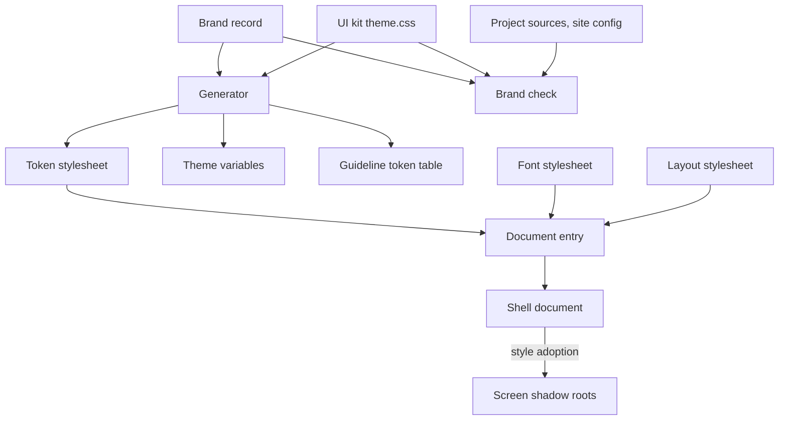
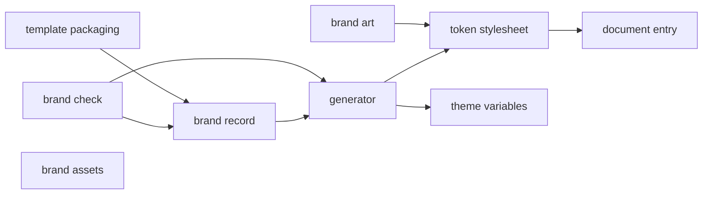
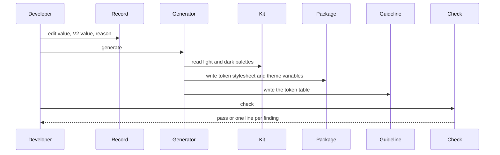
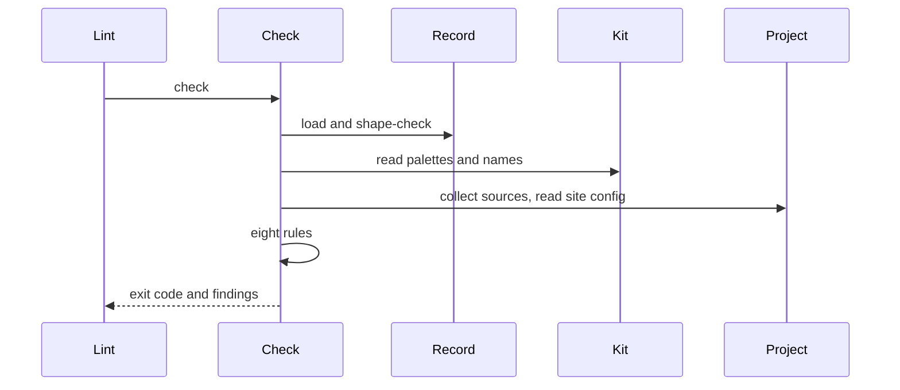
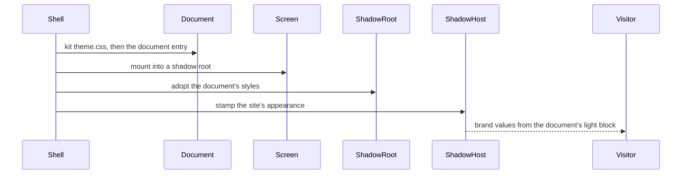

# Technical Design - template-site-brand

<!-- toc -->

- [1. Architecture Overview](#1-architecture-overview)
  - [1.1 Architectural Vision](#11-architectural-vision)
  - [1.2 Architecture Drivers](#12-architecture-drivers)
  - [1.3 Architecture Layers](#13-architecture-layers)
- [2. Principles & Constraints](#2-principles--constraints)
  - [2.1 Design Principles](#21-design-principles)
  - [2.2 Constraints](#22-constraints)
- [3. Technical Architecture](#3-technical-architecture)
  - [3.1 Domain Model](#31-domain-model)
  - [3.2 Component Model](#32-component-model)
  - [3.3 API Contracts](#33-api-contracts)
  - [3.4 Internal Dependencies](#34-internal-dependencies)
  - [3.5 External Dependencies](#35-external-dependencies)
  - [3.6 Interactions & Sequences](#36-interactions--sequences)
  - [3.7 Database schemas & tables](#37-database-schemas--tables)
- [4. Additional context](#4-additional-context)
  - [4.1 Package layout](#41-package-layout)
  - [4.2 Checks that hold the design](#42-checks-that-hold-the-design)
- [5. Traceability](#5-traceability)

<!-- /toc -->

- [x] `p3` - **ID**: `cpt-template-site-brand-design-template`

template-site-brand is a FrontX template of the FrontX site repository: an overlay with one package, `site-brand` (`@gears-frontx/site-brand`, private, under `src-app/verify_packages/`), and one AI bundle. The repository composes it into the site with the other templates; the site-level design is in the [root DESIGN](../../architecture/DESIGN.md), and this document covers only the template.

## 1. Architecture Overview

### 1.1 Architectural Vision

The brand is data first. One record holds every brand value with its role, its design-reference (V2) value and the reason for a difference; everything a browser or a theme registry reads is generated from it. The brand is a layer on the UI kit, not a palette of its own: it overrides kit tokens in the light appearance and adds the tokens the kit lacks, so kit components and site blocks read one set of names.

Delivery goes through the document. The shell loads the package's document entry after the kit's stylesheet; the shell's style adoption carries the document's sheets into each screen's shadow root, and the shell's appearance stamp on each shadow host makes the document's light block match the host from the outer tree. No screen imports the brand. The theme variables are generated alongside, shaped for the theme registry, for the day the registry reaches every scope.

A check closes the loop: it regenerates in memory and compares, holds the kit names, the create-theme value rules, contrast, the V2 record, use, single declaration and the head colours.

### 1.2 Architecture Drivers

**ADRs**: `cpt-template-site-brand-adr-brand-through-document` (brand values are overrides of kit tokens delivered through the document stylesheet until the theme registry carries them to every scope), `cpt-template-site-brand-adr-art-palettes-in-art` (art palettes live in the art components that draw them, not in the record).

The brand's drawings are components of the same package: blocks take them through content slots, so a block stays layout-only and a drawing changes in one file with its palette. The template follows the site repository's decisions on composition by copy, the template boundary and exact registry pins, cited by link (root [ADR folder](../../architecture/ADR/)).

#### Functional Drivers

| Requirement | Design Response |
|-------------|------------------|
| `cpt-template-site-brand-fr-one-record` | The brand record is the only file with brand values; rows not adopted keep a V2 value with a null value (`cpt-template-site-brand-component-brand-record`) |
| `cpt-template-site-brand-fr-generated-outputs` | The generator writes the token stylesheet, the theme variables and the guideline table from the record and the installed kit (`cpt-template-site-brand-component-generator`, `cpt-template-site-brand-component-token-stylesheet`, `cpt-template-site-brand-component-theme-variables`) |
| `cpt-template-site-brand-fr-v2-record` | Every row carries a V2 field; the check's V2 rule requires a reason for a difference (`cpt-template-site-brand-component-brand-record`, `cpt-template-site-brand-component-brand-check`) |
| `cpt-template-site-brand-fr-document-delivery` | The document entry imports tokens and font; the shell loads it (`cpt-template-site-brand-component-document-entry`) |
| `cpt-template-site-brand-fr-typeface` | The font stylesheet registers the variable Inter under the kit's family name (`cpt-template-site-brand-component-document-entry`) |
| `cpt-template-site-brand-fr-theme-variables` | The theme variables module exports the light and dark sets with their appearance (`cpt-template-site-brand-component-theme-variables`) |
| `cpt-template-site-brand-fr-brand-assets` | Brand images live in the package's assets folder and are exported as files (`cpt-template-site-brand-component-brand-assets`) |
| `cpt-template-site-brand-fr-contrast` | The record lists pairs per appearance; the check resolves both sides and computes the ratio (`cpt-template-site-brand-component-brand-check`) |
| `cpt-template-site-brand-fr-brand-check` | Eight rules over the record, the kit, the generated files, the sources and the site config (`cpt-template-site-brand-component-brand-check`) |
| `cpt-template-site-brand-fr-self-contained` | The manifest claims the package and the AI bundle only (`cpt-template-site-brand-component-template-packaging`) |
| `cpt-template-site-brand-fr-brand-art` | Art components under `src/art/`, one export entry each, palettes at the top of their stylesheets (`cpt-template-site-brand-component-brand-art`) |
| `cpt-template-site-brand-fr-ai-guideline` | The AI bundle registers the brand guideline; its token table is generated (`cpt-template-site-brand-component-template-packaging`, `cpt-template-site-brand-component-generator`) |

#### NFR Allocation

| NFR ID | NFR Summary | Allocated To | Design Response | Verification Approach |
|--------|-------------|--------------|-----------------|----------------------|
| `cpt-template-site-brand-nfr-contrast` | 4.5:1 on every pair the brand touches | brand record, brand check | Pairs in the record; ratios from resolved colours, `var()` and `color-mix` in oklab included | The check's contrast rule and its tests |
| `cpt-template-site-brand-nfr-art-accessibility` | Decoration hidden, map links and workbench text real, art text at 4.5:1 | brand art | Hidden unless named; named figure with real links; light and dark palettes for every text surface | The art lane's render and axe tests; browser contrast |
| `cpt-template-site-brand-nfr-kit-conformance` | create-theme value rules | brand record, brand check | Full colours, derived hover, no re-wrapping, declared appearance | The check's value rule and its tests |

### 1.3 Architecture Layers

- [x] `p3` - **ID**: `cpt-template-site-brand-tech-layers`

| Layer | Responsibility | Technology |
|-------|---------------|------------|
| Data | The brand record | JSON |
| Generated | Token stylesheet, theme variables, guideline table | CSS custom properties, a TypeScript module, Markdown |
| Delivery | Document entry, font stylesheet, brand images | CSS `@import`, `@font-face`, SVG |
| Art | Drawings blocks place in their slots | React components, inline SVG, CSS Modules, Recharts over the kit's chart container |
| Tooling | Generator and check | TypeScript run by Node's type stripping, Vitest |

## 2. Principles & Constraints

### 2.1 Design Principles

#### One record

- [x] `p1` - **ID**: `cpt-template-site-brand-principle-one-record`

Every brand value is written once, in the record, with its V2 value and its role. A value the site does not adopt stays in the record with a null value, so the design reference is complete even where the site differs.

**ADRs**: `cpt-template-site-brand-adr-brand-through-document`

#### Kit first, brand second, art last

- [x] `p1` - **ID**: `cpt-template-site-brand-principle-kit-first`

A role the kit has a token for uses the kit token; the brand overrides kit tokens before it adds its own; a brand token exists only where the kit has none. Art palettes are local to the art that draws them.

**ADRs**: `cpt-template-site-brand-adr-art-palettes-in-art`

#### Generated, never edited

- [x] `p2` - **ID**: `cpt-template-site-brand-principle-generated`

The token stylesheet, the theme variables and the guideline table are outputs; the check regenerates them in memory and fails on any difference.

**ADRs**: none.

#### Through the document, not through screens

- [x] `p1` - **ID**: `cpt-template-site-brand-principle-document-delivery`

The brand reaches screens only through the document the shell owns; no screen package imports or copies it.

**ADRs**: `cpt-template-site-brand-adr-brand-through-document`

### 2.2 Constraints

#### Host prerequisites

- [x] `p2` - **ID**: `cpt-template-site-brand-constraint-host-prerequisites`

The project's shell loads every template package's document entry after the kit's stylesheet, adopts the document's styles into each screen's shadow root, and stamps the site's appearance on each screen's shadow host.

**ADRs**: `cpt-template-site-brand-adr-brand-through-document`

#### Theme registry reach

- [x] `p1` - **ID**: `cpt-template-site-brand-constraint-registry-reach`

The theme registry writes its variables on the document root only, where they lose to the kit's palette declared on every themed scope and do not reach shadow roots. Brand values therefore travel in a document stylesheet whose light selector outranks the kit's light block; the registry-shaped variables are generated but not registered.

**ADRs**: `cpt-template-site-brand-adr-brand-through-document`

#### Light overrides only

- [x] `p2` - **ID**: `cpt-template-site-brand-constraint-light-only`

The site keeps the kit's dark palette; the brand overrides kit tokens in the light appearance only and resets its own text tokens on every dark scope.

**ADRs**: none of this template; a site decision recorded in the brand guideline.

#### Exact released versions

- [x] `p2` - **ID**: `cpt-template-site-brand-constraint-exact-pins`

The package pins `@gears-frontx/ui-kit` `0.4.0` and `@fontsource-variable/inter` `5.3.0` exactly, equal to the project's installs; the generator and the check read the kit stylesheet the project installs.

**ADRs**: none of this template; the pins are the site repository's decision (root [ADR folder](../../architecture/ADR/)).

## 3. Technical Architecture

### 3.1 Domain Model

**Technology**: JSON, CSS custom properties

**Location**: [brand.json](../src-app/verify_packages/site-brand/src/brand.json)

**Core Entities**:

| Entity | Description | Schema |
|--------|-------------|--------|
| Brand row | Token, our value (or null when not adopted), V2 value (or null when V2 has none), reason, role; theme-invariant rows also a type | `brand.json` rows |
| Palette | A light or dark section with its appearance and rows | `brand.json` `light`, `dark` |
| Contrast pair | A background and a text token drawn together, per appearance | `brand.json` `pairs` |
| Head row | A head colour of the site config with its V2 value | `brand.json` `head` |
| Kit palette | The kit's light or dark token block | the installed kit `theme.css` |
| Template manifest | The overlay's exclusive subtrees | [frontx-template.json](../frontx-template.json) |
| Art palette | The custom properties at the top of an art stylesheet: a light set and, for art that follows the page's theme, a dark set switching every colour | `src/art/*.module.css` |

**Relationships**:
- Palette -> Brand row: holds rows; a dark row resets a light brand token
- Contrast pair -> Kit palette and Palette: each side resolves over the kit palette of its appearance with the brand rows applied
- Head row -> site config: compared by the check

### 3.2 Component Model

#### Brand record

- [x] `p1` - **ID**: `cpt-template-site-brand-component-brand-record`

##### Why this component exists

The brand needs one place that holds its values and their relation to the design reference.

##### Responsibility scope

Holds the light overrides of kit tokens, the light brand tokens, the dark resets, the typed theme-invariant tokens, the contrast pairs per appearance and the head colours. Loading it checks its shape: names, values, roles, types, no duplicate rows, every dark row resetting a light token, brand tokens never null.

##### Responsibility boundaries

Holds no layout token and no art palette.

##### Related components (by ID)

- `cpt-template-site-brand-component-generator` - is read by
- `cpt-template-site-brand-component-brand-check` - is held by

#### Generator

- [x] `p1` - **ID**: `cpt-template-site-brand-component-generator`

##### Why this component exists

The browser, the theme registry and the guideline each need the record in their own form.

##### Responsibility scope

Reads the record and the installed kit's light and dark palettes, renders the token stylesheet, the theme variables and the guideline's token table, and writes them; the table goes between two markers of the guideline when the guideline exists.

##### Responsibility boundaries

Writes no file outside the package except the guideline table.

##### Related components (by ID)

- `cpt-template-site-brand-component-token-stylesheet` - writes
- `cpt-template-site-brand-component-theme-variables` - writes

#### Token stylesheet

- [x] `p1` - **ID**: `cpt-template-site-brand-component-token-stylesheet`

##### Why this component exists

The browser reads custom properties; the brand has to outrank the kit's light block on every light scope.

##### Responsibility scope

Declares the light overrides and brand tokens under a selector with two attribute conditions for themed scopes, the dark resets on every dark scope, and the theme-invariant tokens on the document root, each with its role as a comment.

##### Responsibility boundaries

Generated; never edited.

##### Related components (by ID)

- `cpt-template-site-brand-component-document-entry` - is imported by

#### Theme variables

- [x] `p2` - **ID**: `cpt-template-site-brand-component-theme-variables`

##### Why this component exists

The design guardrails' theme model registers a complete variable set per theme; the brand provides it ready for that.

##### Responsibility scope

Exports the kit light palette with the brand overrides applied, the kit dark palette, and both with their appearance.

##### Responsibility boundaries

Not registered while the registry cannot reach screens' scopes.

##### Related components (by ID)

- `cpt-template-site-brand-component-generator` - is written by

#### Document entry

- [x] `p1` - **ID**: `cpt-template-site-brand-component-document-entry`

##### Why this component exists

The shell loads one stylesheet per template package into its document.

##### Responsibility scope

Imports the token stylesheet, the font stylesheet (the variable Inter under the family name `Inter`, Latin and Latin Extended, weights 100 to 900). The page layout tokens are not brand values; the site-blocks package declares them in its own document entry.

##### Responsibility boundaries

Declares no brand value itself.

##### Related components (by ID)

- `cpt-template-site-brand-component-token-stylesheet` - imports

#### Brand assets

- [x] `p2` - **ID**: `cpt-template-site-brand-component-brand-assets`

##### Why this component exists

Brand images used inside pages travel with the brand.

##### Responsibility scope

The Constructor Fabric weave logo of the lockup, exported as a package file.

##### Responsibility boundaries

Head assets stay with the project root.

##### Related components (by ID)

- `cpt-template-site-brand-component-template-packaging` - is claimed by

#### Brand art

- [x] `p1` - **ID**: `cpt-template-site-brand-component-brand-art`

##### Why this component exists

Blocks hold layout and content only; the site's drawings need their own shapes, colours and motion somewhere outside them.

##### Responsibility scope

The hairline figure family on one isometric projection (stocks `hub`, `riffle`, `turntable`, `rebuild`, `loupe`, `rest`, 5:4), the template figures by template role, the application slab shown by the hero art and the closing visual, the architecture figure with labels and links as props, the change-story workbench, the chart thumbnails and the metric bars over the kit's chart container. Each fills its slot with no outer layout, is hidden unless named, and reads only its own palette, kit tokens and brand tokens.

##### Responsibility boundaries

Places nothing on a page: the size and position of a slot are the block's. Holds no brand token; its palettes are not in the record.

##### Related components (by ID)

- `cpt-template-site-brand-component-token-stylesheet` - reads brand tokens from

#### Brand check

- [x] `p1` - **ID**: `cpt-template-site-brand-component-brand-check`

##### Why this component exists

The brand drifted through copies, dead tokens, hard-coded hovers and unrecorded differences; each needs a rule.

##### Responsibility scope

Reads the record, the installed kit, the generated files, the guideline, every style and script source of the project outside the package (tests, installs and build output skipped) and the site config, and runs eight rules: generated files equal, kit names, create-theme value rules, contrast in both appearances, V2 record, use, one source, head colours. Resolves colours through `var()` and `color-mix(in oklab, ...)`. Reports one line per finding and exits non-zero on any.

##### Responsibility boundaries

Does not check art palettes or hex literals in other files (the repository's style policy).

##### Related components (by ID)

- `cpt-template-site-brand-component-brand-record` - holds
- `cpt-template-site-brand-component-generator` - regenerates in memory through

#### Template packaging

- [x] `p2` - **ID**: `cpt-template-site-brand-component-template-packaging`

##### Why this component exists

A project copies and validates the template as a unit; agents need the brand guideline.

##### Responsibility scope

The manifest (`@gears-frontx/frontx-template-site-brand`, `0.1.0-alpha.0`) claims the package and the AI bundle; the bundle registers the brand guideline.

##### Responsibility boundaries

Composition into the site is the repository's tooling.

##### Related components (by ID)

- `cpt-template-site-brand-component-brand-record` - ships

### 3.3 API Contracts

- [x] `p2` - **ID**: `cpt-template-site-brand-interface-package-surface`

- **Contracts**: `cpt-template-site-brand-interface-package-exports`, `cpt-template-site-brand-interface-brand-record`, `cpt-template-site-brand-interface-template-overlay`, `cpt-template-site-brand-contract-shell-document-entry`, `cpt-template-site-brand-contract-ui-kit`, `cpt-template-site-brand-contract-site-config`
- **Technology**: npm package exports, CSS, JSON, command line
- **Location**: [package.json](../src-app/verify_packages/site-brand/package.json), [brand guideline](../.frontx/ai/@gears-frontx/frontx-template-site-brand/guidelines/brand.md)

**Endpoints Overview**:

| Method | Path | Description | Stability |
|--------|------|-------------|-----------|
| `import` | `@gears-frontx/site-brand/document.css` | The document entry | experimental |
| `import` | `@gears-frontx/site-brand/theme` | Light and dark variable sets with their appearance | experimental |
| `import` | `@gears-frontx/site-brand/assets/*` | Brand images | experimental |
| `import` | `@gears-frontx/site-brand/art/*` | One art component per entry | experimental |
| `cli` | `src/check/cli.ts generate` | Writes the generated files | experimental |
| `cli` | `src/check/cli.ts check` | Runs the brand check; options `--project`, `--kit`, `--config`, `--scan` | experimental |

### 3.4 Internal Dependencies

| Dependency Module | Interface Used | Purpose |
|-------------------|----------------|----------|
| template-shell (in the project) | document-entry loading, style adoption, host appearance stamp | Delivery |
| `@gears-frontx/ui-kit` | `theme.css` | Kit names and palettes |
| `@fontsource-variable/inter` | font files | Typeface |
| `recharts`, React | chart primitives, components | Brand art |

**Dependency Rules**:
- The package imports nothing outside its own directory
- No screen package imports the brand

### 3.5 External Dependencies

#### npm registry

| Dependency Module | Interface Used | Purpose |
|-------------------|---------------|---------|
| `@gears-frontx/ui-kit`, `@fontsource-variable/inter`, `recharts`, `react`, `typescript`, `vitest`, `jsdom`, `@testing-library/react`, `axe-core` | npm install at exact versions | Runtime styles, art, tooling and tests |

### 3.6 Interactions & Sequences

#### Change a brand value

**ID**: `cpt-template-site-brand-seq-change-value`

**Use cases**: `cpt-template-site-brand-usecase-change-value`

**Actors**: `cpt-template-site-brand-actor-site-developer`

**Description**: The record is edited, the outputs are regenerated, the check confirms.

#### Check the brand

**ID**: `cpt-template-site-brand-seq-check-brand`

**Use cases**: `cpt-template-site-brand-usecase-check-brand`

**Actors**: `cpt-template-site-brand-actor-site-developer`

**Description**: Every rule runs on every check; findings are listed together.

#### The brand reaches a screen

**ID**: `cpt-template-site-brand-seq-document-load`

**Use cases**: `cpt-template-site-brand-usecase-apply-template`

**Actors**: `cpt-template-site-brand-actor-host-shell`, `cpt-template-site-brand-actor-visitor`

**Description**: The brand arrives with the document's styles; the stamped host matches the document's light block from the outer tree.

### 3.7 Database schemas & tables

Not applicable: the template has no database and no server process.

## 4. Additional context

### 4.1 Package layout

| Path (under `src-app/verify_packages/site-brand/`) | Component |
|---|---|
| `src/brand.json` | brand record |
| `src/check/model.ts`, `src/check/generate.ts`, `src/check/cli.ts` | generator |
| `src/tokens.css` | token stylesheet |
| `src/theme.ts` | theme variables |
| `src/document.css`, `src/font.css` | document entry |
| `src/assets/` | brand assets |
| `src/art/` (`iso.ts`, one `<Name>.tsx` and `<Name>.module.css` per drawing), `tsconfig.art.json` | brand art |
| `src/check/rules.ts`, `src/check/color.ts`, `src/check/sources.ts`, `src/check/cli.ts` | brand check |
| `src/test-support/` | test fixtures |
| `package.json`, `tsconfig.json`, `vitest.config.ts` | package and test configuration |

The template manifest and the AI bundle (`.frontx/ai/@gears-frontx/frontx-template-site-brand/`) sit at the template root.

### 4.2 Checks that hold the design

- The package's art lane (jsdom): every art component renders, hides or names itself, and passes axe; a check-lane test holds every art palette.
- The package's tests: colour resolution and contrast, the generated stylesheet and theme variables, the guideline table, a passing fixture and a broken copy per rule, the source walk, and the shipped record against the installed kit.
- The brand check itself, run by the repository's lint over the assembled site.
- In the site repository: the template shape check, the composition drift check and the style and text policies (root [DESIGN](../../architecture/DESIGN.md)).

## 5. Traceability

- **PRD**: [PRD.md](./PRD.md)
- **ADRs**: [ADR/](./ADR/); root decisions in [../../architecture/ADR/](../../architecture/ADR/)
- **Features**: [features/](./features/)
