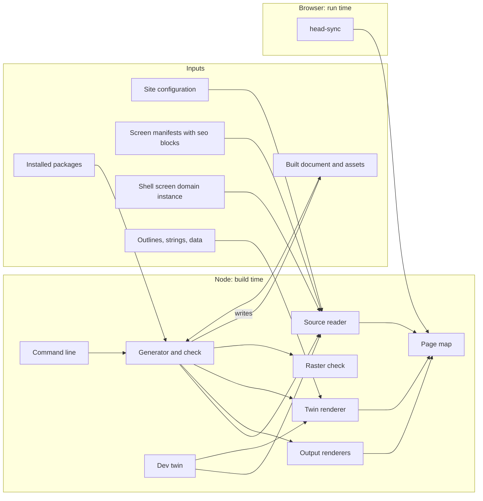
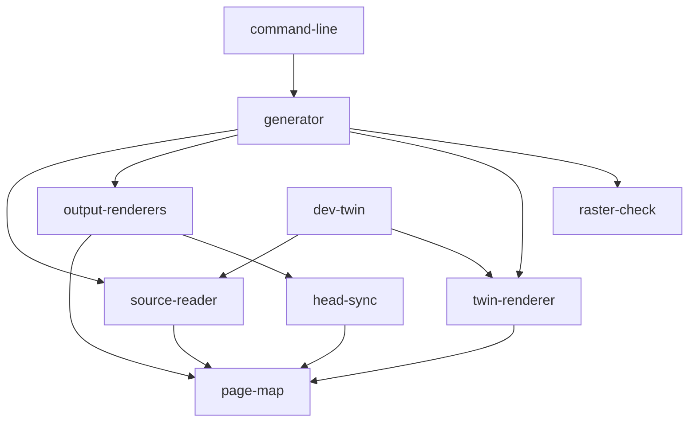
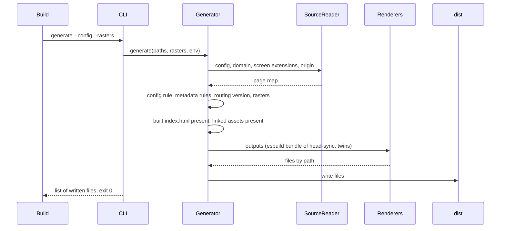
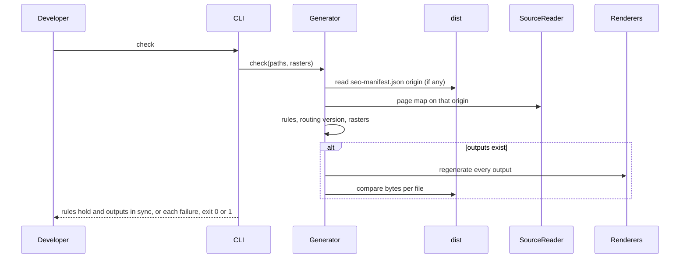
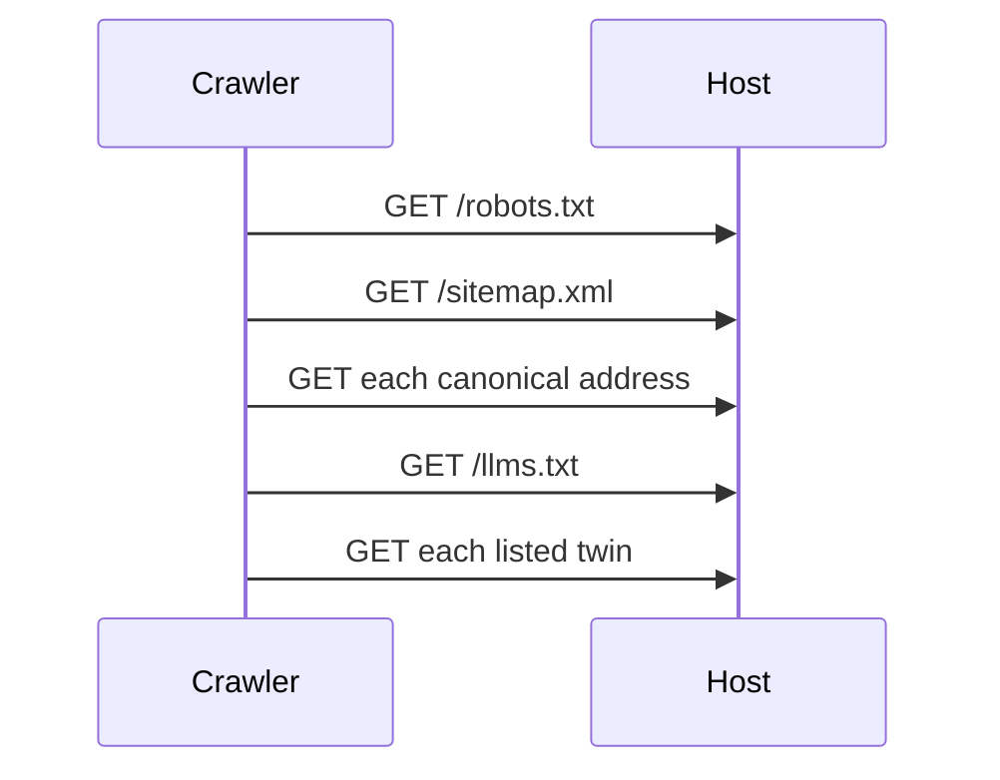

# Technical Design - template-site-meta

- [x] `p3` - **ID**: `cpt-template-site-meta-design-site-meta`

<!-- toc -->

- [1. Architecture Overview](#1-architecture-overview)
  - [1.1 Architectural Vision](#11-architectural-vision)
  - [1.2 Architecture Drivers](#12-architecture-drivers)
  - [1.3 Architecture Layers](#13-architecture-layers)
- [2. Principles & Constraints](#2-principles--constraints)
  - [2.1 Design Principles](#21-design-principles)
  - [2.2 Constraints](#22-constraints)
- [3. Technical Architecture](#3-technical-architecture)
  - [3.1 Domain Model](#31-domain-model)
  - [3.2 Component Model](#32-component-model)
  - [3.3 API Contracts](#33-api-contracts)
  - [3.4 Internal Dependencies](#34-internal-dependencies)
  - [3.5 External Dependencies](#35-external-dependencies)
  - [3.6 Interactions & Sequences](#36-interactions--sequences)
  - [3.7 Database schemas & tables](#37-database-schemas--tables)
- [4. Additional context](#4-additional-context)
  - [4.1 Package layout](#41-package-layout)
  - [4.2 Where metadata lives](#42-where-metadata-lives)
  - [4.3 Rules](#43-rules)
  - [4.4 Verification](#44-verification)
  - [4.5 Related trees](#45-related-trees)
- [5. Traceability](#5-traceability)

<!-- /toc -->

## 1. Architecture Overview

### 1.1 Architectural Vision

template-site-meta delivers one tooling package, `@gears-frontx/site-meta` (private), in `src-app/verify_packages/site-meta/`, and an AI bundle with one guideline in `.frontx/ai/@gears-frontx/frontx-template-site-meta/`. Applied onto a project with template-shell, the package lands in the shell's workspace root for template-delivered packages that are not screens, so the project's install, type-check, lint and unit tests reach it without wiring. It is TypeScript run by Node's type stripping, with no build step of its own.

The package is a pure pipeline from declarations to files. A source reader resolves the site configuration, the shell's screen domain and every composed screen extension's `seo` block into one page map. Renderers turn the page map into the outputs, each a pure function of it; the twin renderer adds a Markdown rendering of every outline page. A generator runs after the project's build, applies the rules and writes the outputs into the build output; the same code, run as the check, applies the rules and compares the outputs in the build output byte for byte with what the sources generate now. The page map module is shared with head-sync, the browser runtime bundled into the built document, which resolves the page the address shows with the same lookup and applies its head on load and on every navigation, writing the head only.

The boundary is the project the template applies into: the package reads the project's composed screen packages, the shell's screen domain instance, the project's installed packages and its build output, and writes only into the build output. The two inputs that are not the project's own layout, the site configuration and the raster record, are passed in as paths. The template references nothing outside its own directories.

### 1.2 Architecture Drivers

**ADRs**: `cpt-template-site-meta-adr-metadata-on-screen-extension`, `cpt-template-site-meta-adr-static-head-and-head-sync`

#### Functional Drivers

| Requirement | Design Response |
|-------------|------------------|
| `cpt-template-site-meta-fr-metadata-once` | The source reader builds the page map from the `seo` blocks and the site configuration only (a route takes its screen's share image, a missing title the screen's label, a missing description the site default); every renderer and head-sync read that map (`cpt-template-site-meta-component-source-reader`, `cpt-template-site-meta-component-page-map`) |
| `cpt-template-site-meta-fr-canonical-addresses` | Addresses are written with the routing package's `serializeGrammar` from the screen domain key, the token and the `route` parameter; a pattern page takes the concrete address it is shown at; duplicate tokens fail the map |
| `cpt-template-site-meta-fr-required-origin` | The source reader resolves the origin from `SITE_ORIGIN`, then the configuration, with no default, and refuses a non-http address or one with a query or fragment |
| `cpt-template-site-meta-fr-site-head` | The output renderers write the delimited head block after the document title and replace it on every generation (`cpt-template-site-meta-component-output-renderers`) |
| `cpt-template-site-meta-fr-discovery-files` | The output renderers produce the sitemap, robots file, `llms.txt` and page map manifest from the page map; the generator adds the documented packages' published `llms.txt` at installed versions |
| `cpt-template-site-meta-fr-web-manifest` | The output renderers produce the web manifest with a start address relative to the manifest |
| `cpt-template-site-meta-fr-linked-assets` | The generator lists the icon set, the icons the built document links and a same-origin share image, and fails on each missing file before writing (`cpt-template-site-meta-component-generator`) |
| `cpt-template-site-meta-fr-plain-text-twins` | The twin renderer reads every composed outline and renders each declared page and each agent task copy (`cpt-template-site-meta-component-twin-renderer`) |
| `cpt-template-site-meta-fr-dev-twins` | The dev twin module renders one twin per request from the current sources and names its media type (`cpt-template-site-meta-component-dev-twin`) |
| `cpt-template-site-meta-fr-head-follows-address` | head-sync applies the resolved page's head at start and on every history change (`cpt-template-site-meta-component-head-sync`) |
| `cpt-template-site-meta-fr-head-only` | head-sync subscribes to the navigation history and writes only head nodes and the document title |
| `cpt-template-site-meta-fr-metadata-rules` | The generator applies the configuration and metadata rules in both commands, before anything is written |
| `cpt-template-site-meta-fr-output-drift` | The check regenerates every output on the origin recorded in the page map manifest and compares bytes |
| `cpt-template-site-meta-fr-routing-version` | The generator compares the routing package esbuild resolves for head-sync with the project's |
| `cpt-template-site-meta-fr-raster-record` | The raster check parses the record strictly and compares hashes and copies (`cpt-template-site-meta-component-raster-check`) |

#### NFR Allocation

| NFR ID | NFR Summary | Allocated To | Design Response | Verification Approach |
|--------|-------------|--------------|-----------------|----------------------|
| `cpt-template-site-meta-nfr-deterministic-outputs` | Byte-identical outputs from the same inputs | Output renderers, generator | Renderers are pure functions of the page map; screens and pages are ordered by menu order and declaration order; head-sync is bundled minified with no legal comments, deterministic for the same sources | Snapshot tests of the sitemap and `llms.txt`; the drift check passes right after generation |
| `cpt-template-site-meta-nfr-self-contained` | No reference outside the template | Every component | Project paths come from the command line or from the package's own position; no import leaves the package directory | Review; the template's manifest claims only its two subtrees |
| `cpt-template-site-meta-nfr-project-lanes` | Checked by the project's existing lanes | Package layout | Lands in the shell's workspace root for template-delivered packages; declares `Object.hasOwn` for the application lib and names each test file's environment | The project's type-check, lint and unit-test commands run the package |
| `cpt-template-site-meta-nfr-head-before-boot` | Head applied before the application's scripts, no request | Output renderers, head-sync | The page map and the bundled runtime are inlined as a classic script right after the title, ahead of the deferred module scripts | Bundle test runs the generated document in a DOM |

### 1.3 Architecture Layers



- [x] `p3` - **ID**: `cpt-template-site-meta-tech-node-and-browser`

| Layer | Responsibility | Technology |
|-------|---------------|------------|
| Interface | Command line, dev twin function | Node with type stripping (the project's toolchain), TypeScript |
| Application | Generation, checking, rule application | TypeScript modules, Node `fs` |
| Domain | Page map, address resolution, rendering of outputs and twins | TypeScript, `@gears-frontx/routing` grammar |
| Runtime | head-sync in the browser | TypeScript bundled by esbuild into one IIFE, `@gears-frontx/routing` navigation history |

## 2. Principles & Constraints

### 2.1 Design Principles

#### Metadata Declared Once

- [x] `p1` - **ID**: `cpt-template-site-meta-principle-metadata-once`

A page's metadata exists once, in its screen extension's `seo` block, and the site-level values once, in the site configuration. Every output, every check and the runtime head are derived from the page map built from those two sources; nothing else carries metadata.

**ADRs**: `cpt-template-site-meta-adr-metadata-on-screen-extension`

#### The Head Only, Never the Address

- [x] `p1` - **ID**: `cpt-template-site-meta-principle-head-only`

The router is the only writer of the address. head-sync reads the navigation history and writes head nodes and the document title only; the generator writes only the build output, never a source.

**ADRs**: `cpt-template-site-meta-adr-static-head-and-head-sync`

#### The Router's Grammar for Every Address

- [x] `p1` - **ID**: `cpt-template-site-meta-principle-router-grammar`

Every canonical address, every link in a twin and the page lookup in head-sync use the routing package's own `serializeGrammar` and `parseGrammar`, the functions the framework router writes and reads the URL with, so a canonical address and the live address cannot drift.

#### Outputs Are Regenerated, Never Edited

- [x] `p2` - **ID**: `cpt-template-site-meta-principle-regenerate-never-edit`

Every output is a deterministic function of the sources. A change is made in a source and generated again; the check names every output that differs, so a hand edit or a stale output is a failure.

#### The Project Is the Boundary

- [x] `p2` - **ID**: `cpt-template-site-meta-principle-project-boundary`

The package reads the project it is given (by default the one it sits in) through one set of resolved paths, with the shell's scanner rules for which packages are screens, and passes in the two inputs that are not the project's layout. It references nothing outside its own directories.

### 2.2 Constraints

#### Screens Are Addressed in the Query String

- [x] `p1` - **ID**: `cpt-template-site-meta-constraint-query-addressing`

FrontX routing keeps the pathname as the shell's territory and addresses every occupant as a query entry; a screen's inner path is projected from its entry's `route` parameter, a name routing-tanstack keeps internal. The page map names the parameter once and a test builds a screen router through routing-tanstack's public API to hold the name.

#### One Static Document Answers Every Address

- [x] `p1` - **ID**: `cpt-template-site-meta-constraint-single-static-document`

On a static host every address is served the same built document, so the per-page head can only be applied in the browser, and a crawler that runs no script sees the site-level head.

**ADRs**: `cpt-template-site-meta-adr-static-head-and-head-sync`

#### No Head Port in the Shell

- [x] `p1` - **ID**: `cpt-template-site-meta-constraint-no-shell-head-port`

template-shell has no head management API; its dev server serves the shell's static head. The block is written into the built document after the build, so the per-page head and the discovery files exist only in a build; in development only the twins are served.

**ADRs**: `cpt-template-site-meta-adr-static-head-and-head-sync`

#### One Routing Version in the Realm

- [x] `p1` - **ID**: `cpt-template-site-meta-constraint-routing-version`

The routing package keeps the realm's navigation history in a version-namespaced slot, so head-sync must be bundled with the same version the project runs. esbuild resolves the package the way Node does, from the package outward: the package's own nested copy when npm installed one, the project's otherwise.

#### The Shell's Workspace Root for Template-Delivered Packages

- [x] `p2` - **ID**: `cpt-template-site-meta-constraint-shell-workspace-root`

template-shell has one workspace root for packages a template delivers that are not screens, `src-app/verify_packages/*`, and its application type-check (lib ES2020) and its browser test lane sweep that root as application code. The package declares `Object.hasOwn` for that lib and each test file names its environment.

#### No Dev-Server Plugin Convention

- [x] `p2` - **ID**: `cpt-template-site-meta-constraint-dev-server-plugin`

template-shell has no convention for a template to contribute a dev-server plugin, so the twin middleware is the project's own addition to its dev server configuration, loading the dev twin module by path and serving nothing when the package is absent.

#### Twins Are Served as Plain Text

- [x] `p2` - **ID**: `cpt-template-site-meta-constraint-twin-media-type`

A browser downloads `text/markdown` or an unknown type instead of showing it, so twins are served as `text/plain; charset=utf-8` by the dev server and by the static host.

#### No Reference to Another Template

- [x] `p2` - **ID**: `cpt-template-site-meta-constraint-no-cross-template-reference`

The outline model belongs to template-site and the twin path rule exists there too (for the links) and here (for the files). This template reads outlines as data and keeps its own copy of the path rule; the repository that hosts both holds the two rules to one answer over its composed site.

## 3. Technical Architecture

### 3.1 Domain Model

**Technology**: TypeScript interfaces, JSON files

**Location**: [site.ts](../src-app/verify_packages/site-meta/src/site.ts), [page-map.ts](../src-app/verify_packages/site-meta/src/page-map.ts), [twins.ts](../src-app/verify_packages/site-meta/src/twins.ts), [rasters.ts](../src-app/verify_packages/site-meta/src/rasters.ts)

**Core Entities**:

| Entity | Description | Schema |
|--------|-------------|--------|
| SiteConfig | The site-level values: origin, site name, short name, title template, default description, locale, home screen, share image and its alternative text, card type, theme and background colours | [site.ts](../src-app/verify_packages/site-meta/src/site.ts) |
| SeoBlock | A screen extension's metadata: title, description, indexable, share image, and routes keyed by inner path with the same fields | [site.ts](../src-app/verify_packages/site-meta/src/site.ts) |
| ScreenExtension | A composed screen as read from its package manifest: id, route token, presentation label and order, seo block, package directory | [site.ts](../src-app/verify_packages/site-meta/src/site.ts) |
| SitePaths | The resolved paths of a project: root, site configuration, composed packages, screen domain instance, build output | [site.ts](../src-app/verify_packages/site-meta/src/site.ts) |
| PageMeta | One page: canonical address, origin-relative address, screen token, inner route, title, document title, description, indexable, share image | [page-map.ts](../src-app/verify_packages/site-meta/src/page-map.ts) |
| ScreenPages | One screen's extension id, label, order, static pages keyed by inner path, and pattern pages | [page-map.ts](../src-app/verify_packages/site-meta/src/page-map.ts) |
| SiteMetaMap | The page map: site fields, screen domain key, route parameter name, home page, fallback page, screens | [page-map.ts](../src-app/verify_packages/site-meta/src/page-map.ts) |
| ScreenOutline | A screen's outline with its pages, strings, variables, libraries and shell packages | [twins.ts](../src-app/verify_packages/site-meta/src/twins.ts) |
| Twin | One plain-text file: its path in the build output, its address path, screen, route, content and an optional title | [twins.ts](../src-app/verify_packages/site-meta/src/twins.ts) |
| RastersRecord | Rasters with size, source and both hashes, and copies with their source | [rasters.ts](../src-app/verify_packages/site-meta/src/rasters.ts) |

**Relationships**:
- SiteConfig and ScreenExtension (with its SeoBlock) resolve into SiteMetaMap: one ScreenPages per screen token, one PageMeta per screen root and per declared route.
- SiteMetaMap has exactly one home PageMeta (root of the configured home screen) and one fallback PageMeta (site name and summary, not indexable, canonical to the home page).
- ScreenOutline names a screen of SiteMetaMap; each outline page must be a static page of that screen; each yields a Twin, and each agent task that offers a copy yields another.
- SitePaths locates every input and the build output for one project.

### 3.2 Component Model



#### Source Reader

- [x] `p1` - **ID**: `cpt-template-site-meta-component-source-reader`

##### Why this component exists

Every output and check needs the same page map built from the same sources with the same rules for which packages are screens.

##### Responsibility scope

Resolves a project's paths (the site configuration by default in the project root); reads the site configuration, the screen domain's id and route key from the shell's screen domain instance, and every screen extension on that domain from the composed packages' manifests, skipping `shared`, dot-directories and packages marked `templateExample`; resolves the origin; reports duplicate screen tokens; builds the page map (a route takes its screen's share image when it has none, a missing title falls back to the screen's label, a missing description to the site default), document titles from the title template (the home page titled with the site name alone), pattern pages non-indexable by default, the home and the fallback page; lists the static pages in menu order.

##### Responsibility boundaries

Does not apply the metadata rules beyond duplicate tokens and an unknown home screen; does not render or write any output.

##### Related components (by ID)

- `cpt-template-site-meta-component-page-map` - depends on (address writing, the map's types)
- `cpt-template-site-meta-component-generator` - called by
- `cpt-template-site-meta-component-dev-twin` - called by

#### Page Map

- [x] `p1` - **ID**: `cpt-template-site-meta-component-page-map`

##### Why this component exists

The generator in Node and head-sync in the browser must write and resolve addresses identically; one module imported by both guarantees it.

##### Responsibility scope

Defines the page map types and the `route` parameter name; writes a page's canonical address with `serializeGrammar`; resolves an address to its page with `parseGrammar`: the bare mount address to the home page, the screen domain's entry and its `route` parameter to a static page, then to a pattern page (canonical to the concrete address), anything else to the fallback. Lookups take own keys only.

##### Responsibility boundaries

Imports nothing but `@gears-frontx/routing`; reads no file and touches no document.

##### Related components (by ID)

- `cpt-template-site-meta-component-source-reader` - shares model with
- `cpt-template-site-meta-component-head-sync` - called by
- `cpt-template-site-meta-component-output-renderers` - shares model with
- `cpt-template-site-meta-component-twin-renderer` - shares model with

#### Output Renderers

- [x] `p1` - **ID**: `cpt-template-site-meta-component-output-renderers`

##### Why this component exists

Each output is a pure function of the page map, kept apart from file access so it is deterministic and testable by snapshot.

##### Responsibility scope

Renders the sitemap, the robots file, `llms.txt` (sections per screen, grouping by first path segment, twins, documented packages), the page map manifest, the web manifest and the built document with its head block: language and title set, the block placed after the title between `site-meta:start` and `site-meta:end` comment markers, replacing a previous block; the page map inlined as JSON with `<` escaped and the runtime inlined with closing sequences escaped. Names the icon set the head and the web manifest link.

##### Responsibility boundaries

Reads and writes no file; does not bundle the runtime (it receives the bundle).

##### Related components (by ID)

- `cpt-template-site-meta-component-head-sync` - shares model with (the head tags of a page)
- `cpt-template-site-meta-component-generator` - called by

#### Twin Renderer

- [x] `p1` - **ID**: `cpt-template-site-meta-component-twin-renderer`

##### Why this component exists

Outline pages are rendered in the browser from data; agents and non-script crawlers need the same content as text, rendered from the same data.

##### Responsibility scope

Finds every composed package with an outline file, reads its strings and data, resolves text keys and variables (with the site origin available as a variable), writes links as canonical addresses, and renders each outline page, the home page included, as Markdown by entry type (section and closing headings, numbered and unnumbered steps with code and expected results, links, agent tasks, troubleshooting, lists, code, checklists, every card arrangement, file explorers, panels, call-to-action boxes and rules, facts, details, callouts, package lists, and the home entries: hero actions, features, the architecture map, the change story, the kit showcase, the metric comparison without figures and without an empty unit or note, the logo strip, the get-started steps and the closing call); renders an agent task's text on its own when the task offers a copy; derives each twin's path from the screen token and route; fails on an outline for an unknown screen or a page the screen's seo block does not declare, on a link to a screen extension the site does not have, on a show action that names no page or more than one page of its screen, and on a link that names a screen by its address token or gives a route beside an extension.

##### Responsibility boundaries

Does not define the outline model, which belongs to template-site; renders nothing for an entry type it does not know.

##### Related components (by ID)

- `cpt-template-site-meta-component-page-map` - depends on
- `cpt-template-site-meta-component-generator` - called by
- `cpt-template-site-meta-component-dev-twin` - called by

#### Dev Twin

- [x] `p2` - **ID**: `cpt-template-site-meta-component-dev-twin`

##### Why this component exists

The dev server has no build output, yet a page's link to its twin must work in development.

##### Responsibility scope

For a request path ending in `.md`, builds the page map on the dev server's origin from the current sources, renders the twins and returns the one at that path with its media type, `text/plain; charset=utf-8`; re-exports the project path resolution for the dev server.

##### Responsibility boundaries

Does not apply the rules or write files; the project's dev server configuration owns the middleware that calls it.

##### Related components (by ID)

- `cpt-template-site-meta-component-source-reader` - depends on
- `cpt-template-site-meta-component-twin-renderer` - depends on

#### head-sync

- [x] `p1` - **ID**: `cpt-template-site-meta-component-head-sync`

##### Why this component exists

The per-page head can only be applied in the browser (`cpt-template-site-meta-constraint-single-static-document`), and must follow every navigation.

##### Responsibility scope

The browser entry reads the page map from its inert script node and starts head-sync; head-sync resolves the realm's navigation history, applies the head of the resolved page at once and on every history change: the document title, description, robots, canonical link, Open Graph and Twitter tags with the document title as share title, updating the static tags in place and adding missing ones marked as owned, and removing a share image tag the page does not have.

##### Responsibility boundaries

Never writes the address or the history; does nothing when the page map node is absent.

##### Related components (by ID)

- `cpt-template-site-meta-component-page-map` - depends on
- `cpt-template-site-meta-component-output-renderers` - bundled into the document by

#### Generator

- [x] `p1` - **ID**: `cpt-template-site-meta-component-generator`

##### Why this component exists

Generation and checking share the same loading, rules and rendering; one component runs both so they cannot diverge.

##### Responsibility scope

Loads the site through the source reader; applies the configuration rule (share image needs its alternative text), the metadata rules, the routing version check and the raster check; bundles head-sync with esbuild into a minified IIFE; finds the documented packages' published `llms.txt` at installed versions; lists missing linked assets; renders every output. Generate refuses without an origin, on a rule failure, without a built document or with a missing asset, then writes the outputs and returns their paths. Check takes the origin from the page map manifest in the build output when present, applies the rules, and when outputs exist regenerates them and names each that differs or is missing.

##### Responsibility boundaries

Writes only into the build output, never a source file.

##### Related components (by ID)

- `cpt-template-site-meta-component-source-reader` - depends on
- `cpt-template-site-meta-component-output-renderers` - depends on
- `cpt-template-site-meta-component-twin-renderer` - depends on
- `cpt-template-site-meta-component-raster-check` - depends on
- `cpt-template-site-meta-component-command-line` - called by

#### Raster Check

- [x] `p2` - **ID**: `cpt-template-site-meta-component-raster-check`

##### Why this component exists

Hand-rendered icons and share images cannot be rebuilt by the check, so they are pinned to their sources by hash.

##### Responsibility scope

Parses the record strictly (a malformed entry fails loudly), resolves its paths against the record's folder, and reports a missing file, a source changed since its raster was drawn, a raster that is not the recorded one, and a copy that differs from its source. Without a record it reports nothing.

##### Responsibility boundaries

Does not render images.

##### Related components (by ID)

- `cpt-template-site-meta-component-generator` - called by

#### Command Line

- [x] `p2` - **ID**: `cpt-template-site-meta-component-command-line`

##### Why this component exists

The project's scripts and its continuous integration call the pipeline as a command.

##### Responsibility scope

Parses the command (generate or check) and the options for the project, the site configuration and the raster record, resolving paths against the working directory, with the project defaulting to the one the package sits in; prints the written files or each failure relative to the working directory; exits 0, 1 on failure, 2 on a usage error.

##### Responsibility boundaries

Holds no rule or rendering logic.

##### Related components (by ID)

- `cpt-template-site-meta-component-generator` - calls

### 3.3 API Contracts

- [x] `p1` - **ID**: `cpt-template-site-meta-interface-tool-surface`

- **Contracts**: `cpt-template-site-meta-interface-command-line`, `cpt-template-site-meta-interface-dev-twin`, `cpt-template-site-meta-interface-generated-outputs`, `cpt-template-site-meta-contract-metadata-block`, `cpt-template-site-meta-contract-site-configuration`, `cpt-template-site-meta-contract-shell-layout`, `cpt-template-site-meta-contract-routing`, `cpt-template-site-meta-contract-outline`, `cpt-template-site-meta-contract-raster-record`
- **Technology**: Node command line, ES module function, files in the build output, JSON manifests
- **Location**: [cli.ts](../src-app/verify_packages/site-meta/src/cli.ts), [args.ts](../src-app/verify_packages/site-meta/src/args.ts), [dev.ts](../src-app/verify_packages/site-meta/src/dev.ts), [outputs.ts](../src-app/verify_packages/site-meta/src/outputs.ts), the AI guideline [site-meta-contract.md](../.frontx/ai/@gears-frontx/frontx-template-site-meta/guidelines/site-meta-contract.md)

**Endpoints Overview**:

| Method | Path | Description | Stability |
|--------|------|-------------|-----------|
| `cli` | `cli.ts generate [--project <dir>] [--config <file>] [--rasters <file>]` | Applies the rules and writes the outputs into the build output, after the project's build | unstable |
| `cli` | `cli.ts check [--project <dir>] [--config <file>] [--rasters <file>]` | Applies the rules and compares existing outputs with the sources | unstable |
| `function` | `devTwin(paths, origin, requestPath)`, `sitePaths(project, config?)` | Twin and media type for a dev-server request | unstable |
| `file` | `dist/index.html` between `site-meta:start` and `site-meta:end` | Site-level head, inlined page map, head-sync | unstable |
| `file` | `dist/sitemap.xml`, `dist/robots.txt`, `dist/llms.txt`, `dist/seo-manifest.json`, `dist/site.webmanifest` | Discovery files and web manifest | unstable |
| `file` | `dist/<token>/index.md`, `dist/<token>/<route>.md`, `dist/<token>/<route>/<task id>.md` | Plain-text twins and agent task copies | unstable |
| `file` | `src-app/mfe_packages/<package>/mfe.json` `extensions[].seo` | Metadata block read from each screen | unstable |
| `env` | `SITE_ORIGIN` | Origin override for a local preview | unstable |

### 3.4 Internal Dependencies

| Dependency Module | Interface Used | Purpose |
|-------------------|----------------|----------|
| template-shell (the project) | screen domain instance `screen.v1.json` (`id`, `route`), `src-app/mfe_packages/*/mfe.json`, `src-app/verify_packages/*` workspace root, `dist/`, `public/brand/` icon set | Where screens, the domain key and the build output are, and where the package lands |
| Screen packages of other templates | `seo` block on their screen extensions; outline, strings and data files | The metadata and the twin content |
| template-site's content model | outline JSON shape (`pages[].entries`) | The entries twins are rendered from, read as data |

**Dependency Rules**:
- No import from another template or from the hosting repository; other templates are read as data from the composed project.
- No circular dependencies: the page map imports only the routing package; renderers do not read files.
- The browser runtime imports only the page map and the routing package.

### 3.5 External Dependencies

#### @gears-frontx/routing

| Dependency Module | Interface Used | Purpose |
|-------------------|---------------|---------|
| `@gears-frontx/routing` (exact pin, the project's version) | `serializeGrammar`, `parseGrammar`, `resolveNavigationHistory` | Canonical addresses, the page lookup, the navigation history head-sync follows |

#### @gears-frontx/routing-tanstack

| Dependency Module | Interface Used | Purpose |
|-------------------|---------------|---------|
| `@gears-frontx/routing-tanstack` (development, exact pin) | `adaptProviderHistory` | The test that holds the `route` parameter convention |

#### esbuild

| Dependency Module | Interface Used | Purpose |
|-------------------|---------------|---------|
| `esbuild` (development, exact pin) | `build` | Bundles head-sync into one browser script at generation time |

#### Published package llms.txt

| Dependency Module | Interface Used | Purpose |
|-------------------|---------------|---------|
| `@gears-frontx/ui-kit`, `@gears-frontx/api` as installed in the project | their `llms.txt` and `package.json` | Linked from the site's `llms.txt` on unpkg at the installed versions |

**Dependency Rules**:
- Every dependency is pinned to an exact version; the routing version equals the project's, enforced by the check.
- No network access at generation time; the published `llms.txt` is linked, not fetched.

### 3.6 Interactions & Sequences

#### Generate After the Build

**ID**: `cpt-template-site-meta-seq-generate`

**Use cases**: `cpt-template-site-meta-usecase-generate`

**Actors**: `cpt-template-site-meta-actor-project-build`



**Description**: Any failure before the write stops generation with every message listed and nothing written.

#### Check in the Project's Checks

**ID**: `cpt-template-site-meta-seq-check`

**Use cases**: `cpt-template-site-meta-usecase-check`

**Actors**: `cpt-template-site-meta-actor-project-developer`, `cpt-template-site-meta-actor-project-build`



**Description**: Without generated outputs the rules still run on a placeholder origin that enters no rule.

#### Visit a Page

**ID**: `cpt-template-site-meta-seq-visit-page`

**Use cases**: `cpt-template-site-meta-usecase-visit-page`

**Actors**: `cpt-template-site-meta-actor-visitor`, `cpt-template-site-meta-actor-frontx-router`

```mermaid
sequenceDiagram
    Visitor ->> Host: GET /?screen=docs;route=get-started
    Host -->> Browser: index.html with head block
    Browser ->> HeadSync: inline script before module scripts
    HeadSync ->> History: resolveNavigationHistory, location
    HeadSync ->> PageMap: resolvePage(address)
    HeadSync ->> Head: title, description, robots, canonical, og, twitter
    Router ->> History: push on navigation
    History -->> HeadSync: change
    HeadSync ->> Head: apply new page's head
```

**Description**: The router is the only writer of the address; head-sync follows it.

#### Crawl the Site

**ID**: `cpt-template-site-meta-seq-crawl`

**Use cases**: `cpt-template-site-meta-usecase-crawl`

**Actors**: `cpt-template-site-meta-actor-crawler`



**Description**: A crawler that runs scripts gets each page's head through head-sync; one that does not reads the site-level head and the twins.

#### Serve a Twin in Development

**ID**: `cpt-template-site-meta-seq-dev-twin`

**Use cases**: `cpt-template-site-meta-usecase-dev-twin`

**Actors**: `cpt-template-site-meta-actor-project-developer`

```mermaid
sequenceDiagram
    Developer ->> DevServer: GET /docs/get-started.md
    DevServer ->> DevTwin: devTwin(sitePaths, origin, path)
    DevTwin ->> SourceReader: page map on the dev origin
    DevTwin ->> TwinRenderer: twins from current outlines
    DevTwin -->> DevServer: content, text/plain; charset=utf-8
    DevServer -->> Developer: twin shown in the tab
```

**Description**: When no twin has that path, the dev server continues as without the package.

### 3.7 Database schemas & tables

Not applicable: the template has no database; its data is the project's JSON files and the files it writes into the build output.

## 4. Additional context

### 4.1 Package layout

| Path (under `src-app/verify_packages/site-meta/`) | Component |
|---|---|
| `src/cli.ts`, `src/args.ts` | Command line |
| `src/generate.ts` | Generator |
| `src/site.ts` | Source reader |
| `src/page-map.ts` | Page map |
| `src/outputs.ts` | Output renderers |
| `src/twins.ts` | Twin renderer |
| `src/dev.ts` | Dev twin |
| `src/head-sync.ts`, `src/head-sync-entry.ts` | head-sync |
| `src/rasters.ts` | Raster check |
| `src/object-has-own.d.ts` | Declaration for the shell's application lib (`cpt-template-site-meta-constraint-shell-workspace-root`) |
| `src/*.test.ts`, `src/test-support/`, `src/__snapshots__/` | Tests and fixtures; fixtures build a project in a temporary directory |
| `package.json`, `tsconfig.json`, `vitest.config.ts` | Package, type-check (ES2023, DOM, Node types, no emit, erasable syntax only), own unit-test lane |

The template's manifest claims two subtrees, the package and the AI bundle, and no shared file.

### 4.2 Where metadata lives

| Level | Source | Fields |
|---|---|---|
| Site | site configuration (`site.config.json` in the project unless `--config` names another file) | `origin` (required for generate; `SITE_ORIGIN` overrides it), `siteName`, `shortName`, `titleTemplate` (with `%s`), `defaultDescription`, `locale`, `homeScreen`, `ogImage` (absolute, or a path resolved under the origin) with `ogImageAlt`, `twitterCard`, `themeColor`, `backgroundColor` |
| Screen | `seo` on the screen extension in its package manifest | `title`, `description`, `indexable` (default true), `ogImage` |
| Route inside a screen | `seo.routes["<inner path>"]` on the same extension | the same fields; a path with a `$` segment is a pattern, not indexable by default; a route takes the screen's share image when it declares none, its title falls back to the screen's label and its description to the site default |

The screen domain key is not configured: it is the `route` of the shell's screen domain instance.

### 4.3 Rules

Both commands apply: a share image in the configuration has its alternative text; every screen extension has a `seo` block with a title and a description; a description is 50 to 160 characters; a route key starts with `/` and is not `/`; every declared route has a title; a static route that is not marked non-indexable has a description; no two static pages share a document title or a canonical address; no two screens share a token; the home screen exists; the routing package head-sync bundles has the project's version; the raster record holds. Generate also requires the built document and every linked asset.

### 4.4 Verification

The package's own unit-test lane covers: the command line's options and defaults; canonical strings equal to `serializeGrammar` output; the `route` parameter convention through routing-tanstack's public API in composed mode; the page map's resolution of static, pattern, bare and unknown addresses; sitemap, `llms.txt` and output snapshots; twin rendering and paths; the dev twin and its media type; head-sync on a navigation through the history, at the bare address and with the document title as share title, leaving the address unchanged; the generated document with the real bundle run in a DOM; the check's rules, drift detection and routing version comparison.

### 4.5 Related trees

The repository that hosts this template describes how the site composes it and the twin path agreement test in its own [DESIGN](../../architecture/DESIGN.md), and the gaps it records against template-shell and FrontX in its [GAPS.md](../../architecture/GAPS.md). The outline model is described in [template-site's DESIGN](../../template-site/architecture/DESIGN.md).

## 5. Traceability

- **PRD**: [PRD.md](./PRD.md)
- **ADRs**: [ADR/](./ADR/)
- **Features**: [features/](./features/)
