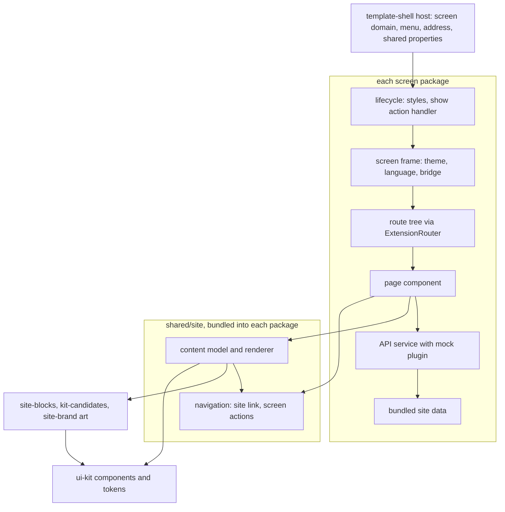
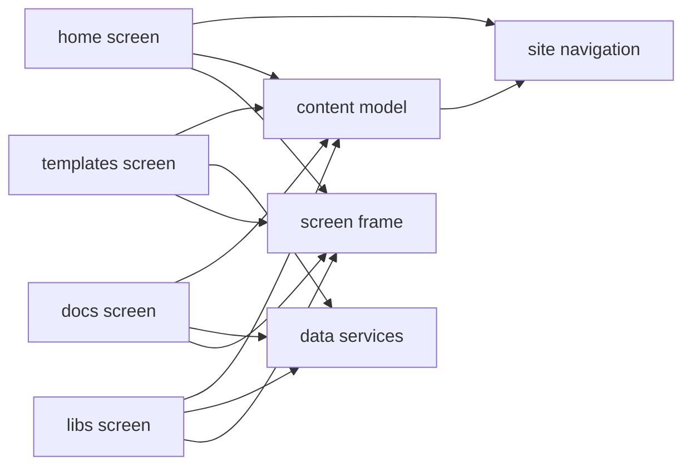
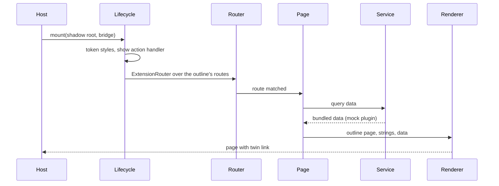
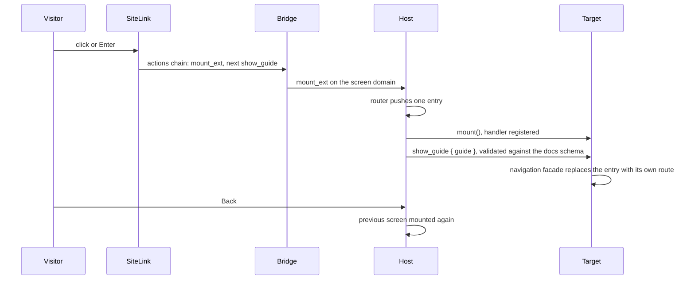
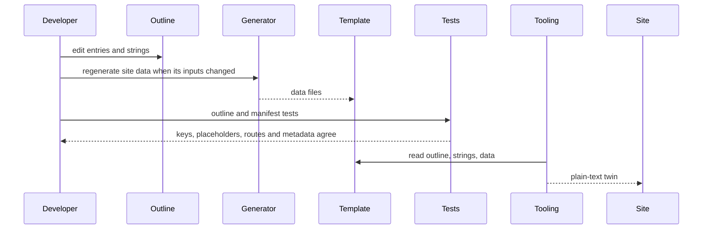

# Technical Design - template-site

- [x] `p3` - **ID**: `cpt-template-site-design-sections`

<!-- toc -->

- [1. Architecture Overview](#1-architecture-overview)
  - [1.1 Architectural Vision](#11-architectural-vision)
  - [1.2 Architecture Drivers](#12-architecture-drivers)
  - [1.3 Architecture Layers](#13-architecture-layers)
- [2. Principles & Constraints](#2-principles--constraints)
  - [2.1 Design Principles](#21-design-principles)
  - [2.2 Constraints](#22-constraints)
- [3. Technical Architecture](#3-technical-architecture)
  - [3.1 Domain Model](#31-domain-model)
  - [3.2 Component Model](#32-component-model)
  - [3.3 API Contracts](#33-api-contracts)
  - [3.4 Internal Dependencies](#34-internal-dependencies)
  - [3.5 External Dependencies](#35-external-dependencies)
  - [3.6 Interactions & Sequences](#36-interactions--sequences)
  - [3.7 Database schemas & tables](#37-database-schemas--tables)
- [4. Additional context](#4-additional-context)
  - [4.1 Pages](#41-pages)
  - [4.2 AI bundle](#42-ai-bundle)
  - [4.3 Package shape](#43-package-shape)
  - [4.4 Errors, tests and concerns that do not apply](#44-errors-tests-and-concerns-that-do-not-apply)
- [5. Traceability](#5-traceability)

<!-- /toc -->

## 1. Architecture Overview

### 1.1 Architectural Vision

template-site is an overlay of four screen MFE packages and one shared folder, applied onto a project that has template-shell, template-site-brand, template-kit-candidates and template-site-blocks. Each package is a Module Federation remote with its own FrontX app, its own lifecycle and its own route tree, registered in the host's screen domain from its manifest: `site-home-mfe` (token `home`), `site-templates-mfe` (token `templates`), `site-docs-mfe` (token `docs`) and `site-libs-mfe` (token `libs`). The host owns the address, the menu and mounting; a screen renders inside its own shadow root, takes the theme and language from the host's shared properties and moves only its own router.

The shared folder `shared/site/` holds what the screens have in common and is bundled into each package's build through a path alias, never loaded at runtime from another package: the content model and its renderer, the links between screens and the theme helpers. The home, templates, docs and libraries pages are outlines of content-only entries rendered by that renderer; each entry type is named after the block of template-site-blocks it renders, or the kit part it renders directly, and the repository's metadata tooling renders the same outlines as plain-text twins (ADR [0001](./ADR/0001-outline-content-model.md)). The look of every page comes from the named packages of other templates, the blocks (`@gears-frontx/site-blocks`), the kit candidates (`@gears-frontx/kit-candidates`) and the brand art (`@gears-frontx/site-brand`), together with the UI kit; the template ships no stylesheet of its own.

Facts on the pages are data, not text: the templates outline, the docs version data and the libraries data are generated outside the template and bundled into their packages, and each screen reads its data through its own FrontX API service whose mock plugin answers from the bundled file, because the site has no backend. A screen never writes, builds or renders the host's address: a link to another screen is a link element that dispatches the screen domain's mount action for the target's extension id and, for a page of it, the show action that screen declares (the docs screen's `show_guide`, the templates screen's `show_template`, the catalogue's `show_component`); the host's router writes the address as a byproduct.

### 1.2 Architecture Drivers

**ADRs**: `cpt-template-site-adr-outline-content-model`

#### Functional Drivers

| Requirement | Design Response |
|-------------|------------------|
| `cpt-template-site-fr-screen-registration` | Each package's manifest declares one screen extension on the host's screen domain with its route token, label and order; the host registers it with no host change (screen packages) |
| `cpt-template-site-fr-home` | The home package renders its home outline with the home blocks and its registry of live kit samples, linking other screens through the navigation component |
| `cpt-template-site-fr-templates` | The templates package builds its routes from the generated templates outline, which carries each template's identity, requirement, next steps, source-spec, claimed paths and key files with their encoded content |
| `cpt-template-site-fr-docs` | The docs package renders its hand-written outline with commands filled from the generated version data and a tab bar across its pages |
| `cpt-template-site-fr-libraries` | The libs package renders its hand-written outline with the package list, shell packages and source links from the generated libraries data |
| `cpt-template-site-fr-not-found` | Every route tree has a not-found component that links back to the screen's root |
| `cpt-template-site-fr-outline-content` | The content model parses each outline on module load, refusing unknown entries and drawing options, and the content screens build one route per outline page (content model) |
| `cpt-template-site-fr-generated-facts` | Placeholders in outlines are filled only from the bundled data the API service returns; page loading and error states wrap the query (data services) |
| `cpt-template-site-fr-twin-links` | The renderer links each page's twin by the twin path rule, from the side panel's foot or the footer line; agent tasks link their own copy |
| `cpt-template-site-fr-cross-screen-links` | The site link renders a link element with no address that opens another screen through the mount action and, for a page, the target's show action, on a click or Enter (navigation) |
| `cpt-template-site-fr-show-page` | The docs and templates lifecycles register their show action handler in `mount()`; the handler maps the payload to the screen's own route and replaces the entry through its app's navigation facade; each manifest declares the action with a closed schema of its pages |
| `cpt-template-site-fr-mount-independent-links` | Links to plain-text twins are written relative to the host's document; links to other screens carry no address at all |
| `cpt-template-site-fr-in-page-jumps` | Anchor links scroll to the heading and move focus to it; the side panel marks the heading in view |
| `cpt-template-site-fr-page-metadata` | The `seo` block on each screen extension declares the root and every route; each manifest test reads the routes from the route tree |
| `cpt-template-site-fr-theme-language` | The screen frame maps the host theme to the kit's token scope and sets language and direction on the frame and the shadow host |
| `cpt-template-site-fr-no-backend-data` | Each content package registers a REST API service with a mock plugin over its bundled data, switched on by default in its app |

#### NFR Allocation

| NFR ID | NFR Summary | Allocated To | Design Response | Verification Approach |
|--------|-------------|--------------|-----------------|----------------------|
| `cpt-template-site-nfr-styling` | Kit first, blocks and kit candidates where the kit has none, no page styling, no utility framework | content model, screen packages | Pages and the renderer compose blocks, kit candidates and kit components only and import no stylesheet; button-styled links use the kit's button recipe | checked by the hosting repository's own-styles check |
| `cpt-template-site-nfr-semantics` | One top-level heading, headed sections, real links, kit size floors, reduced motion | renderer, blocks, home package | Headings come from the blocks and the page intro; links are announced as links and open on a click or Enter, and a link to another screen carries no address; animated art stops under the reduced-motion preference | screen tests per page |
| `cpt-template-site-nfr-self-contained` | No reference outside the template; exact pins equal to the application's | package manifests, build configuration | Packages reach shared code only through the alias to their own shared folder, take blocks, kit candidates and brand art from named packages at exact versions, and deduplicate the kit, icons and routing packages; every FrontX dependency is pinned exactly | checked by the hosting repository's template and pin checks |
| `cpt-template-site-nfr-truthful-content` | Only sourced statements, no unsourced figures | outlines, home strings | Summaries link the source they are written from; the comparison describes what the templates give in words, with no figures, units or chart proportions | review of the strings and outlines |
| `cpt-template-site-nfr-description-length` | 50 to 160 characters per description | `seo` blocks | Each description is written to the range | the metadata tooling's check |

### 1.3 Architecture Layers

- [x] `p3` - **ID**: `cpt-template-site-tech-layers`

| Layer | Responsibility | Technology |
|-------|---------------|------------|
| Presentation | Pages composed from blocks, kit candidates and kit components inside the screen's shadow root | React 19, `@gears-frontx/site-blocks`, `@gears-frontx/kit-candidates`, `@gears-frontx/site-brand`, `@gears-frontx/ui-kit`, `lucide-react` |
| Application | Lifecycle, screen frame, routes inside the screen, show action handling | `@gears-frontx/react`, `@gears-frontx/routing-tanstack` |
| Domain | Outlines, link targets, twin paths, the template's screen ids and show actions | TypeScript modules in `shared/site/` |
| Infrastructure | Data services over bundled data, the remote build | `@gears-frontx/api` through `@gears-frontx/react`, template-shell's mock plugin, Vite, Module Federation, template-shell's MFE build plugin |

## 2. Principles & Constraints

### 2.1 Design Principles

#### One source per content page

- [x] `p1` - **ID**: `cpt-template-site-principle-one-source`

A home, templates, docs or libraries page exists only as an outline with its strings and data; the screen and the plain-text twin are two renderings of it, never two copies.

**ADRs**: `cpt-template-site-adr-outline-content-model`

#### Facts are data

- [x] `p1` - **ID**: `cpt-template-site-principle-facts-are-data`

Versions, source-specs, package lists, commits and template contents enter a page only through the bundled site data and the outline's placeholders; nothing in the template writes such a fact by hand.

#### Pages carry no styling

- [x] `p2` - **ID**: `cpt-template-site-principle-no-page-styling`

Pages are outlines of entries and their renderer composes blocks, kit candidates and kit components; a missing arrangement becomes a block of template-site-blocks and a missing primitive a kit candidate, and never a style inside this template.

#### Other screens are reached through actions

- [x] `p1` - **ID**: `cpt-template-site-principle-actions-not-addresses`

A screen reaches another screen only through FrontX actions: the screen domain's mount action, and for a page the show action the receiving screen declares. It never writes, builds or renders the host's address, never names another screen's routes and never reads the list of registered screens; the address is the host router's byproduct of those actions.

#### The host owns the page

- [x] `p1` - **ID**: `cpt-template-site-principle-host-owns-page`

A screen never writes the page address or the host document's attributes: the host's router writes the address as a result of mount actions and of the screen's own router, and theme and language arrive as shared properties.

### 2.2 Constraints

#### Screens are addressed in the query string

- [x] `p1` - **ID**: `cpt-template-site-constraint-query-addressing`

FrontX routing addresses a screen as a query entry of the screen domain and projects a screen's own path from the entry's `route` parameter, which routing-tanstack keeps internal; the template names that parameter itself and writes every address with the routing grammar at the shell subroute `/` template-shell uses.

#### Shadow-root isolation

- [x] `p1` - **ID**: `cpt-template-site-constraint-shadow-root`

Each screen renders in a shadow root where the kit's `:root` token rules match nothing; the lifecycle rewrites the kit's root selectors onto the shadow host, the brand tokens reach the shadow root from the host's document with the head styles the theme-aware base lifecycle adopts, and the screen frame selects the kit's light or dark scope from the host theme id, since the host passes the id and no light or dark flag.

#### No backend

- [x] `p1` - **ID**: `cpt-template-site-constraint-no-backend`

The site is static; data services are answered by mock plugins over bundled files, switched on by default when the app is built, with the mock plugin registered before the shared query cache so its first toggle does not clear the page's cache.

#### The child bridge has no screen list

- [x] `p2` - **ID**: `cpt-template-site-constraint-no-screen-list`

A screen's bridge exposes actions and shared properties but not the registered screens, and a screen has no need to know them: a link names its target by the target's screen extension id, from the content or from the template's own constants, which the manifest tests hold to the manifests. The host, which owns the registered screens, lists them in its menu.

#### The remote's base says nothing about the host

- [x] `p2` - **ID**: `cpt-template-site-constraint-unknown-mount-point`

A remote is built with its own base, which does not tell where the host is mounted; the links to plain-text twins, the one kind of address a screen renders, are resolved against the host's document.

#### Import-like text in bundled data

- [x] `p2` - **ID**: `cpt-template-site-constraint-loader-rewrites`

The MFE loader finds a chunk's imports by matching its text, string literals included; source text carried as data, the templates' key files, is therefore stored Base64-encoded in the generated outline and decoded in the page.

#### One router copy

- [x] `p2` - **ID**: `cpt-template-site-constraint-one-router`

The router context of a screen's route tree comes from the routing packages the host links at runtime, so the routing packages are externalized with the rest of the shared set in each package's build and never bundled.

#### Overlay on template-shell with exact pins

- [x] `p1` - **ID**: `cpt-template-site-constraint-overlay`

The template applies only onto a project with template-shell, template-site-brand, template-kit-candidates and template-site-blocks: from template-shell it takes the host, the MFE build plugin, the API mock plugin and the test harness, and from the other three the brand, the kit candidates and the blocks as named workspace packages; its packages pin the FrontX packages exactly at the versions the project's application installs.

## 3. Technical Architecture

### 3.1 Domain Model

**Technology**: TypeScript types and JSON files

**Location**: [shared/site/content/outline.ts](../src-app/mfe_packages/shared/site/content/outline.ts), [shared/site/navigation/siteScreens.ts](../src-app/mfe_packages/shared/site/navigation/siteScreens.ts), [shared/site/content/twins.ts](../src-app/mfe_packages/shared/site/content/twins.ts)

**Core Entities**:

| Entity | Description | Schema |
|--------|-------------|--------|
| Outline | A screen's content: its token, strings file, optional data file and pages | [outline.ts](../src-app/mfe_packages/shared/site/content/outline.ts) |
| Page | A route with a title, a lead, optional meta facts, back link and side panel title, and an ordered list of entries | [outline.ts](../src-app/mfe_packages/shared/site/content/outline.ts) |
| Entry | One typed, content-only line of a page, named after the block it renders (section heading, step, path cards, template pair, panels, call to action, facts, file explorer, agent task, troubleshooting, package list, the home blocks) or the kit part it renders (paragraph, code, checklist, list, callout, details) | [outline.ts](../src-app/mfe_packages/shared/site/content/outline.ts) |
| Text | A string key `t:<key>` of the screen's strings or a literal, with `{name}` placeholders from the data | [outline.ts](../src-app/mfe_packages/shared/site/content/outline.ts) |
| Link target | Another screen by its screen extension id with an optional show action (type and payload), a route inside the current screen, a heading anchor, or an external address | [outline.ts](../src-app/mfe_packages/shared/site/content/outline.ts) |
| Key file | A template file's path, description, line count, Base64 content and source address | [outline.ts](../src-app/mfe_packages/shared/site/content/outline.ts) |
| Site screen | One of the template's own screens, or the catalogue screen the site opens: its screen extension id and the show action it declares | [siteScreens.ts](../src-app/mfe_packages/shared/site/navigation/siteScreens.ts) |
| Site data | The generated templates outline, docs version variables and libraries list with shell packages | [templates outline](../src-app/mfe_packages/site-templates-mfe/src/content/outline.generated.json), [versions](../src-app/mfe_packages/site-docs-mfe/src/data/versions.generated.json), [libraries](../src-app/mfe_packages/site-libs-mfe/src/data/libraries.generated.json) |

**Relationships**:
- Outline -> Page: holds one or more, each a route of the screen
- Page -> Entry: holds an ordered list
- Entry -> Text, Link target: carries texts and links
- Outline -> Site data: names the data file its placeholders read
- Link target -> Site screen: names a screen by its extension id and a page of it by its show action

### 3.2 Component Model

#### Home screen

- [x] `p2` - **ID**: `cpt-template-site-component-home-screen`

##### Why this component exists

The site needs a landing page that presents FrontX and leads to every other section.

##### Responsibility scope

The `site-home-mfe` package: the `home` screen extension and its metadata, its lifecycle and route tree (the root page and a not-found page), the home outline of one landing page, the registry of live kit samples its kit showcase names, and its English strings.

##### Responsibility boundaries

Reads no site data. Leaves the header and footer to the host.

##### Related components (by ID)

- `cpt-template-site-component-site-navigation` - links other screens through
- `cpt-template-site-component-content-model` - renders its page with
- `cpt-template-site-component-screen-frame` - renders inside

#### Templates screen

- [x] `p2` - **ID**: `cpt-template-site-component-templates-screen`

##### Why this component exists

Visitors choose a template from an index and from a page that shows what the template really contains.

##### Responsibility scope

The `site-templates-mfe` package: the `templates` screen extension with a metadata entry per template page, the hand-written guide that groups the templates and lists their key files, the generated outline, the route tree built from that outline, and the page that renders the index or a template page with the key-files explorer.

##### Responsibility boundaries

Does not read template sources at runtime: their content arrives in the generated outline. Does not generate that outline.

##### Related components (by ID)

- `cpt-template-site-component-content-model` - renders its pages with
- `cpt-template-site-component-data-services` - reads the outline through
- `cpt-template-site-component-screen-frame` - renders inside

#### Docs screen

- [x] `p2` - **ID**: `cpt-template-site-component-docs-screen`

##### Why this component exists

Visitors need guides they can follow to a running application and to a first change.

##### Responsibility scope

The `site-docs-mfe` package: the `docs` screen extension and metadata, the hand-written outline of the overview and the two guides, the tab bar across them, and the page that fills the commands from the version data.

##### Responsibility boundaries

Does not run or verify the commands; they are run before publication. Does not hold versions of its own.

##### Related components (by ID)

- `cpt-template-site-component-content-model` - renders its pages with
- `cpt-template-site-component-data-services` - reads the version data through
- `cpt-template-site-component-screen-frame` - renders inside

#### Libs screen

- [x] `p2` - **ID**: `cpt-template-site-component-libs-screen`

##### Why this component exists

Developers need the exact FrontX packages, their sources, and short accounts of routing, the MFE model and the screen domain.

##### Responsibility scope

The `site-libs-mfe` package: the `libs` screen extension and metadata, the hand-written outline of the libraries page and the three summaries, the tab bar across them, and the package list rendered from the libraries data.

##### Responsibility boundaries

Writes no package facts by hand; states in a summary only what the installed packages and their published sources support.

##### Related components (by ID)

- `cpt-template-site-component-content-model` - renders its pages with
- `cpt-template-site-component-data-services` - reads the libraries data through
- `cpt-template-site-component-screen-frame` - renders inside

#### Content model

- [x] `p1` - **ID**: `cpt-template-site-component-content-model`

##### Why this component exists

The site's pages must be written once and rendered as a page and as plain text, with every text and fact checked, and composed from blocks without styling of their own.

##### Responsibility scope

`shared/site/content/`: the outline types and their parser, text resolution with placeholders, the key list for string checks, page lookup and anchors, the twin path rule, the page renderer that renders each entry with its block or kit part in the frame the page's shape asks for, the binding of the file explorer, shell-command wrapping, the choice of brand art, and the page loading, error and not-found states as kit parts.

##### Responsibility boundaries

Has no styling of its own and no data access; receives strings, data and live samples from the page that uses it. Does not write the twins and does not define blocks.

##### Related components (by ID)

- `cpt-template-site-component-site-navigation` - renders links with
- `cpt-template-site-component-home-screen` - is used by

#### Site navigation

- [x] `p1` - **ID**: `cpt-template-site-component-site-navigation`

##### Why this component exists

Moving to another screen must go through FrontX actions, with the address a byproduct, while staying a link for assistive technology and the keyboard.

##### Responsibility scope

`shared/site/navigation/`: the site link for every link form, the link element that opens another screen (the link role, the tab order, a click or Enter), opening a screen with the mount action and the target's show action as its next step, the show action handler and its registration, the ids of the template's screens and their show actions, and heading jumps that move focus.

##### Responsibility boundaries

Never writes, builds or renders the host's address; the host's router writes it. Reads no list of registered screens and knows no other screen's routes.

##### Related components (by ID)

- `cpt-template-site-component-home-screen` - is used by
- `cpt-template-site-component-content-model` - is used by

#### Screen frame

- [x] `p2` - **ID**: `cpt-template-site-component-screen-frame`

##### Why this component exists

Every screen needs the same frame inside its shadow root: kit tokens that work there, the host's theme and language, and the bridge for its routes.

##### Responsibility scope

The theme helpers in `shared/site/theme/`, each package's `src/shared/` and lifecycle: rewriting the kit's root token rules onto the shadow host into one style node per mount, without the brand, mapping the host theme id to the kit's light or dark scope, the language and direction of the rendered text on the frame and the shadow host, the languages the screen ships, translation loading that ignores stale loads, and the bridge context for route components.

##### Responsibility boundaries

Never writes `data-theme`, `lang` or `dir` on the host's document, and never declares a brand token. The theme helpers exist once in `shared/site/theme/`, code-identical to template-mfe's per-package copies; the rest of `src/shared/` is copied into each package.

##### Related components (by ID)

- `cpt-template-site-component-site-navigation` - registers the show action handler of, from the lifecycle

#### Data services

- [x] `p2` - **ID**: `cpt-template-site-component-data-services`

##### Why this component exists

The pages' facts come from generated data, and a FrontX screen reads data through the FrontX data layer.

##### Responsibility scope

Each content package's `src/api/` and app setup: a REST API service per package (templates catalogue, docs versions, libraries) with the template-shell mock plugin answering from the bundled generated file, registered before the app is built with mocks on by default.

##### Responsibility boundaries

Does not generate or check the data files; the Site Data Generator does. Calls no network.

##### Related components (by ID)

- `cpt-template-site-component-templates-screen` - serves
- `cpt-template-site-component-docs-screen` - serves
- `cpt-template-site-component-libs-screen` - serves

### 3.3 API Contracts

- **Contracts**: `cpt-template-site-interface-screen-addresses`, `cpt-template-site-interface-outline`, `cpt-template-site-interface-twin-paths`, `cpt-template-site-interface-show-actions`, `cpt-template-site-contract-host`, `cpt-template-site-contract-site-data`, `cpt-template-site-contract-page-metadata`
- **Technology**: URL grammar, JSON outlines, FrontX actions with closed JSON schemas, REST services answered by mock plugins, JSON manifests
- **Location**: the package manifests (`mfe.json`), [outline.ts](../src-app/mfe_packages/shared/site/content/outline.ts), [twins.ts](../src-app/mfe_packages/shared/site/content/twins.ts)

**Endpoints Overview**:

| Method | Path | Description | Stability |
|--------|------|-------------|-----------|
| `GET` | `/?screen=home`, `/?screen=templates[;route=<template>]`, `/?screen=docs[;route=get-started\|first-change]`, `/?screen=libs[;route=routing\|mfes\|screen-domain]` | The pages of the four screens | stable |
| `action` | `gts.frontx.mfes.comm.action.v1~frontx.site_docs.action.show_guide.v1~`, payload `{ guide }` | Shows one guide of the docs screen; the schema's enum names the guides and its target is the docs screen only | unstable |
| `action` | `gts.frontx.mfes.comm.action.v1~frontx.site_templates.action.show_template.v1~`, payload `{ template }` | Shows one template's page of the templates screen; the schema's enum names the templates and its target is the templates screen only | unstable |
| `GET` | `/api/site-templates/catalogue` | The templates outline, answered from the bundled file | unstable |
| `GET` | `/api/site-docs/versions` | The docs version variables, answered from the bundled file | unstable |
| `GET` | `/api/site-libs/libraries` | The libraries data, answered from the bundled file | unstable |
| `file` | `mfe.json` `extensions[].seo` | Page metadata for the root and each route | unstable |
| `file` | `src/content/outline.json`, `src/content/outline.generated.json` | Outlines the metadata tooling reads with their strings and data files | unstable |
| `GET` | `/<token>/<route>.md`, `/<token>/index.md` | Plain-text twins the pages link, published by the metadata tooling | stable |

### 3.4 Internal Dependencies

| Dependency Module | Interface Used | Purpose |
|-------------------|----------------|----------|
| template-shell | screen domain, theme and language shared properties, MFE build plugin, REST mock plugin, test base and utilities | Host, registration, build and tests |
| `@gears-frontx/routing` | shared and externalized like the rest of the set; the tests read route-tree paths through `resolveNavigationHistory` | Route-tree paths in tests; no screen code uses the routing grammar |
| `@gears-frontx/react` | lifecycle base, `ExtensionRouter`, app builder with effects, mock, shared query cache and microfrontends, API service base, `ActionHandler`, mount action and screen domain constants | Lifecycle, routes, data, actions |
| `@gears-frontx/routing-tanstack` | route trees, `Link` | Routes inside a screen |
| `@gears-frontx/ui-kit` | components, `theme.css` | Kit parts and tokens |
| `@gears-frontx/site-blocks` (template-site-blocks) | one block per entry point, `@gears-frontx/site-blocks/<Block>` | The blocks the entries render |
| `@gears-frontx/kit-candidates` (template-kit-candidates) | `Heading`, `Text`, `Link`, `CodeBlock`, title parts with `render` | Primitives the kit lacks |
| `@gears-frontx/site-brand` (template-site-brand) | brand art components | The drawings the blocks show in their art slots |

**Dependency Rules**:
- A package references only its own files and the template's `shared/site/` folder, through the alias, and the code of other templates only through their named packages at the exact versions they deliver, never through a path
- Route hooks and links come from routing-tanstack; nothing imports the underlying router directly
- No runtime cycle between the shared folder's parts: navigation imports only types from the content model and no other part, and the content model depends on navigation and on the named packages
- No screen reads the host's manifest aggregate or uses the routing grammar

### 3.5 External Dependencies

#### npm registry

| Dependency Module | Interface Used | Purpose |
|-------------------|---------------|---------|
| `@gears-frontx/*` ecosystem releases, React, `lucide-react` | install at exact versions; template-shell's own `@gears-frontx/*` packages are the applied shell's workspace sources at the versions it carries | Runtime of the screens |

#### Other templates' screens

| Dependency Module | Interface Used | Purpose |
|-------------------|---------------|---------|
| template-catalogue | the catalogue screen's extension id (`frontx.catalogue.screens.catalogue.v1`) and its `show_component` action (`{ component }`, an enum of the component slugs) | The home page's UI kit tiles, the docs overview's UI kit card, the libs screen's UI kit card and the template-catalogue page's Example tab on the templates screen open the catalogue, at a component's page for the tiles; a slug the catalogue drops makes the host refuse the tile's action |
| template-inbox, template-mfe-demo, template-calendar-demo | their screen extension ids, named by the templates screen's generated outline | The templates pages' Example tabs open the demo screens; without those templates the links open nothing |

#### Site Data Generator

| Dependency Module | Interface Used | Purpose |
|-------------------|---------------|---------|
| The repository's site data tooling, or a project's own | the three generated JSON files inside the template | Every fact the content pages show |

#### Metadata Tooling

| Dependency Module | Interface Used | Purpose |
|-------------------|---------------|---------|
| The page metadata tooling the project runs (in this repository, delivered by template-site-meta) | reads `seo` blocks, outlines, strings and data; writes the twins | Head, discovery files and plain-text twins of the screens |

### 3.6 Interactions & Sequences

#### Render a content page

**ID**: `cpt-template-site-seq-render-content-page`

**Use cases**: `cpt-template-site-usecase-read-guide`

**Actors**: `cpt-template-site-actor-visitor`, `cpt-template-site-actor-host`

**Description**: A content page renders from its outline once its strings and data are loaded; its links to other screens need nothing more than the bridge.

#### Open a page in another screen

**ID**: `cpt-template-site-seq-open-other-screen`

**Use cases**: `cpt-template-site-usecase-open-other-screen`

**Actors**: `cpt-template-site-actor-visitor`, `cpt-template-site-actor-host`

**Description**: The link carries no address; the click or Enter dispatches the chain, so the history gains one entry, the host's router writes the address and the page is not reloaded.

#### Change a content page

**ID**: `cpt-template-site-seq-change-page`

**Use cases**: `cpt-template-site-usecase-change-page`

**Actors**: `cpt-template-site-actor-site-developer`, `cpt-template-site-actor-data-generator`, `cpt-template-site-actor-metadata-tooling`

**Description**: A change to a content page is checked by the package's tests and reaches the page and its twin from the same files.

### 3.7 Database schemas & tables

Not applicable: the template has no database; its data are bundled JSON files.

## 4. Additional context

### 4.1 Pages

- **Home** (`/`), an outline of home entries: a hero with the definition of FrontX and links to the docs and the source, the groundwork the templates give (each part linking its template page), a map of a shell holding two screens with the optional UI kit and the design guardrails, a worked first change shown as a task, a one-line diff and a preview, UI kit samples in groups whose tiles each link their catalogue page, a comparison of working with and without FrontX in words only, the teams using FrontX as company logos linking their sites, three steps to a running application and a closing band.
- **Templates** (`/`, `/<template>`): an index of the featured groups of the guide (start an application with template-shell and template-mfe, then add the design guardrails) and a page per template with a back link, title and lead, the key-files explorer with a Files tab and, where the site runs screens built from the template, an Example tab linking them, what the template gives, links to the manifest and source, the source snapshot, and a "Before you start" panel. The site's own templates have pages but are not on the index.
- **Docs** (`/`, `/get-started`, `/first-change`): an overview with path cards and source and tool cards; a guide to start an application in numbered steps with commands and expected results, versions and limitations, and other ways to use FrontX; a first-change guide with a task for a coding agent, steps over the files to change, questions for when something looks different, and links onward. A side panel lists a guide's steps and links its twin.
- **Libraries** (`/`, `/routing`, `/mfes`, `/screen-domain`): a card per FrontX package the site's application depends on with version, description, install command and source at its published commit, the shell's workspace packages, path cards to the three summaries and the list of the site's own templates.

### 4.2 AI bundle

The template ships three AI guidelines under `.frontx/ai/@gears-frontx/frontx-template-site/`: the screens' contract (tokens, metadata, content, links, data, styling, build), the styling rules for every part of the site, and the nav groups the shell's header menu reads to group screens: the nav group type, the host's instances and a screen's `presentation.group` naming one.

### 4.3 Package shape

Every package follows template-mfe's package form: a manifest with one entry and one screen extension, a lifecycle exposed as the federation module, an app in `init.ts`, a route tree in `routes.tsx`, screens with their strings under `src/screens/<screen>/i18n/`, its own shared frame, a build configuration that externalizes the shared set and aliases only the template's own shared folder, dependencies on the named block, kit candidate and brand packages at exact versions, and tests next to the code. Ports 3050 to 3053 serve the four remotes during development.

### 4.4 Errors, tests and concerns that do not apply

- **Errors**: a page shows the loading state while its data is read and the error state when the read fails; a malformed outline fails when its module loads; a show action payload without its string property, or an app built without the microfrontends plugin, throws in the handler; the host's mediator refuses a show action outside its schema (framework behaviour the template relies on and does not test itself), which leaves the target where the mount action left it.
- **Tests**: each package has tests for its manifest (screen extension, metadata against the route tree, the show action and its closed schema against the route tree, or no action), its lifecycle (styles, handler registration in `mount()`), its routes, its pages and its outline (string keys, placeholders, entry types) and its API service; the docs package also drives the whole `show_guide` chain through the host's router, mediator and screen domain. Tests run on template-shell's MFE test base.
- **Not applicable**: authentication, authorization, audit and data protection (public, read-only pages with no visitor data); capacity, scaling and latency budgets (static remotes with bundled data); observability; databases and events.

## 5. Traceability

- **PRD**: [PRD.md](./PRD.md)
- **ADRs**: [ADR/](./ADR/)
- **Features**: [features/](./features/)
- **Repository tree**: the site-level design of the repository that composes this template is [architecture/DESIGN.md](../../architecture/DESIGN.md) at the repository root.
